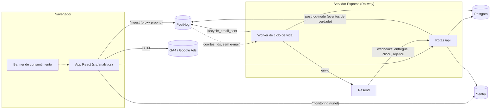

# Analytics, Funil e Reengajamento: PostHog + GA4 + Sentry

> **Objetivo:** instrumentar o Casa Mia para (1) saber de onde vêm os leads, orgânicos e pagos; (2) enxergar o caminho de cada pessoa até o primeiro valor; (3) usar esse conhecimento para disparos de marketing e reengajamento que tragam as pessoas de volta no momento certo; (4) ver os erros antes que o usuário reclame.
>
> **Status:** planejamento. Nada disto está instalado hoje. A página de privacidade ainda diz que o app não usa ferramentas de análise de terceiros; ela precisa ser atualizada antes do primeiro evento sair do navegador.
>
> Documento irmão: [`internacionalizacao-regiao-e-seguranca.md`](./internacionalizacao-regiao-e-seguranca.md) (idiomas, preço por região, IP e banimento). Os dois se cruzam em três pontos: idioma/país/moeda viram dimensões de análise (seção 11), a política de IP vale para as ferramentas daqui (seção 3.4) e o consentimento é o mesmo.

---

## 1. Papel de cada ferramenta

| Ferramenta | Responde | Quem usa | Não usar para |
|---|---|---|---|
| **PostHog** | Como as pessoas usam o produto: funis, caminhos, retenção, coortes, gravação de sessão, testes A/B | Produto e crescimento | Otimizar campanhas do Google Ads |
| **GA4** (via Google Tag Manager) | De onde vem o tráfego e qual campanha converte; liga com Google Ads, Search Console e públicos de remarketing | Marketing | Análise de comportamento dentro do app (limitado) |
| **Sentry** | O que quebrou, onde, para quem e desde qual versão; lentidão de rotas e de rotinas agendadas | Engenharia | Medir uso do produto |
| **Banco do próprio app (Postgres)** | Fonte de verdade para estado do usuário (data da mudança, itens, atrasos) e para os **gatilhos de reengajamento** | Engenharia e CRM | Análise exploratória pesada |
| **Resend** (já integrado) | Entrega dos e-mails transacionais e de ciclo de vida | Produto | Decidir quem recebe o quê |

**Regra de ouro:** quem **decide** um disparo é o Postgres (estado confiável, sem depender de navegador nem de bloqueador); quem **mede** o resultado é o PostHog; quem **otimiza o anúncio** é o GA4/Google Ads. Os três usam os mesmos nomes de evento e os mesmos identificadores.

### Por que PostHog e GA4 juntos
Os números não vão bater (definição de sessão, filtro de robôs e bloqueadores diferem). Definir fontes oficiais:

| Pergunta | Fonte oficial |
|---|---|
| Custo e retorno por campanha, públicos de remarketing, conversões para o Google Ads | **GA4 / Google Ads** |
| Visitantes orgânicos por palavra-chave | **Search Console** (ligado ao GA4) |
| Funil, ativação, retenção, comportamento no app | **PostHog** |
| Cadastros, enxovais e receita "de verdade" | **Postgres** |

---

## 2. Arquitetura



Duas decisões que moldam tudo:

1. **Eventos que valem dinheiro nascem no servidor** (cadastro, enxoval criado, item comprado, convite aceito, pagamento). Bloqueadores de anúncio cortam parte do tráfego do navegador; o servidor não perde.
2. **O PostHog nunca recebe e-mail nem nome.** Ele conhece só o `user_id` (UUID). Para um disparo, o PostHog entrega uma lista de ids e o servidor resolve o e-mail no Postgres. Isso reduz o dado pessoal em terceiros e simplifica a LGPD.

---

## 3. Privacidade, consentimento e LGPD

> Orientação técnica, não parecer jurídico. Valide com advogado antes do lançamento.

### 3.1 Categorias de consentimento
| Categoria | O que cobre | Padrão |
|---|---|---|
| **Essencial** | Sessão de login, segurança, Sentry de erros (sem dados pessoais) | Sempre ligado |
| **Análise** | PostHog (eventos, gravação), GA4 (`analytics_storage`) | **Desligado** até aceitar |
| **Marketing** | Google Ads/GA4 para anúncios (`ad_storage`, `ad_user_data`, `ad_personalization`), Meta Pixel se usar | **Desligado** até aceitar |

* O banner é obrigatório antes de qualquer cookie ou envio de análise/marketing. Opções: usar uma biblioteca aberta de consentimento (como `vanilla-cookieconsent`) ou um CMP pago. Botões "Aceitar", "Recusar" e "Personalizar" com o mesmo destaque; o guia de cookies da ANPD é a referência de boas práticas.
* **Google Consent Mode v2:** o GTM sobe com todos os sinais em `denied` e é atualizado quando a pessoa decide. Sem isso, o Google limita medição e públicos.
* **PostHog antes do consentimento:** iniciar sem persistência (`persistence: "memory"`) e sem gravação de sessão; ao aceitar, ligar persistência e `opt_in_capturing()`. Verificar na versão instalada se existe o modo sem cookies ("cookieless") do PostHog e se atende à política escolhida. Em recusa, só os eventos do servidor (sem identificar a pessoa em terceiros) continuam.
* **Marketing por e-mail é outro consentimento**, separado dos termos de uso (ver 9.5).

### 3.2 O que nunca vai para ferramentas de terceiros
E-mail, nome, senha, endereço, **texto livre** (nome de item, descrição, mensagem de ajuda, nome do enxoval: pode conter dado pessoal, como "presente da Maria") e IP bruto. Usar `user_id`, categorias (cômodo do item, origem do item, faixa de preço) e booleanos (`has_price`, `has_link`).

### 3.3 Gravação de sessão
* PostHog com `maskAllInputs` ligado e seletores de bloqueio para campos de e-mail, senha, preço e texto livre (`data-ph-no-capture`/`data-ph-mask`).
* **Uma só ferramenta grava sessão** (PostHog). Replay do Sentry fica desligado, para não gravar duas vezes nem duplicar consentimento.
* Nunca gravar `/login`, `/cadastro`, `/redefinir-senha` e `/admin`.

### 3.4 IP e geolocalização
* O PostHog descarta o IP do cliente (configuração do projeto "Discard client IP data" ou `ip: false` nos eventos do servidor) e o país vem do próprio banco (campo `country` da conta; ver o documento irmão). O GA4 já não armazena IP.
* O IP bruto fica **só** no banco do app, em tabela de segurança com retenção definida (documento irmão, parte C).

### 3.5 Página de privacidade e aviso
Atualizar `src/components/PrivacyPage.tsx`: listar PostHog, Google (GA4/Tag Manager/Ads), Sentry e Resend como operadores; finalidade de cada um; **transferência internacional** (nenhum deles opera em território brasileiro, até onde sei; confirmar a região disponível de cada contrato); prazos de retenção; como recusar ou revogar (link "Preferências de privacidade" no rodapé); contato do encarregado. A frase atual "não usamos ferramentas de análise nem de publicidade de terceiros" precisa sair antes de qualquer script entrar.

---

## 4. Fundação no código

### 4.1 Estrutura proposta
```
src/analytics/
  events.ts        # mapa tipado: nome do evento -> propriedades permitidas (fonte única da verdade)
  track.ts         # track(evento, props): único ponto que fala com PostHog e GA4
  consent.ts       # estado do consentimento, banner, atualização do Consent Mode
  attribution.ts   # captura UTM/referrer/click ids da primeira visita (first-touch)
  identify.ts      # identify/reset ao entrar e sair
  sentry.ts        # init do Sentry no navegador
server/
  analytics.ts     # cliente posthog-node + capture() tipado (mesmos nomes de evento)
  sentry.ts        # init do Sentry no Node (carregado antes de tudo)
```
* **Nenhum componente chama `posthog.capture` ou `gtag` diretamente.** Só `track()`. Isso permite trocar de ferramenta, proibir propriedades com dado pessoal por tipo e desligar tudo em testes.
* `events.ts` é um objeto TypeScript: o compilador recusa evento ou propriedade que não esteja no dicionário (seção 6).
* O app não usa `react-router`: o roteamento é por `window.location.pathname` em `src/main.tsx` e por estado interno em `App.tsx` (`workspaceView`). Por isso **o `page_view` é manual**: `track("screen_viewed", { screen })` na entrada de cada tela, com nomes estáveis (`landing`, `cadastro`, `login`, `comecar`, `app_overview`, `app_plan`, `app_list`, `convite`, `privacidade`...). Desligar a medição automática de "mudanças de página por histórico" do GA4 para não contar duas vezes.

### 4.2 Variáveis de ambiente
| Variável | Onde | Observação |
|---|---|---|
| `VITE_POSTHOG_KEY`, `VITE_POSTHOG_HOST` (`/ingest`) | navegador | Chave pública do projeto |
| `POSTHOG_API_KEY`, `POSTHOG_HOST` | servidor | Chave do projeto; host real do PostHog |
| `VITE_GTM_ID` | navegador | Contêiner do Tag Manager (GA4 e Ads ficam lá dentro) |
| `VITE_SENTRY_DSN`, `SENTRY_DSN` | navegador / servidor | DSN é público por natureza |
| `SENTRY_AUTH_TOKEN`, `SENTRY_ORG`, `SENTRY_PROJECT` | só no build | Envio de source maps; nunca no navegador |
| `VITE_ANALYTICS` | navegador | `off` em desenvolvimento e em testes (Playwright, testes de integração) |
| `VITE_RELEASE` | build | SHA do commit (`RAILWAY_GIT_COMMIT_SHA`), usado pelo Sentry e como propriedade de evento |

Ambientes separados: um projeto PostHog, uma propriedade GA4 e um projeto Sentry **por ambiente** (produção e homologação), para teste não sujar o dado real. Tráfego interno (equipe, `/admin`) filtrado no PostHog e no GA4.

### 4.3 Proxy próprio (anti-bloqueio e cookies de primeira parte)
Rotas no Express: `/ingest/*` para o PostHog e `/monitoring` para o Sentry (opção `tunnel`). O endereço fica no domínio do app, e bloqueadores deixam passar bem mais tráfego. Seguir o guia oficial de "reverse proxy" do PostHog (inclui o caminho de arquivos estáticos) e repassar o IP real do cliente. Aplicar limite de tamanho e de taxa nessas rotas, para não virarem porta aberta.

---

## 5. Atribuição: leads orgânicos e pagos

### 5.1 Convenção de UTM (obrigatória em todo link que a equipe criar)
| Parâmetro | Valores permitidos (minúsculas, sem acento, `-` como separador) |
|---|---|
| `utm_source` | `google`, `meta`, `instagram`, `tiktok`, `pinterest`, `youtube`, `whatsapp`, `newsletter`, `parceiro-<nome>` |
| `utm_medium` | `cpc` (busca paga), `paid-social`, `organic-social`, `email`, `referral`, `influencer`, `qr` |
| `utm_campaign` | `<tema>-<publico>-<aaaa>q<t>`, por exemplo `enxoval-casal-sp-2026q4` |
| `utm_content` | variação do criativo (`video-cozinha-a`, `carrossel-1`) |
| `utm_term` | palavra-chave (busca paga) |

* Google Ads: **marcação automática ligada** (`gclid`). Meta Ads: UTMs manuais com parâmetros dinâmicos do gerenciador.
* Documentar as UTMs numa planilha de campanhas. Link sem UTM vira "direto" e some da análise.

### 5.2 Grupo de canal (calculado no servidor, uma regra só)
| Grupo | Regra |
|---|---|
| `paid_search` | `gclid` presente, ou `medium=cpc` |
| `paid_social` | `fbclid` presente, ou `medium=paid-social` |
| `email` | `medium=email` ou origem `newsletter` |
| `organic_search` | sem UTM e referenciador Google, Bing, DuckDuckGo, Ecosia ou similar |
| `organic_social` | sem UTM e referenciador Instagram, Facebook, TikTok, Pinterest, YouTube; ou `medium=organic-social` |
| `referral` | qualquer outro referenciador, ou `medium=referral`/`parceiro-*` |
| `direct` | sem nada (inclui o que vem de WhatsApp e apps, o chamado "tráfego escuro") |

### 5.3 Primeiro toque guardado de verdade
Hoje `detectSource()` (`src/onboarding/storage.ts`) lê `utm_source` ou o domínio do referenciador e grava uma string (até 60 caracteres) em `onboarding_profile.source`, e só para quem chega ao `/comecar`. Como o cadastro agora vem **antes** do funil, essa origem se perde entre a landing e o `/cadastro`.

Proposta:
1. `attribution.ts` roda na primeira página vista: lê UTMs, `gclid`, `fbclid`, referenciador e a página de entrada, e grava em `localStorage` (`cm_first_touch`, validade de 90 dias). Não sobrescreve um primeiro toque existente. Um segundo registro `cm_last_touch` guarda a última visita com parâmetros.
2. `POST /api/auth/register` aceita um objeto opcional `acquisition`, **validado no servidor** (lista de campos permitidos, tamanhos máximos, mesmo estilo de `parseOnboardingProfile`). O servidor calcula o `channel_group` (5.2); não confia no que o navegador diz.
3. Colunas novas em `users`:

| Coluna | Conteúdo |
|---|---|
| `acq_source`, `acq_medium`, `acq_campaign`, `acq_content`, `acq_term` | UTMs do primeiro toque |
| `acq_channel_group` | Resultado da regra 5.2 |
| `acq_referrer_host`, `acq_landing_path` | Domínio e página de entrada |
| `acq_gclid`, `acq_fbclid` | Identificadores de clique, para enviar conversões depois (ver 5.5). Só gravar com consentimento de marketing |
| `acq_first_seen_at` | Quando o visitante apareceu pela primeira vez |
| `ga_client_id` | `client_id` do GA4, para conversões do servidor (5.5) |

4. `identify` no PostHog define **uma vez** (`$set_once`) as propriedades `initial_channel_group`, `initial_source`, `initial_medium`, `initial_campaign`. Com isso, toda análise pode ser fatiada por origem.
5. `onboarding_profile.source` continua existindo por compatibilidade.

### 5.4 GA4 via Tag Manager
* Propriedade GA4 com fluxo de dados web. Desativar "mudanças de página por histórico" nas medições aprimoradas; **retenção de dados em 14 meses**; regra de tráfego interno; ligar Search Console e Google Ads.
* O Tag Manager sobe com Consent Mode em `denied`. O app só envia eventos via `dataLayer.push` pelo `track()`.
* **Eventos-chave (conversões) no GA4**, usando nomes recomendados quando existirem:

| Evento GA4 | Quando | Uso |
|---|---|---|
| `sign_up` | Conta criada | Conversão inicial (barata, boa para volume) |
| `tutorial_begin` / `tutorial_complete` | Início e fim do funil `/comecar` | Mede qualidade do lead |
| `generate_lead` ou `enxoval_created` (personalizado) | Enxoval criado | **Conversão de qualidade** para otimizar anúncios |
| `begin_checkout`, `purchase` | Fase 2 (Stripe) | Receita |

* Otimizar o Google Ads primeiro em `sign_up` e migrar para `enxoval_created` quando houver volume suficiente de conversões por mês para o lance inteligente aprender (confirmar o mínimo recomendado na documentação do Google no momento).
* **Meta (opcional):** Pixel pelo mesmo Tag Manager mais a API de Conversões enviada pelo servidor, com o mesmo `event_id` para deduplicar. Só com consentimento de marketing.

### 5.5 Conversões enviadas pelo servidor (fase 2 da atribuição)
Quando houver pagamento: o servidor envia a conversão ao GA4 (Measurement Protocol) e ao Google Ads usando o `ga_client_id` e o `gclid` guardados no cadastro. Assim o anúncio é otimizado por **receita real** e não por cadastro, mesmo que a pessoa pague dias depois, em outro aparelho ou com bloqueador. Exige consentimento de marketing registrado.

### 5.6 SEO técnico mínimo (para o orgânico existir)
A landing é renderizada no navegador (SPA). Para os leads orgânicos, verificar: títulos e descrições por página, `canonical`, `robots.txt` e `sitemap.xml`, dados estruturados, imagens Open Graph por idioma, velocidade (Core Web Vitals) e **pré-renderização/SSG da landing e das páginas públicas** (indexação confiável). Com inglês e espanhol, entram também `hreflang` e URLs por idioma (documento irmão, parte A). Medir pelo Search Console, ligado ao GA4.

---

## 6. Dicionário de eventos

Convenção: `substantivo_verbo_no_passado`, minúsculas com `_`. Propriedades em `snake_case`. **Sem texto livre.** Toda chamada leva automaticamente as propriedades globais da seção 11 (idioma, país, moeda, ambiente, versão do app).

### 6.1 Aquisição e cadastro
| Evento | Origem | Propriedades | Observação |
|---|---|---|---|
| `landing_viewed` | navegador | `variant` | Entrada pela landing |
| `cta_clicked` | navegador | `cta_id` (`hero`, `header`, `footer`, `precos`), `destination` | |
| `screen_viewed` | navegador | `screen` | Substitui `page_view` |
| `signup_started` | navegador | | Tela `/cadastro` vista |
| `account_created` | **servidor** | `via` (`senha`, `convite`), `channel_group`, `has_invite` | Evento principal de cadastro |
| `login_succeeded` | servidor | `via` | |
| `password_reset_requested` / `password_reset_completed` | servidor | | |
| `consent_updated` | navegador | `analytics`, `marketing`, `version` | Prova do consentimento também fica no banco |

### 6.2 Funil de onboarding (`/comecar`)
Etapas reais de `OnboardingFlow.tsx`: `welcome`, `name`, `greet`, `moment`, `date`, `timeline`, `state`, `climate`, `housing`, `people`, `rooms`, `owned`, `style`, `budget`, `worries`, `usage`, `thanks`, `building`, `ready`, `savings`, `firstnight`, `schedule`, `compare`, `save`.

| Evento | Origem | Propriedades |
|---|---|---|
| `onboarding_started` | navegador | `resumed` (voltou de progresso salvo) |
| `onboarding_step_viewed` | navegador | `step`, `index`, `total` |
| `onboarding_step_completed` | navegador | `step`, `index`, `seconds_on_step` |
| `enxoval_created` | **servidor** | `from_funnel`, `items_count`, `rooms_count`, `housing`, `moment`, `people`, `budget`, `spending_tier`, `has_move_date`, `weeks_to_move_bucket`, `uf`, `style` |

`weeks_to_move_bucket`: `sem_data`, `0-4`, `5-12`, `13-26`, `27+`. Usar faixas, nunca a data exata.

### 6.3 Ativação e uso
| Evento | Origem | Propriedades |
|---|---|---|
| `item_created` | **servidor** | `origin` (`manual`, `link`, `planilha`, `catalogo`, `nino`), `room`, `has_price`, `has_link` |
| `item_status_changed` | **servidor** | `from`, `to`, `room`, `price_bucket`. O `to` em `bought`, `gifted` ou `owned` é o marco de valor |
| `item_deleted` | servidor | `room` |
| `buy_week_changed` | servidor | `set_by` (`pessoa`, `automatico`) |
| `link_import_attempted` / `link_import_succeeded` / `link_import_failed` | servidor | `store_domain`, `partial`, `error_code` |
| `spreadsheet_import_completed` | servidor | `rows`, `errors` |
| `export_downloaded` | navegador | `format` |
| `plan_viewed` | navegador | `weeks_to_move_bucket`, `overdue_count` |
| `planning_updated` | servidor | `field` (`data`, `estado`, `cidade`, `perfil_gasto`) |
| `nino_requested` | servidor | `kind` (`assess`, `recommend`, `prioritize`), `inferred`, `cached` |
| `nino_suggestion_accepted` | navegador | `kind` |
| `price_alert_enabled` | servidor | `store_domain` |
| `invitation_sent` / `invitation_accepted` | servidor | `role` |
| `feedback_sent` | servidor | `kind`, `area` |

### 6.4 E-mail e ciclo de vida
| Evento | Origem | Propriedades |
|---|---|---|
| `lifecycle_email_sent` | servidor (worker) | `flow_key`, `step`, `template_version`, `locale`, `holdout` |
| `lifecycle_email_delivered` / `_clicked` / `_bounced` / `_complained` / `_unsubscribed` | servidor (webhook do Resend) | `flow_key`, `step` |
| `price_alert_email_sent` | servidor | `items_count` |

Aberturas de e-mail são pouco confiáveis (proteção de privacidade de clientes de e-mail). Usar **clique** e **retorno ao app** como sinais, não abertura.

### 6.5 Receita (Fase 2)
`upgrade_prompt_viewed` (`limit_hit`), `checkout_started` (`plan`, `region`, `currency`), `subscription_started`, `subscription_canceled` (`reason`), `payment_failed`.

---

## 7. Funis, dashboards e a definição de ativação

### 7.1 Marco de ativação (hipótese a calibrar)
O funil gera de cara um plano com dezenas de itens, então "ter itens" não prova uso. **Ativada** = nos primeiros 7 dias após o cadastro, a pessoa **conquistou ao menos 1 item** (`item_status_changed` com `to` em `bought`, `gifted` ou `owned`) **ou** adicionou 3 itens de verdade (`item_created` com `origin` diferente de `catalogo`). Revisar com os primeiros 200 usuários: manter a definição que mais separa quem volta na semana 4 de quem não volta.

**Métrica de norte:** *enxovais com pelo menos 1 item conquistado por semana* (cresce quando a aquisição, a ativação e a retenção melhoram). Secundárias: itens conquistados por semana e % do plano concluído.

### 7.2 Funis no PostHog
| Funil | Passos | Janela | Quebras |
|---|---|---|---|
| **F1 Aquisição → cadastro** | `landing_viewed` → `cta_clicked` → `signup_started` → `account_created` | 1 sessão / 7 dias | `channel_group`, `utm_source`, `utm_campaign`, dispositivo, país, idioma |
| **F2 Cadastro → enxoval** | `account_created` → `onboarding_started` → `onboarding_step_completed` (por etapa) → `enxoval_created` | 1 dia / 7 dias | Etapa de saída, origem, dispositivo |
| **F3 Ativação** | `enxoval_created` → `item_created` → `item_status_changed (to bought…)` | 7 dias | Origem, perfil (`moment`, `housing`, `budget`), `weeks_to_move_bucket` |
| **F4 Colaboração** | `invitation_sent` → `invitation_accepted` → item alterado pelo convidado | 14 dias | Papel, perfil |
| **F5 Valor do Nino** | `nino_requested` → `nino_suggestion_accepted` | 1 dia | `kind` |
| **F6 Receita** (Fase 2) | `upgrade_prompt_viewed` → `checkout_started` → `subscription_started` | 14 dias | Região, moeda, plano |

* **F2 é o funil mais valioso**: mostra em qual das ~24 etapas a pessoa abandona, e como a conta agora é criada antes do funil, dá para falar com quem desistiu (fluxo L1 da seção 9).
* **Retenção:** semanal, com `item_created`, `item_status_changed` ou `plan_viewed` como "evento de retorno". Fatiar por origem, perfil e semanas até a mudança.
* **Ciclo de vida (lifecycle):** novos, recorrentes, ressuscitados e dormentes por semana.
* **Caminhos (paths):** o que fazem logo depois de `enxoval_created`.

### 7.3 Dashboards
1. **Aquisição:** visitantes, cadastros e custo por canal; F1 por `channel_group` e campanha (cruzar com o custo do Google Ads/Meta).
2. **Ativação:** F2 e F3, tempo até o primeiro item conquistado, % ativada por origem.
3. **Retenção:** curva semanal, por coorte de cadastro e por origem.
4. **Ciclo de vida:** envios, cliques, retorno ao app e descadastros por fluxo.
5. **Qualidade técnica:** erros do Sentry por versão, tempo de resposta das rotas, taxa de falha de leitura de links.

### 7.4 Perguntas de negócio que o funil precisa responder
1. Qual canal traz cadastros que **ativam** (e não só cadastram)? Isso muda onde investir.
2. Em que etapa do funil `/comecar` perdemos mais gente, e esse abandono varia por dispositivo ou origem?
3. Quanto tempo leva do cadastro ao primeiro item conquistado? O que quem chega rápido fez diferente?
4. Quem informa a data da mudança volta mais? (Se sim, pedir a data mais cedo e fazer dela o centro dos disparos.)
5. O que quem usa o Nino, o link de loja ou a planilha tem de retenção a mais?
6. Os fluxos de reengajamento **geram** retorno ou só acontecem para quem voltaria de qualquer forma? (grupo de controle, seção 9.6)

---

## 8. Segmentos e propriedades de pessoa

**Propriedades de pessoa no PostHog** (via `identify` e `$set`, sem dado pessoal): `moment`, `housing`, `people_bucket`, `uf`, `budget_band`, `spending_tier`, `has_move_date`, `weeks_to_move_bucket`, `locale`, `country`, `currency`, `plan` (Fase 2), `initial_*` (5.3), `activated`, `items_bought_bucket`, `last_active_at_bucket`.

As respostas do funil `worries` (`start`, `waste`, `forget`, `budget`, `time`) e `usage` (`buy`, `spend`, `links`, `share`) já dizem **o que a pessoa quer** e devem guiar o tom e o conteúdo das mensagens. `usage = share` indica interesse no Chá de Casa Nova (Fase 4).

**Segmentos úteis** (coortes no PostHog para análise; para disparar, a regra equivalente roda em SQL no servidor):

| Segmento | Regra |
|---|---|
| S1 Cadastro sem funil | Conta criada, nenhum enxoval, há mais de 1 hora |
| S2 Funil feito, sem uso | Enxoval criado, nenhum item conquistado, há mais de 2 dias |
| S3 Contagem regressiva | Faltam 12, 8, 4 ou 1 semanas para `move_date` |
| S4 Itens atrasados | `overdue_count > 0` no planejamento |
| S5 Inativos | Sem login nem alteração há 14, 30 ou 60 dias |
| S6 Quase lá | Enxoval com 80% ou mais dos itens conquistados |
| S7 Convite parado | Convite enviado há 3 dias e não aceito |
| S8 Pós-mudança | 30 dias depois de `move_date` |
| S9 Paga vs orgânica | `acq_channel_group` (custo por lead, retenção por canal) |
| S10 Potencial premium | Orçamento alto (`budget = gt50`) ou perfil `premium` |

---

## 9. Reengajamento: motor de ciclo de vida

### 9.1 Princípio
O gatilho vem do **estado** do Postgres (data da mudança, itens atrasados, última atividade), porque é isso que torna a mensagem relevante: *"faltam 8 semanas para a sua mudança; esta semana vale comprar a geladeira, que demora a chegar"*. Isso o Casa Mia pode fazer e uma ferramenta genérica de e-mail não consegue.

### 9.2 Componentes
* **Worker** `server/workers/lifecycleWorker.ts` no mesmo estilo de `priceTrackerWorker.ts`, rodando a cada 15 minutos, com trava no banco (`pg_try_advisory_lock`) para que duas instâncias não enviem em dobro.
* **Fluxos** como funções que devolvem "quem está elegível agora" (SQL) e "o que enviar" (modelo + dados).
* **Camada de decisão** (aplicada depois dos fluxos): consentimento, supressão, limite de frequência, horário permitido, prioridade quando mais de um fluxo qualifica.
* **Envio** pelo Resend, com cabeçalhos `List-Unsubscribe` e `List-Unsubscribe-Post` (descadastro com um clique). Modelos por idioma (documento irmão).
* **Webhooks do Resend** (entregue, clique, rejeição, reclamação) alimentam o banco e o PostHog.
* **Central de preferências** `/preferencias` (link assinado, sem login): lembretes da mudança, dicas e novidades, alertas de preço, pausar tudo por 30 dias.

### 9.3 Tabelas
```sql
-- em users (além das colunas da seção 5.3):
marketing_consent_at      timestamptz,   -- NULL = sem consentimento
marketing_consent_source  text,          -- 'cadastro', 'preferencias', 'banner'
marketing_consent_version text,
marketing_unsubscribed_at timestamptz,
locale                    text NOT NULL DEFAULT 'pt-BR',
timezone                  text NOT NULL DEFAULT 'America/Sao_Paulo',

CREATE TABLE lifecycle_messages (
  id uuid PRIMARY KEY,
  user_id uuid NOT NULL REFERENCES users(id) ON DELETE CASCADE,
  enxoval_id uuid REFERENCES enxovais(id) ON DELETE CASCADE,
  flow_key text NOT NULL,          -- 'funnel_resume', 'countdown_8w', ...
  step text NOT NULL,              -- '1', '2', 'w8', ...
  channel text NOT NULL DEFAULT 'email',
  locale text NOT NULL,
  template_version text NOT NULL,
  holdout boolean NOT NULL DEFAULT false,  -- grupo de controle: elegível, mas não recebeu
  status text NOT NULL,            -- 'sent', 'suppressed', 'failed'
  suppressed_reason text,
  provider_message_id text,
  scheduled_for timestamptz NOT NULL,
  sent_at timestamptz,
  UNIQUE (user_id, flow_key, step, enxoval_id)   -- garante que nunca se envia duas vezes
);
CREATE TABLE lifecycle_events (
  id uuid PRIMARY KEY,
  message_id uuid NOT NULL REFERENCES lifecycle_messages(id) ON DELETE CASCADE,
  type text NOT NULL,              -- 'delivered', 'clicked', 'bounced', 'complained', 'unsubscribed'
  occurred_at timestamptz NOT NULL
);
```
Rejeição definitiva e reclamação de spam **suprimem** o endereço para tudo que for marketing.

### 9.4 Fluxos
| Fluxo | Gatilho (Postgres) | Cadência | Conteúdo e chamada | Sai quando |
|---|---|---|---|---|
| **L0 Boas-vindas** | `account_created` | Imediato | Bem-vinda e próximo passo: montar o enxoval (`/comecar`) | Enxoval criado |
| **L1 Retomar o funil** | Conta sem enxoval (S1) | +2 h, +1 dia, +4 dias | "Faltam poucas perguntas para o seu plano." Leva a `/comecar` (o progresso fica salvo no navegador, então avisar que retoma no mesmo aparelho) | Enxoval criado |
| **L2 Primeiro valor** | Enxoval sem item conquistado (S2) | +1, +3 e +7 dias | Kit da primeira noite; "marque o primeiro item"; mostrar 3 itens do plano para começar | Item conquistado |
| **L3 Contagem regressiva** | Semanas até `move_date` (S3) | T-12, T-8, T-4, T-1, semana da mudança, T+1 | **O mais valioso.** O que comprar nesta janela (usa o planejamento e a régua do Nino), itens grandes com entrega demorada em T-8, primeira noite em T-1 | Mudança feita ou data removida |
| **L4 Resumo de atrasos** | `overdue_count > 0` (S4) | Semanal, no máximo 1 | Lista curta dos itens atrasados, com um clique para ver o plano | Sem atrasos |
| **L5 Queda de preço** | Já existe (`priceOpportunityEmail`) | Quando há queda | Medir (`price_alert_email_sent`, cliques) e aplicar o limite de frequência comum | Item comprado |
| **L6 Volte quando quiser** | Inativo (S5) | 21, 45 e 90 dias | "Você já tem 23 de 60 itens." Progresso + 3 próximos itens | Voltou ao app |
| **L7 Marcos** | 50% de um ambiente, ambiente completo, S6 | No evento | Celebração (Nino) e convite para compartilhar (Chá de Casa Nova, Fase 4) | Evento passou |
| **L8 Convite parado** | Convite pendente há 3 dias (S7) | Uma vez, **para quem convidou** | "Seu convite ainda não foi aceito. Reenviar?" Nunca insistir com o convidado | Convite aceito ou expirado |
| **L9 Pós-mudança** | `move_date` + 30 dias (S8) | Uma vez | Pesquisa curta (NPS), pedido de avaliação, apresentar o Chá de Casa Nova | Respondeu |
| **L10 Remarketing pago** | Eventos no GA4 | Contínuo | Públicos no Google Ads/Meta: "iniciou o cadastro e não criou conta"; "criou conta e não terminou o funil". Listas de e-mail só com consentimento de marketing | Converteu |
| **L11 Upgrade** (Fase 2) | Bateu o limite do plano gratuito | No evento + 2 lembretes | Mostrar o valor já criado e o preço **na moeda e região da pessoa** | Assinou ou recusou |

Mensagens e telas usam o idioma da pessoa e o tom dos `worries` do funil (quem marcou "medo de esquecer algo" recebe checklist; quem marcou "orçamento" recebe economia).

### 9.5 Governança
* **Consentimento:** e-mails de marketing e de ciclo de vida só para quem aceitou (caixa **desmarcada por padrão** no cadastro, separada dos termos, com texto claro). Mensagens de serviço (redefinir senha, convite, alerta de preço que a própria pessoa ligou) são transacionais, mas respeitam o descadastro por categoria.
* **Limites:** no máximo 2 e-mails de marketing por semana e 1 por dia por pessoa; horário entre 8h e 20h no fuso da pessoa; se mais de um fluxo qualifica, vence o de maior prioridade (L3 > L2 > L1 > L4 > L6).
* **Remetentes:** transacional em `nao-responda@` e marketing em um subdomínio próprio (`mail.`), para a reputação de um não afetar o outro. SPF, DKIM e DMARC configurados; descadastro com um clique e taxa de reclamação abaixo de 0,3%, exigência dos grandes provedores para quem envia em volume.
* **Aquecimento:** começar com volumes pequenos e crescer.
* **Ambiente seguro:** modo "simulação" (só calcula e registra, não envia) e envio de teste para a equipe antes de ligar cada fluxo.

### 9.6 Medir se funciona (incrementalidade)
Para cada fluxo, **10% das pessoas elegíveis ficam de fora** (`holdout = true`). Compara-se a taxa de retorno e de ativação entre quem recebeu e quem não recebeu. Sem isso, o painel mostra "40% voltaram" sem saber se voltariam de qualquer jeito. Evento `lifecycle_email_sent` entra no PostHog com `holdout`, para os funis comparem os dois grupos.

### 9.7 Campanhas (disparos pontuais)
Fase posterior: uma tela em `/admin` para escolher um **segmento salvo**, o modelo (por idioma), data de envio, ver a estimativa de público (já com supressões), enviar teste e acompanhar resultado. O público sai do Postgres; as coortes do PostHog servem para descobrir e validar o segmento. Canais futuros (notificação push, WhatsApp oficial com modelos aprovados) só com consentimento específico.

---

## 10. Sentry

### 10.1 Navegador
* `@sentry/react` iniciado em `src/main.tsx` antes da renderização, com `ErrorBoundary` ao redor do `<App />` e telas de erro amigáveis (com o Nino).
* Opções: `environment`, `release` (SHA do commit), `sendDefaultPii: false`, `tracesSampleRate` baixo (por exemplo 0,1; ajustar com o volume), `tunnel: "/monitoring"`. Replay do Sentry desligado (3.3).
* **Source maps:** `build.sourcemap: "hidden"` no `vite.config.ts` e envio com `@sentry/vite-plugin`; apagar os `.map` da pasta publicada depois do envio, para o código-fonte não ficar público.
* `Sentry.setUser({ id })` só com o UUID. Nunca e-mail.

### 10.2 Servidor
* `@sentry/node` iniciado **antes** de qualquer outro import (em ESM, via `--import`, conforme a documentação da versão instalada). O servidor roda por `tsx server/index.ts` em desenvolvimento e `node dist/server.js` em produção (`npm run start`); o ajuste vale para os dois.
* O tratador de erros central de `server/routes.ts` hoje responde 500 e faz `console.error`. Passa a chamar `Sentry.captureException` **só para erros inesperados** (não para `HttpError` 4xx), com etiquetas `route`, `enxoval_id` e `user_id`.
* **Filtro obrigatório (`beforeSend`)**: remover `request.data`, cookies e cabeçalhos de autorização, e descartar corpo de requisição das rotas `/api/auth/*`, `/api/invitations/*` e `/api/feedback`. As requisições de login e cadastro carregam senha em texto no corpo.
* Rotinas agendadas (`priceTrackerWorker`, `lifecycleWorker`) com **Sentry Crons** (aviso se a rotina deixar de rodar) e captura de falhas.
* Falhas esperadas e frequentes (`[jev] Chamada falhou`, leitura de loja bloqueada) entram como *breadcrumb* ou aviso com agrupamento próprio (`fingerprint`), para não afogar a caixa de erros.

### 10.3 Alertas
Novo erro em produção, regressão (erro que voltou depois de resolvido), pico de erros por versão, lentidão de `/api/products/extract` e de `/api/ai/*`, falha ou atraso de rotina agendada. Destino: e-mail e canal da equipe. Vincular a versão ao commit permite apontar "quebrou no deploy X".

---

## 11. Dimensões globais (idioma, país, moeda)

Com inglês e espanhol e preço por região (documento irmão), todo evento e toda pessoa carrega, como **propriedades globais** adicionadas pelo `track()`: `locale`, `country`, `currency`, `region` (grupo de preço), `app_version` e `environment`. Dashboards e funis ganham quebra por país/idioma; fluxos de ciclo de vida escolhem o modelo pelo `locale`; testes de preço por região usam o PostHog (experimentos) e o GA4 mede o efeito nos anúncios. Receita é reportada na moeda original **e** numa moeda de referência com a cotação do dia.

---

## 12. Plano de implementação

| Etapa | Entrega | Critério de aceite | Porte |
|:---:|---|---|:---:|
| **E0** | Contas e projetos (PostHog, GA4, GTM, Sentry; produção e homologação), domínio do e-mail de marketing, decisão de região de dados | Chaves nas variáveis da Railway; nenhuma no repositório | P |
| **E1** | `src/analytics/` (`track`, `events`, `consent`), banner de consentimento, página de privacidade atualizada, `VITE_ANALYTICS=off` em testes | Nenhum script de terceiro carrega antes do aceite; testes não enviam evento | M |
| **E2** | Sentry no navegador e no servidor, source maps, `beforeSend`, Crons, alertas | Erro provocado em homologação chega com versão e linha certas, **sem senha nem e-mail** | M |
| **E3** | PostHog base: proxy `/ingest`, `identify`/`reset`, `screen_viewed`, propriedades globais, descarte de IP | Evento aparece no "ao vivo" com `user_id`; nenhum dado pessoal nas propriedades | M |
| **E4** | Atribuição: `attribution.ts`, colunas `acq_*`, validação no `register`, `channel_group`, GTM + GA4 + Consent Mode, eventos-chave, ligação com Google Ads e Search Console | Um clique em anúncio de teste aparece com a campanha no GA4, no PostHog e na linha de `users` | M |
| **E5** | Instrumentação dos eventos do dicionário (cliente e servidor), com teste automatizado que valida o dicionário | Os funis F1 a F3 mostram dados reais ponta a ponta | G |
| **E6** | Dashboards, funis, coortes e retenção; definição de ativação revisada | Equipe responde às perguntas de 7.4 sem consultar o banco | M |
| **E7** | Consentimento de marketing no cadastro, `/preferencias`, tabelas, worker, supressão, fluxos **L0 a L3** com grupo de controle | Fluxos em modo simulação, depois ligados para 10% e crescendo | G |
| **E8** | Demais fluxos (L4 a L9), webhooks do Resend, campanhas no `/admin`, remarketing (L10) | Painel de ciclo de vida com efeito incremental por fluxo | G |
| **E9** | Revisão de privacidade e LGPD, checklist de lançamento, documentação do dicionário para a equipe | Checklist abaixo todo marcado | P |

**Checklist de lançamento:** banner funcionando e registrando a escolha · página de privacidade e termos atualizados · IP descartado nas ferramentas · filtro de dados do Sentry testado com senha · tráfego interno excluído · UTMs documentadas · chaves só em variáveis de ambiente · eventos de homologação separados de produção · descadastro com um clique testado · alerta de erro recebido de ponta a ponta.

**Ordem recomendada:** E0 → E1 → E2 (Sentry primeiro, porque não depende de consentimento) → E3 → E4 → E5 → E6, e só então E7/E8. **Instalar antes de gastar com anúncios**: dado de origem que não foi coletado não volta.

---

## 13. Riscos e pontos em aberto

* **Bloqueadores e consentimento reduzem o volume medido.** Por isso os eventos de valor saem do servidor e o proxy próprio existe. Os números do GA4 sempre serão menores que os reais.
* **Custo do PostHog cresce com o volume de eventos.** Autocaptura desligada, `person_profiles` apenas para pessoas identificadas e eventos curados mantêm a conta baixa. Revisar o plano e os limites no site da ferramenta.
* **Excesso de mensagens:** os limites e o grupo de controle existem para impedir que o reengajamento vire spam e prejudique a reputação do domínio de e-mail.
* **Progresso do funil só no navegador:** quem abandona e volta de outro aparelho recomeça. Avaliar salvar o progresso no servidor (conta já existe) para o fluxo L1 funcionar em qualquer aparelho.
* **Definição de ativação é hipótese.** Recalibrar com dados reais.
* **Multi-usuário por enxoval:** convidados editam o mesmo enxoval. Os eventos levam `enxoval_id`; "grupos" do PostHog (agrupar por enxoval) podem entrar se o plano da ferramenta incluir.
* **Região de dados do PostHog e do Sentry:** decidir (Europa ou EUA) e registrar na política; não há região brasileira, até onde sei.
* **Testes e2e:** os specs do Playwright precisam rodar com `VITE_ANALYTICS=off`.
