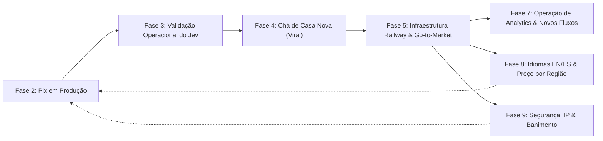

# Plano Faseado de Implementações Futuras: Casa Mia

> **Objetivo:** Reunir as próximas entregas técnicas e de produto do **Casa Mia**.
>
> **Este documento lista só o que falta fazer.** Revisado em **22/10/2026**, considerando o código atual, inclusive alterações locais. A numeração das fases foi preservada para manter as referências entre documentos. Configurações de produção devem ser confirmadas no ambiente antes de serem consideradas pendências.

---

## 1. O que ainda falta

1. **Pagamentos (produção):** concluir cadastro Stripe, configurar chaves/preços/webhook live e URL de produção, ativar Pix live e validar compra até a liberação de acesso no processo publicado; para a NFS-e (código pronto), obter certificado A1, confirmar habilitação e política contábil e homologar no Emissor Nacional antes de ativar a transmissão (Fases 2 e 5; ver [`pagamentos-e-notas-fiscais.md`](./pagamentos-e-notas-fiscais.md)).
2. **Nino (validação operacional):** validar uma consulta ao Jev a partir do processo publicado (Fase 3).
3. **Chá de Casa Nova:** sem rotas públicas, tabela ou Pix (Fase 4).
4. **Produção:** Dockerfile, confirmação de backups, domínio e DNS; e-mails de boas-vindas/presente/resumo, ativação da emissão fiscal e depósito de marca (Fase 5).
5. **Analytics (restante):** configuração e validação do Google em produção, conversões de cobranças recorrentes, SEO, funis e dashboards, fluxos adicionais de reengajamento e retorno do provedor de e-mail (Fase 7).
6. **Idiomas e preço por região:** app só em português e reais (Fase 8).
7. **Segurança e banimento (restante):** auditoria das ações da equipe, linha do tempo de segurança, contas relacionadas, Turnstile/Cloudflare e lista de e-mails descartáveis (Fase 9).
8. **Lista "Meu enxoval" (mais valor):** parcelas e fluxo mensal, responsável por item, presentes e agradecimentos, comprovantes e garantias das compras do enxoval, várias lojas por item e modo loja (Fase 11).

---

## 2. Roadmap Faseado de Implementação

---

### FASE 2: Pix em Produção

#### 2.1 Pendências operacionais de lançamento
* Concluir o cadastro Stripe e habilitar cobranças reais. Os ambientes `staging` e `production` na Railway ainda usam chave de teste e URL de staging.
* Configurar chave, preços, URL e webhook próprios de produção; ativar Pix na configuração live.
* Publicar o código e validar uma compra real autorizada no Passe em BRL, incluindo confirmação assinada no webhook, liberação única de acesso e tratamento de expiração. Seguir o procedimento de [`pagamentos-e-notas-fiscais.md`](./pagamentos-e-notas-fiscais.md).

---

### FASE 3: Validação Operacional do Jev em Produção

* Validar uma consulta ao Jev a partir do processo publicado, pelo fluxo autenticado do app. Ver o procedimento e os limites da verificação em [Nino — Fase 3](./nino-fase3.md).

---

### FASE 4: Página Pública de Chá de Casa Nova (Viral Loop)

A funcionalidade que transforma convidados em novos clientes da plataforma.

#### 4.1 Estrutura de Banco de Dados
* Nova tabela `housewarming_lists`:
  * `id`: uuid
  * `user_id`: uuid
  * `slug`: text unique (ex.: `lar-da-ana-e-leo`)
  * `title`: text (*"Chá de Casa Nova da Ana e do Léo"*)
  * `message`: text (*"Estamos montando nosso cantinho e ficaremos muito felizes com a sua presença e carinho!"*)
  * `event_date`: timestamp
  * `pix_key`: text (chave Pix do casal)
  * `pix_key_type`: text (`cpf`, `email`, `phone`, `random`)
  * `is_public`: boolean

#### 4.2 Interface Pública do Chá (`/cha/:slug`)
* Página de visualização pública, leve e responsiva (sem necessidade de cadastro do convidado).
* **Ações do Convidado:**
  1. **"Vou presentear com este item":** o convidado informa seu nome e e-mail; o item é marcado como "Reservado/Presenteado" na lista em tempo real.
  2. **"Presentear via Pix":** gera o QR Code e código copia-e-cola direto com a chave Pix cadastrada pelos moradores.
  3. **Deixar Recado de Boas-Vindas:** campo de texto onde o convidado deixa uma mensagem de afeto.
* **Experiência do Anfitrião:**
  * O morador recebe notificação no app: *"Maria reservou o Jogo de Pratos para a sua Cozinha e deixou um recado!"*.
* **Rodapé Viral:**
  * Em destaque no final da página: *"Lista organizada com amor no Casa Mia. Monte o seu enxoval também! [Começar Grátis]"*.

---

### FASE 5: Infraestrutura Railway, Automação Fiscal e Lançamento

#### 5.1 Hospedagem no Railway
* Dockerfile do serviço Node.js/Express (não existe no repositório).
* Confirmar PostgreSQL dedicado com backups diários automáticos no ambiente de produção.
* Confirmar domínio personalizado (`app.casamia.com.br` ou `casamiaapp.com.br`).

#### 5.2 E-mails Transacionais com Resend Pro
* Confirmar autenticação DNS do domínio (SPF, DKIM e DMARC).
* Templates novos com a assinatura do Nino: boas-vindas após a confirmação da conta, presente recebido no Chá de Casa Nova e resumo mensal de conquistas.

#### 5.3 Ativação Fiscal e Registro de Marca
* **NFS-e Nacional (pendências operacionais):** a integração direta com o Emissor Público Nacional está implementada e validada localmente (simulação, PostgreSQL e certificado sintético). Nenhuma nota real foi emitida. Falta:
  1. Obter o certificado ICP-Brasil A1 da empresa e configurar `NFSE_NACIONAL_CERT_PATH`, `NFSE_NACIONAL_KEY_PATH` e `NFSE_NACIONAL_KEY_PASSPHRASE`.
  2. Confirmar a habilitação do CNPJ para emitir pelo Emissor Nacional em Camaçari/BA (2905701). A transição para ME/EPP do Simples está prevista para 01/11/2026 (CGSN 191/2026); a adesão do município ao ADN não basta como permissão de emissão.
  3. Obter da contabilidade, por escrito, o momento de emissão e a competência; preencher `NFSE_NACIONAL_TAX_CONFIG`, `NFSE_NACIONAL_ISSUE_ON`, `NFSE_NACIONAL_COMPETENCE` e `NFSE_NACIONAL_ACCOUNTING_REFERENCE`. Até lá, a emissão fica manual.
  4. Emitir e consultar uma nota em produção restrita (`NFSE_NACIONAL_ENVIRONMENT="homologacao"`) antes de ativar a produção.
  5. Ativar `NFSE_NACIONAL_ENABLED` e `NFSE_NACIONAL_ISSUER_ENABLED` em produção e acompanhar a primeira emissão real. Ver [`pagamentos-e-notas-fiscais.md`](./pagamentos-e-notas-fiscais.md).
* Depósito de marca mista no INPI nas classes 9, 35 e 42.

---

### FASE 6: Catálogo Compartilhado (só quando escalar)

> Nada pendente hoje. Os itens abaixo só valem quando o uso crescer.

* **Na Railway:** o Redis só vale a pena quando houver mais de uma instância; ao ligá-lo, configure `REDIS_URL` (e `REDIS_KEY_PREFIX` diferente se homologação e produção dividirem o mesmo Redis).
* **Escala:** se o catálogo passar de dezenas de milhares de itens, migrar a similaridade em memória para `pg_trgm`.

---

### FASE 7: Analytics, Funil de Aquisição e Reengajamento (restante)

> **Referências:** [`analytics-funil-e-reengajamento.md`](./analytics-funil-e-reengajamento.md) e [`analytics.md`](./analytics.md). Validar a coleta em produção antes de qualquer gasto com anúncios.

#### 7.1 Configuração e validação em produção
* Configurar e validar o contêiner do **Google Tag Manager**, as tags e os eventos do **GA4**, a ligação com Google Ads e Search Console e os sinais do Consent Mode v2, conforme o ambiente.
* Validar o proxy `/ingest`, a atribuição do cadastro e as conversões de compras com as chaves e serviços reais.
* Validar o ciclo de vida em modo `simulate` antes de ativar `LIFECYCLE_MODE=send` em produção.

#### 7.2 Atribuição orgânica e paga
* Ampliar as conversões de receita para a primeira cobrança após o trial e as renovações mensais (`invoice.paid`); o envio atual depende de um checkout com pagamento confirmado.
* Completar o SEO técnico para o orgânico: URL canônica, sitemap e regras de indexação das páginas públicas e privadas.
* Alertas de erro por versão e monitoramento das rotinas agendadas.

#### 7.3 Funis e dashboards
* Completar os funis F1 a F6 e os painéis de retenção semanal, calibrar a definição de **ativação** e validar as perguntas de negócio com dados reais.

#### 7.4 Ciclo de vida: fluxos adicionais e operação
* Fluxos restantes: resumo de atrasos, marcos de progresso, convite parado e pesquisa de pós-mudança (+30 dias).
* Integrar os alertas de queda de preço ao limite de frequência e às preferências comuns do ciclo de vida.
* Receber e validar webhooks do provedor de e-mail para entrega, rejeição e reclamação de spam; alimentar `lifecycle_events` e a lista de supressão. Medir cliques e retorno ao app por fluxo.
* Configurar públicos de remarketing pago conforme o consentimento e criar campanhas pontuais por segmento em `/admin`.
* Medir o efeito dos fluxos em comparação com o grupo de controle nos dashboards.

---

### FASE 8: Idiomas (Inglês e Espanhol) e Preço por Região

> **Documentação:** [`internacionalizacao-regiao-e-seguranca.md`](./internacionalizacao-regiao-e-seguranca.md), partes A e B.

#### 8.1 Três idiomas no app inteiro
* Português (base), **inglês e espanhol** em interface, landing, funil, e-mails, erros do servidor, catálogo, planilhas, textos legais e Nino. Atualizar o inventário de textos antes da extração das traduções.
* Infra com `i18next`, chaves tipadas, teste de paridade entre idiomas, pseudolocalização, erros do servidor por **código** e URLs por idioma com `hreflang`. **A infra vem primeiro: nenhum texto novo entra fixo no código.**
* Não é só tradução: o catálogo já tem `slug` e `translations` por item, a geografia e o clima deixam de ser só Brasil (país → região → cidade, hemisfério) e o conceito de "enxoval" é adaptado a cada mercado.

#### 8.2 Preço por região e segregação regional
* Tabelas `regions`, `region_countries` e `plan_prices` (preço versionado por região e moeda), integradas à Stripe com várias moedas, impostos (Stripe Tax) e meios de pagamento locais; NFS-e só no Brasil.
* País de cobrança confirmado no pagamento e anti-abuso de preço regional (VPN, cartão de outro país). Países bloqueados.
* Segregam-se por região: preços e moedas, impostos, textos legais e consentimento, pacote de itens, relatórios e modelos de e-mail. A conta continua global.

---

### FASE 9: Confiança, Segurança e Proteção contra Abuso (IP, Dispositivo e Banimento)

> **Documentação:** [`internacionalizacao-regiao-e-seguranca.md`](./internacionalizacao-regiao-e-seguranca.md), parte C.

* **Próximos passos:** `auth_events` para trocas de senha e ações sensíveis; histórico de aceite e revogação de termos e consentimentos além do registro de marketing no cadastro; trilha de auditoria das ações da equipe (hoje só o autor do bloqueio fica registrado); decidir o que acontece com enxovais compartilhados quando o dono é bloqueado.
* **Prevenção:** limites persistentes para as demais rotas (hoje em memória, reiniciam a cada deploy), Cloudflare/Turnstile, lista de e-mails descartáveis e e-mail equivalente (pontos e `+` no Gmail), alertas de pico.
* **Painel `/admin`:** linha do tempo de segurança da conta, contas relacionadas (mesmo aparelho ou faixa), fila de abuso e trilha de auditoria.
* **Conformidade:** documentar a base legal e revisar a cobertura e a retenção dos registros de acesso; manter a política de privacidade alinhada às novas funcionalidades; definir o processo de revisão humana de bloqueios, a segurança dos próprios logs e o plano de incidente.

---

### FASE 11: Mais Valor na Lista "Meu enxoval"

> **Origem:** pesquisa de mercado de 22/10/2026 (registries como Zola e Amazon, listas de desejo como Moonsift, Giftful e Klarna, iCasei, apps de mudança e o YNAB para orçamento).
>
> As seis frentes abaixo são o que falta. A ordem sugerida está no fim da seção.

#### 11.1 Planejamento de parcelas e fluxo mensal
**Por quê:** no Brasil, compra grande de casa é parcelada (10x, 12x sem juros). O casal não quer saber só "quanto falta investir", e sim **quanto da renda de cada mês já está comprometido** até a mudança e depois dela. Nenhum concorrente brasileiro de lista de enxoval faz isso. O YNAB resolve algo parecido com o "needed this month", mas não entende parcelamento.

* **Banco de dados (`items`):**
  * `installments smallint NOT NULL DEFAULT 1` (1 a 24; `CHECK (installments BETWEEN 1 AND 24)`).
  * `first_installment_on date`: mês da primeira parcela. Se vier nulo, vale o mês da compra (`purchased_at`, ver abaixo) ou o mês da semana planejada.
  * `purchased_at date`: hoje o app não guarda quando o item foi comprado. Gravar ao passar para `bought` (pode ser editado) também serve para 11.4 (garantia) e para os relatórios.
  * `payment_method text`: `pix`, `credit`, `debit`, `boleto`, `cash` ou `other`. Opcional, para o resumo por meio de pagamento.
  * Juros: guardar `installment_cents integer` (valor de cada parcela) só quando a parcela × N for diferente do preço, ou seja, quando há juros. A diferença aparece como "juros: R$ X".
* **Enxoval (`enxovais`):** `monthly_budget_cents integer`, o teto mensal que o casal quer respeitar (opcional, só o dono edita, igual à data da mudança).
* **Interface:**
  * No `ItemCompletionDialog` (opção *Comprado*), ao lado de "Quanto você pagou?": um seletor "À vista / 2x … 24x" e o meio de pagamento. No formulário do item, a mesma coisa na seção **Valores**.
  * Para itens ainda pendentes: o campo "Pretendo parcelar em" ajusta a previsão do plano.
  * Nova seção no **Planejamento**: "Parcelas por mês", com um gráfico de barras mês a mês (parcelas já assumidas + previsão dos pendentes pela semana de compra), a linha do teto mensal e destaque para os meses que estouram o teto.
  * No resumo "Seu dinheiro": "Comprometido nos próximos 3 meses: R$ X" e "Última parcela: mar/2027".
  * Na lista: selo "10x R$ 189" na linha do item comprado parcelado.
* **Regras:**
  * "Já investimos" continua sendo o valor total da compra (não só as parcelas pagas). O fluxo mensal é uma visão à parte.
  * Mudar o número de parcelas de um item já comprado recalcula o fluxo; não há histórico de pagamento real (não é app de finanças).
  * Exportação (`ExportMenu`): incluir as colunas parcelas, valor da parcela, primeira parcela e meio de pagamento.
* **Analytics:** `installments_set` (número de parcelas, meio de pagamento) e `monthly_budget_set`.
* **Testes:** cálculo do fluxo (`src/planning/installments.ts`) em `tests/purchase-plan.mjs`: parcelas que atravessam o ano, item sem data, juros, teto estourado.

#### 11.2 Quem compra o quê (responsável por item)
**Por quê:** a lista a dois já existe (convites), mas não diz quem vai cuidar de cada item. Apps de mudança dividem as tarefas entre as pessoas; num casal, isso evita compra duplicada ("achei que você ia comprar").

* **Banco de dados:** `items.assignee_id uuid REFERENCES users(id) ON DELETE SET NULL`. Só pode ser o dono ou um membro do enxoval (`enxoval_members`), validado no servidor. Quando a pessoa sai do enxoval, os itens dela voltam a ficar sem responsável.
* **API:** `assigneeId` em `PATCH /items/:id` e na criação; o `GET` do enxoval devolve os membros com nome e avatar (já existe `EnxovalMember`).
* **Interface:**
  * Na linha do item: o avatar pequeno do responsável (o `UserAvatar` já existe), com o nome no `title`.
  * No formulário do item: o campo "Quem vai comprar" com os membros e a opção "Ninguém ainda".
  * Atalho novo em `ListInsights`: "Meus itens (N)", que só aparece quando o enxoval tem mais de um membro. Filtro no diálogo: "Meus itens / Sem responsável / De [nome]".
  * O próximo passo (`pickNextStep`) prefere os itens da própria pessoa ou sem responsável.
  * Toast quando alguém risca um item que estava com outra pessoa: "Ana comprou o Micro-ondas que estava com você". Depende da sincronização ao abrir o app, que já mostra "N itens mudaram desde a última visita".
* **Regras:** sem responsável continua sendo o padrão. Atribuir não bloqueia ninguém de editar o item.
* **Analytics:** `item_assigned` (com ou sem responsável próprio).

#### 11.3 Presentes recebidos e agradecimentos
**Por quê:** o Gift Tracker do Zola guarda *quem deu* cada presente e se o agradecimento já foi enviado, e exporta tudo em CSV. Hoje o status "Ganhei" (`received`) não diz de quem veio. Isto também prepara a Fase 4 (Chá de Casa Nova), em que o convidado se identifica ao reservar.

* **Banco de dados (`items`):**
  * `gift_from text`: nome livre ("Tia Rosa", "Colegas do trabalho"), até 120 caracteres.
  * `gift_message text`: o recado que veio com o presente (opcional).
  * `thanked_at timestamptz`: quando o agradecimento foi marcado como enviado.
  * Na Fase 4, `gift_reservation_id` liga o item à reserva do convidado; aí `gift_from` vem preenchido.
* **Interface:**
  * No `ItemCompletionDialog`, ao escolher *Recebido*: "De quem foi o presente?" (campo opcional com autocompletar dos nomes já usados no enxoval) e o recado.
  * Na linha do item recebido: o selo "de Tia Rosa", e o selo "Agradecer" enquanto `thanked_at` estiver vazio.
  * Atalho em `ListInsights`: "N agradecimentos pendentes", que filtra os itens ganhos sem agradecimento.
  * Ação rápida na linha: "Marquei como agradecido". Botão "Agradecer pelo WhatsApp" que abre `https://wa.me/?text=` com uma mensagem pronta e editável ("Oi, Tia Rosa! O jogo de panelas já está na nossa cozinha…"). A pessoa escolhe o contato no WhatsApp; o app não guarda telefone.
  * Página "Presentes" no **Meu Lar**: quem deu o quê, total recebido em valor (o `sumReceived` já existe) e exportação em CSV (item, ambiente, de quem, recado, valor, agradecido em).
* **Privacidade:** nomes de terceiros ficam só no enxoval e saem na exclusão da conta. Atualizar a política de privacidade (dados de terceiros informados pelo usuário).
* **Analytics:** `gift_logged` (com ou sem recado) e `gift_thanked` (canal: manual ou WhatsApp).

#### 11.4 Comprovantes e garantias das compras do enxoval
**Por quê:** é o que mantém o app útil **depois** da mudança, quando a lista acaba e o uso cai. Apps de mudança guardam recibos e contratos, e apps de inventário servem para seguro. O lembrete de fim de garantia é um bom gatilho de reengajamento (Fase 7.4).

Esta frente permite guardar as notas fiscais e garantias dos produtos comprados para a casa.

* **Armazenamento:** hoje as imagens (avatar) ficam em `bytea` no Postgres, o que não serve para PDFs e fotos de nota em volume. Usar um bucket de objetos (Cloudflare R2 ou S3, com URL assinada de 5 min) e guardar no banco só a referência. Limite de 10 MB por arquivo e 20 arquivos por item; reaproveitar `prepareImageForUpload` para fotos.
* **Banco de dados:**
  * Nova tabela `item_documents`: `id`, `item_id` (FK, `ON DELETE CASCADE`), `enxoval_id`, `kind` (`invoice`, `warranty`, `manual` ou `other`), `storage_key`, `file_name`, `content_type`, `size_bytes`, `uploaded_by` e `created_at`.
  * Em `items`: `warranty_months smallint` (garantia do fabricante + estendida) e `warranty_until date` (calculado a partir de `purchased_at` de 11.1, mas editável). Também `store_name text`, para saber onde foi comprado quando não há link.
* **Interface:**
  * Na linha do item comprado: um ícone de clipe quando há documento; no formulário, a seção **Nota e garantia**, com envio pela câmera do celular (`capture="environment"`), lista de arquivos e a garantia ("12 meses, até 15/03/2027").
  * Atalho em `ListInsights`, depois da mudança: "N garantias vencem em 30 dias".
  * Na página **Meu Lar** depois da mudança: "Documentos da casa", com tudo o que tem nota, filtro por ambiente e download em ZIP.
* **Lembretes:** um worker diário (como `trialNotifications.ts`) envia e-mail 30 dias e 7 dias antes de a garantia vencer, com opção de desligar no perfil. Integrar às preferências e aos limites do ciclo de vida (Fase 7.4).
* **Leitura automática (depois):** o Jev lê a foto da nota e preenche loja, data e valor. Definir o limite de consultas para controlar o custo.
* **Limites de armazenamento:** definir a cota de documentos por conta conforme o custo do serviço.
* **Segurança:** só membros do enxoval baixam; o tipo do arquivo é conferido pelo conteúdo, não pela extensão; os arquivos são apagados junto com a conta ou o enxoval (no job de exclusão).

#### 11.5 Comparar lojas para o mesmo item
**Por quê:** hoje cada item acompanha **um** link (`items.tracked_product_id`). Moonsift e Google Shopping mostram o mesmo produto em várias lojas. O casal costuma salvar dois ou três links antes de decidir.

* **Banco de dados:** nova tabela `item_offers`: `id`, `item_id` (FK, cascade), `tracked_product_id` (FK para `tracked_products`, reaproveitando o worker de preço), `is_primary boolean`, `created_at` e `UNIQUE(item_id, tracked_product_id)`. Migrar o `tracked_product_id` atual de cada item para uma oferta `is_primary = true` e manter a coluna como espelho da oferta principal por uma versão, para não quebrar clientes antigos.
* **Limites:** até 5 ofertas por item.
* **Regra de preço:** o preço do item (`price_cents`) segue a oferta principal. A oferta mais barata em estoque (considerando o Pix quando `priceBasis = 'pix'`) ganha o selo "Mais barato" e pode virar a principal com um toque.
* **Interface:**
  * Na linha do item: "3 lojas · a partir de R$ 899", que abre a comparação.
  * No formulário: a seção **Lojas**, com cada oferta mostrando loja (`storeLabel`), preço, Pix, estoque, última leitura e "Tornar principal".
  * "Adicionar outra loja" usa o mesmo fluxo de leitura do link (`extractProduct`).
  * O `PriceHistoryDialog` ganha uma linha por loja no gráfico.
* **Atalhos e alertas:** o atalho "baixou de preço" e o alerta de preço-alvo passam a considerar **qualquer** oferta. O aviso diz em qual loja: "Air fryer: R$ 389 na Amazon (meta R$ 400)".
* **Worker:** o `priceTrackerWorker` já lê por `tracked_products`; só muda a consulta dos alertas, que passa a juntar `item_offers`.
* **Analytics:** `offer_added`, `offer_promoted` e `offer_cheapest_found` (economia em relação à principal).

#### 11.6 Modo loja
**Por quê:** na loja física (Leroy, Tok&Stok, Camicado, Havan) a pessoa abre o app no celular e quer ver só o que falta, o preço-alvo e as medidas, e riscar rápido. A lista completa, com filtros, cartões e atalhos, atrapalha nessa hora.

* **Rota:** `/app/loja` (e `/app/loja/:ambienteId`) no `appRoute.ts`, com entrada pelo menu do enxoval e por um botão "Estou na loja" na lista (só no celular).
* **Tela:**
  * Só itens pendentes, agrupados por ambiente, com letra grande e alvo de toque de 56 px.
  * Cada item mostra quantidade, variação (`selectedVariation`, por exemplo "220V"), preço-alvo ou faixa de referência do perfil de gasto (`itemBand`) e a observação (`description`), onde ficam as medidas.
  * Busca no topo e filtro por ambiente em chips.
  * Riscar abre uma versão compacta do `ItemCompletionDialog` (só "Comprei" + valor + parcelas) e o item some da tela com o `UndoToast`.
  * "Vale a pena?": ao digitar o preço da etiqueta, a tela compara com o preço-alvo, com o menor preço em 60 dias e com a faixa do perfil, e diz "abaixo do que você planejou" ou "R$ 120 acima do menor preço online".
* **Offline:** a tela tem de funcionar com sinal ruim. Guardar o último retrato do enxoval em IndexedDB (via service worker) e enfileirar as alterações para enviar quando a rede voltar, com aviso "3 alterações aguardando conexão". Conflitos: vale a última alteração, como já acontece hoje.
* **Tela ligada:** usar a Wake Lock API para a tela não apagar enquanto o modo loja estiver aberto (onde o navegador suportar).
* **Acesso:** a comparação "Vale a pena?" com o histórico de preço segue as regras do acompanhamento de preço.
* **Analytics:** `store_mode_opened`, `store_mode_item_checked` e `store_mode_offline_sync` (quantas alterações estavam na fila).

#### 11.7 Ordem sugerida e dependências

| Ordem | Frente | Depende de | Complexidade |
|:---:|---|---|:---:|
| 1º | 11.3 Presentes e agradecimentos | — (prepara a Fase 4) | Baixa |
| 2º | 11.1 Parcelas e fluxo mensal | `purchased_at` (criado aqui) | Média |
| 3º | 11.2 Quem compra o quê | Membros e convites do enxoval | Baixa |
| 4º | 11.5 Comparar lojas | Worker de preço (já existe) | Média |
| 5º | 11.6 Modo loja | 11.1 para o valor/parcelas no risco rápido | Média-Alta (offline) |
| 6º | 11.4 Comprovantes e garantias dos itens | Bucket de objetos, `purchased_at` (11.1), integração ao ciclo de vida (7.4) | Média-Alta |

---

## 3. Matriz de Prioridade e Sequência de Execução

| Ordem | Entregável | Impacto Principal | Complexidade |
|:---:|---|---|:---:|
| **2º** | **Fase 2 (restante):** Cadastro Stripe, configuração live e validação do Pix em produção | Monetização e Negócio | Baixa-Média |
| **3º** | **Fase 3 (validação operacional):** Consulta ao Jev pelo fluxo autenticado do processo publicado | Retenção e Diferencial | Baixa |
| **4º** | **Fase 4:** Página pública de Chá de Casa Nova com Pix e Reservas | Crescimento Viral | Média |
| **5º** | **Fase 5 (restante):** Dockerfile, validação de infraestrutura e DNS, novos e-mails e ativação fiscal | Escala e Estabilidade | Média |
| **7º** | **Fase 7 (restante):** Validação em produção, receita recorrente, SEO, dashboards, novos fluxos e webhooks de e-mail | Aquisição, Ativação e Retenção | Média-Alta |
| **8º** | **Fase 8:** Inglês e espanhol no app inteiro + preço, impostos e conteúdo por região | Novos Mercados e Receita | Alta |
| **9º** | **Fase 9 (restante):** Auditoria, linha do tempo e contas relacionadas no painel, Turnstile e e-mails descartáveis | Proteção e Confiança | Média |
| **11º** | **Fase 11:** Parcelas e fluxo mensal, responsável por item, presentes e agradecimentos, comprovantes e garantias dos itens, várias lojas por item, modo loja | Retenção depois da mudança e Diferencial no Brasil | Média-Alta |

> **A ordem acima é de menor risco de produto, não de valor.** A validação em produção da Fase 7 (antes de comprar anúncios) e a Fase 9 devem ser **antecipadas**; a infraestrutura de idiomas da Fase 8 (nenhum texto novo fixo no código) também deve começar já, porque o custo de extração cresce a cada tela nova. Tabelas de região e preço da Fase 8 e o antifraude da Fase 9 são pré-requisitos da cobrança em outros países.
