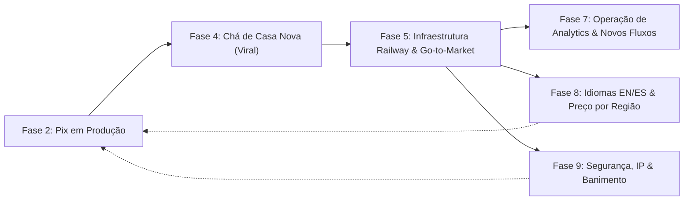

# Plano Faseado de Implementações Futuras: Casa Mia

> **Objetivo:** Reunir as próximas entregas técnicas e de produto do **Casa Mia**.
>
> **Este documento lista só o que falta fazer.** Revisado em **23/10/2026**, considerando o código atual, inclusive alterações locais. A numeração das fases foi preservada para manter as referências entre documentos. Configurações de produção devem ser confirmadas no ambiente antes de serem consideradas pendências.

---

## 1. O que ainda falta

1. **Pagamentos (produção):** concluir cadastro Stripe, configurar chaves/preços/webhook live e URL de produção, ativar Pix live e validar compra até a liberação de acesso no processo publicado; para a NFS-e (código pronto), obter certificado A1, confirmar habilitação e política contábil e homologar no Emissor Nacional antes de ativar a transmissão (Fases 2 e 5; ver [`pagamentos-e-notas-fiscais.md`](./pagamentos-e-notas-fiscais.md)).
2. **Chá de Casa Nova:** sem rotas públicas, tabela ou Pix (Fase 4).
3. **Produção:** Dockerfile, confirmação de backups, domínio e DNS; e-mails de boas-vindas/presente/resumo, ativação da emissão fiscal e depósito de marca (Fase 5).
4. **Analytics (configuração nas contas):** o código está pronto; falta configurar Google (Tag Manager, GA4, Ads, Search Console), PostHog (funis, painéis e alertas por versão) e o webhook do Resend com os dados reais, e ligar os e-mails em produção (Fase 7).
5. **Idiomas e preço por região:** app só em português e reais (Fase 8).
6. **Segurança e banimento (restante):** auditoria das ações da equipe, linha do tempo de segurança, contas relacionadas, Turnstile/Cloudflare e lista de e-mails descartáveis (Fase 9).
7. **Lista "Meu enxoval" (restante):** bucket de documentos em produção, leitura automática da nota, volta ao app pelos lembretes de garantia e validação do modo loja offline em aparelhos reais (Fase 11).

---

## 2. Roadmap Faseado de Implementação

---

### FASE 2: Pix em Produção

#### 2.1 Pendências operacionais de lançamento
* Concluir o cadastro Stripe e habilitar cobranças reais. Os ambientes `staging` e `production` na Railway ainda usam chave de teste e URL de staging.
* Configurar chave, preços, URL e webhook próprios de produção; ativar Pix na configuração live.
* Publicar o código e validar uma compra real autorizada no Passe em BRL, incluindo confirmação assinada no webhook, liberação única de acesso e tratamento de expiração. Seguir o procedimento de [`pagamentos-e-notas-fiscais.md`](./pagamentos-e-notas-fiscais.md).

---

### FASE 4: Página Pública de Chá de Casa Nova (Viral Loop)

A funcionalidade que transforma convidados em novos clientes da plataforma.

#### 4.1 Estrutura de Banco de Dados
* Nova tabela `housewarming_lists`:
  * `id`: uuid
  * `user_id`: uuid
  * `slug`: text unique (ex.: `lar-da-ana-e-leo`)
  * `title`: text (*"Chá de Casa Nova da Ana e do Léo"*)
  * `message`: text (*"Estamos montando nosso cantinho e ficaremos muito felizes com a sua presença e carinho!"*)
  * `event_date`: timestamp
  * `pix_key`: text (chave Pix do casal)
  * `pix_key_type`: text (`cpf`, `email`, `phone`, `random`)
  * `is_public`: boolean

#### 4.2 Interface Pública do Chá (`/cha/:slug`)
* Página de visualização pública, leve e responsiva (sem necessidade de cadastro do convidado).
* **Ações do Convidado:**
  1. **"Vou presentear com este item":** o convidado informa seu nome e e-mail; o item é marcado como "Reservado/Presenteado" na lista em tempo real.
  2. **"Presentear via Pix":** gera o QR Code e código copia-e-cola direto com a chave Pix cadastrada pelos moradores.
  3. **Deixar Recado de Boas-Vindas:** campo de texto onde o convidado deixa uma mensagem de afeto.
* **Experiência do Anfitrião:**
  * O morador recebe notificação no app: *"Maria reservou o Jogo de Pratos para a sua Cozinha e deixou um recado!"*.
* **Rodapé Viral:**
  * Em destaque no final da página: *"Lista organizada com amor no Casa Mia. Monte o seu enxoval também! [Começar Grátis]"*.

---

### FASE 5: Infraestrutura Railway, Automação Fiscal e Lançamento

#### 5.1 Hospedagem no Railway
* Dockerfile do serviço Node.js/Express (não existe no repositório).
* Confirmar PostgreSQL dedicado com backups diários automáticos no ambiente de produção.
* Confirmar domínio personalizado (`app.casamia.com.br` ou `casamiaapp.com.br`).

#### 5.2 E-mails Transacionais com Resend Pro
* Confirmar autenticação DNS do domínio (SPF, DKIM e DMARC).
* Templates novos com a assinatura do Nino: boas-vindas após a confirmação da conta, presente recebido no Chá de Casa Nova e resumo mensal de conquistas.

#### 5.3 Ativação Fiscal e Registro de Marca
* **NFS-e Nacional (pendências operacionais):** nenhuma nota real foi emitida. Falta:
  1. Obter o certificado ICP-Brasil A1 da empresa e configurar `NFSE_NACIONAL_CERT_PATH`, `NFSE_NACIONAL_KEY_PATH` e `NFSE_NACIONAL_KEY_PASSPHRASE`.
  2. Confirmar a habilitação do CNPJ para emitir pelo Emissor Nacional em Camaçari/BA (2905701). A transição para ME/EPP do Simples está prevista para 01/11/2026 (CGSN 191/2026); a adesão do município ao ADN não basta como permissão de emissão.
  3. Obter da contabilidade, por escrito, o momento de emissão e a competência; preencher `NFSE_NACIONAL_TAX_CONFIG`, `NFSE_NACIONAL_ISSUE_ON`, `NFSE_NACIONAL_COMPETENCE` e `NFSE_NACIONAL_ACCOUNTING_REFERENCE`. Até lá, a emissão fica manual.
  4. Emitir e consultar uma nota em produção restrita (`NFSE_NACIONAL_ENVIRONMENT="homologacao"`) antes de ativar a produção.
  5. Ativar `NFSE_NACIONAL_ENABLED` e `NFSE_NACIONAL_ISSUER_ENABLED` em produção e acompanhar a primeira emissão real. Ver [`pagamentos-e-notas-fiscais.md`](./pagamentos-e-notas-fiscais.md).
* Depósito de marca mista no INPI nas classes 9, 35 e 42.

---

### FASE 6: Catálogo Compartilhado (só quando escalar)

> Nada pendente hoje. Os itens abaixo só valem quando o uso crescer.

* **Na Railway:** o Redis só vale a pena quando houver mais de uma instância; ao ligá-lo, configure `REDIS_URL` (e `REDIS_KEY_PREFIX` diferente se homologação e produção dividirem o mesmo Redis).
* **Escala:** se o catálogo passar de dezenas de milhares de itens, migrar a similaridade em memória para `pg_trgm`.

---

### FASE 7: Analytics, Funil de Aquisição e Reengajamento (configuração nas contas)

> **Referências:** [`analytics.md`](./analytics.md) (o que está implementado e como configurar) e [`analytics-funil-e-reengajamento.md`](./analytics-funil-e-reengajamento.md). O código está pronto; o que falta depende das contas do Google, do PostHog e do Resend e de dados reais. Validar a coleta em produção antes de qualquer gasto com anúncios.

* **Google:** criar e publicar o contêiner do Tag Manager (tags do GA4 para os eventos da seção "GA4 e Tag Manager", "mudanças no histórico" desligado, retenção de 14 meses, tráfego interno), ligar Google Ads e Search Console, enviar `sitemap.xml` ao Search Console e conferir os sinais do Consent Mode v2. Configurar `GA4_MEASUREMENT_ID`/`GA4_API_SECRET` e validar `purchase` do Passe e das cobranças recorrentes com uma compra real.
* **Remarketing (L10):** criar no Google Ads os públicos "visitou /cadastro e não criou conta" e "criou conta e não terminou o funil" (os eventos já chegam ao GA4) e decidir o uso de listas de e-mail, só com consentimento de marketing.
* **PostHog:** montar os funis F1 a F6, a retenção semanal e os alertas de exceção por `app_version`; calibrar a definição de **ativação** e responder às perguntas de negócio com os primeiros 200 usuários.
* **Resend:** cadastrar o webhook `<APP_URL>/api/webhooks/resend` e configurar `RESEND_WEBHOOK_SECRET`.
* **Ligar os e-mails em produção:** validar o proxy `/ingest` e a atribuição do cadastro com as chaves reais; rodar o ciclo de vida em `LIFECYCLE_MODE=simulate`, revisar o painel de Operação em `/admin` e só então ativar `send`.

---

### FASE 8: Idiomas (Inglês e Espanhol) e Preço por Região

> **Documentação:** [`internacionalizacao-regiao-e-seguranca.md`](./internacionalizacao-regiao-e-seguranca.md), partes A e B.

#### 8.1 Três idiomas no app inteiro
* Português (base), **inglês e espanhol** em interface, landing, funil, e-mails, erros do servidor, catálogo, planilhas, textos legais e Nino. Atualizar o inventário de textos antes da extração das traduções.
* Infra com `i18next`, chaves tipadas, teste de paridade entre idiomas, pseudolocalização, erros do servidor por **código** e URLs por idioma com `hreflang`. **A infra vem primeiro: nenhum texto novo entra fixo no código.**
* Não é só tradução: o catálogo já tem `slug` e `translations` por item, a geografia e o clima deixam de ser só Brasil (país → região → cidade, hemisfério) e o conceito de "enxoval" é adaptado a cada mercado.

#### 8.2 Preço por região e segregação regional
* Tabelas `regions`, `region_countries` e `plan_prices` (preço versionado por região e moeda), integradas à Stripe com várias moedas, impostos (Stripe Tax) e meios de pagamento locais; NFS-e só no Brasil.
* País de cobrança confirmado no pagamento e anti-abuso de preço regional (VPN, cartão de outro país). Países bloqueados.
* Segregam-se por região: preços e moedas, impostos, textos legais e consentimento, pacote de itens, relatórios e modelos de e-mail. A conta continua global.

---

### FASE 9: Confiança, Segurança e Proteção contra Abuso (IP, Dispositivo e Banimento)

> **Documentação:** [`internacionalizacao-regiao-e-seguranca.md`](./internacionalizacao-regiao-e-seguranca.md), parte C.

* **Próximos passos:** `auth_events` para trocas de senha e ações sensíveis; histórico de aceite e revogação de termos e consentimentos além do registro de marketing no cadastro; trilha de auditoria das ações da equipe (hoje só o autor do bloqueio fica registrado); decidir o que acontece com enxovais compartilhados quando o dono é bloqueado.
* **Prevenção:** limites persistentes para as demais rotas (hoje em memória, reiniciam a cada deploy), Cloudflare/Turnstile, lista de e-mails descartáveis e e-mail equivalente (pontos e `+` no Gmail), alertas de pico.
* **Painel `/admin`:** linha do tempo de segurança da conta, contas relacionadas (mesmo aparelho ou faixa), fila de abuso e trilha de auditoria.
* **Conformidade:** documentar a base legal e revisar a cobertura e a retenção dos registros de acesso; manter a política de privacidade alinhada às novas funcionalidades; definir o processo de revisão humana de bloqueios, a segurança dos próprios logs e o plano de incidente.

---

### FASE 11: Mais Valor na Lista "Meu enxoval" (restante)

> Como funciona e como configurar: [`lista-meu-enxoval-fase11.md`](./lista-meu-enxoval-fase11.md).

* **Bucket de documentos em produção:** criar o bucket privado (Cloudflare R2 ou S3), configurar `DOCUMENT_STORAGE=s3`, `S3_ENDPOINT`, `S3_BUCKET`, `S3_REGION`, `S3_ACCESS_KEY_ID` e `S3_SECRET_ACCESS_KEY` e validar envio, download pela URL assinada e exclusão. Sem bucket, os arquivos ficam no Postgres (serve para desenvolvimento e homologação, não para volume). Definir `DOCUMENT_QUOTA_MB` conforme o custo (padrão 500 MB por conta).
* **Leitura automática da nota:** o Jev lê a foto da nota e preenche loja, data e valor; definir o limite de consultas para controlar o custo.
* **Lembretes de garantia:** já entram no limite de frequência e recebem entrega e clique pelo webhook; falta o link do e-mail levar `lm` para medir a volta ao app.
* **Chá de Casa Nova (Fase 4):** ligar a reserva do convidado ao item (`gift_reservation_id`) para o "de quem foi o presente" vir preenchido.
* **Modo loja sem conexão:** a casca do app e as telas só ficam guardadas depois de abrir o modo loja uma vez com internet (service worker só no build de produção). Validar em aparelhos reais (Android e iPhone), incluindo a Wake Lock.

---

## 3. Matriz de Prioridade e Sequência de Execução

| Ordem | Entregável | Impacto Principal | Complexidade |
|:---:|---|---|:---:|
| **2º** | **Fase 2 (restante):** Cadastro Stripe, configuração live e validação do Pix em produção | Monetização e Negócio | Baixa-Média |
| **4º** | **Fase 4:** Página pública de Chá de Casa Nova com Pix e Reservas | Crescimento Viral | Média |
| **5º** | **Fase 5 (restante):** Dockerfile, validação de infraestrutura e DNS, novos e-mails e ativação fiscal | Escala e Estabilidade | Média |
| **7º** | **Fase 7 (configuração):** Google, PostHog e Resend com dados reais; ligar os e-mails em produção | Aquisição, Ativação e Retenção | Baixa |
| **8º** | **Fase 8:** Inglês e espanhol no app inteiro + preço, impostos e conteúdo por região | Novos Mercados e Receita | Alta |
| **9º** | **Fase 9 (restante):** Auditoria, linha do tempo e contas relacionadas no painel, Turnstile e e-mails descartáveis | Proteção e Confiança | Média |
| **11º** | **Fase 11 (restante):** Bucket de documentos em produção, leitura automática da nota, volta ao app pelos lembretes de garantia e validação do modo loja offline | Retenção depois da mudança | Baixa-Média |

> **A ordem acima é de menor risco de produto, não de valor.** A validação em produção da Fase 7 (antes de comprar anúncios) e a Fase 9 devem ser **antecipadas**; a infraestrutura de idiomas da Fase 8 (nenhum texto novo fixo no código) também deve começar já, porque o custo de extração cresce a cada tela nova. Tabelas de região e preço da Fase 8 e o antifraude da Fase 9 são pré-requisitos da cobrança em outros países.
