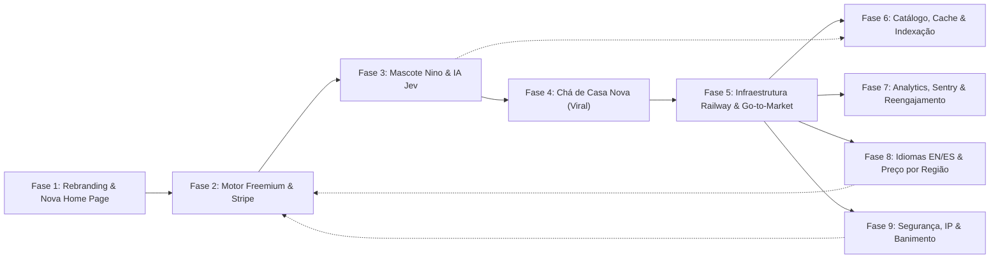

# Plano Faseado de Implementações Futuras: Casa Mia

> **Objetivo:** Estabelecer o roteiro técnico e de produto para transformar a base de código atual no aplicativo comercial do **Casa Mia**, com arquitetura Freemium, integração de pagamentos Stripe, motor de IA Jev (TypeSafe AI), mascote Nino e a página pública de Chá de Casa Nova.

---

## 1. Diagnóstico do Estado Atual da Aplicação

### O que já existe hoje no código
* **Estrutura de Domínio de Enxoval:** cadastro de ambientes/cômodos (`src/components/EnvironmentList.tsx`, `WorkspaceOverview.tsx`), CRUD de itens com status e quantidades (`AddItemModal.tsx`, `ItemRow.tsx`, `data.ts`), cálculo básico de orçamento total e gasto.
* **Ferramentas Utilitárias:** exportação e importação de listas em planilhas Excel e CSV (`src/utils/export.ts`, `src/utils/importItems.ts`).
* **Onboarding Estruturado:** funil de boas-vindas com perfil de moradia, preferências e catálogo inicial de sugestões (`src/components/onboarding/OnboardingFlow.tsx`, `src/onboarding/catalog.ts`).
* **Autenticação e Backend:** rotas de login, cadastro, recuperação de senha com tokens seguros, suporte a PostgreSQL e SQLite (`server/database.ts`, `server/routes.ts`, `server/security.ts`), envio de e-mails transacionais via Resend (`server/mailer.ts`).
* **Área Administrativa:** gestão básica de contas e permissões (`src/components/AdminPage.tsx`, `server/admin.ts`).

### O que NÃO existe e precisa ser implementado
1. **Página Principal (Home Page):** a `LandingPage.tsx` precisa ser 100% reconstruída com a paleta terracota/creme, o mascote Nino, o conceito de enxoval inteligente e a nova tabela de planos.
2. **Regras e Travas de Freemium:** atualmente qualquer usuário pode criar cômodos e itens ilimitados sem restrição.
3. **Motor de Pagamentos:** não há conexão ativa com a Stripe para cobrança recorrente, checkout ou portal de autoatendimento do cliente.
4. **Inteligência Artificial (Jev):** não há integração com a TypeSafe AI para recomendações determinísticas e cálculos de urgência.
5. **Mascote Nino:** ausência de ilustrações e componentes de interface do Nino.
6. **Página de Chá de Casa Nova:** não há suporte a rotas públicas para convidados visualizarem presentes e enviarem Pix.
7. **Camada de cache e catálogo compartilhado de itens:** cada enxoval refaz sozinho o que outro já descobriu (o Jev reavalia "Geladeira" para cada pessoa), e não há busca rápida nem deduplicação de itens. Ver a Fase 6.
8. **Analytics, atribuição de leads e reengajamento:** não há PostHog, GA4 nem Sentry; a origem do lead se perde entre a landing e o cadastro; não existe nenhum disparo de ciclo de vida. Ver a Fase 7.
9. **Idiomas e preço por região:** o app é só em português e em reais (54 arquivos de interface, 130 mensagens de erro do servidor e 13 e-mails com texto fixo; geografia só do Brasil). Ver a Fase 8.
10. **Dados de segurança e banimento:** o app não grava IP nem aparelho, não verifica e-mail e só consegue ligar/desligar uma conta. Ver a Fase 9.

---

## 2. Roadmap Faseado de Implementação

---

### FASE 1: Rebranding Visual & Reconstrução Total da Home Page

> **Status: implementada.** Paleta oficial em tokens `--cm-*` (`src/index.css`) e migração das cores do app; tipografia **Nunito** (interface) + **Fraunces** (títulos e logotipo); `Brand` com o Nino em `<picture>` e tamanho em `em`; favicons, manifest e títulos; mascote **Nino** (`src/components/Nino.tsx`, arte final em `public/brand/nino*.png`, gerada em ícones por `scripts/generate-brand-assets.ts`); nova Home em `src/components/LandingPage.tsx` + `src/landing.css`, com cabeçalho de vidro fixo. Desvios do texto abaixo: a interface usa Nunito, e não DM Sans; o botão secundário do hero é "Ver como funciona" (não existe demonstração). Os limites do plano gratuito, a cobrança e as dicas de IA citados na página só passam a existir nas Fases 2 e 3.

Esta fase alinha toda a experiência visual da aplicação ao manual de branding do **Casa Mia**.

#### 1.1 Migração Global da Identidade Visual
* **Tokens de Cores e CSS (`src/index.css` e `src/product.css`):**
  * Atualizar as variáveis CSS com a paleta oficial:
    * `--cm-bg: #FBF3E6;` (Creme Acolhedor)
    * `--cm-text: #3B2A20;` (Café Tostado)
    * `--cm-primary: #C2603F;` (Terracota Artesanal)
    * `--cm-success: #5C6643;` (Oliva Natural)
    * `--cm-accent: #244B66;` (Azulejo Noturno)
* **Tipografia:**
  * Importar a fonte **Fraunces** via Google Fonts para títulos e logotipo (`h1, h2, h3, .brand-title`).
  * Manter **DM Sans** para interfaces, botões e dados tabulares de preços.
* **Componente da Marca e Favicon:**
  * Refatorar `src/components/Brand.tsx` para renderizar a marca "Casa Mia" com a porta em arco e o coração estilizado.
  * Substituir favicons e ícones em `public/` pelos novos assets do Casa Mia (feito: derivados do Nino).
  * Atualizar títulos de página e `public/site.webmanifest`.

#### 1.2 Reconstrução Completa da Home Page (`src/components/LandingPage.tsx`)
A página inicial precisa ser refeita do zero com forte apelo emocional e clareza de conversão:
* **Header / Navegação:** Logotipo do Casa Mia, links de ancoragem (*"Como Funciona"*, *"O Nino"*, *"Chá de Casa Nova"*, *"Preços"*), botão de Login e botão de destaque *"Começar Grátis"*.
* **Hero Section:**
  * Headline: *"Transforme o sonho da casa nova em uma lista que dá para riscar, item por item."*
  * Subheadline: *"Chega de planilhas estressantes e compras por impulso. O Casa Mia organiza seu enxoval, protege seu orçamento com inteligência artificial e celebra cada conquista do seu novo lar."*
  * CTAs principais: Botão primário *"Criar Minha Lista Grátis (Sem Cartão)"* + Botão secundário *"Ver Demonstração"*.
  * Ilustração/Mockup do app com a porta em arco abrindo e o mascote Nino acenando.
* **Seção "Conheça o Nino":**
  * Apresentação do mascote oficial: o conselheiro da mudança que segura a trena e calcula suas prioridades sem te julgar.
* **Seção de Recursos de Produto:**
  * *Organização por Cômodos:* Cozinha, quarto, sala, banheiro e lavanderia em cards táteis.
  * *Inteligência de Compra (Jev):* Como a IA evita que você esqueça itens do "Primeiro Dia" e corta compras redundantes.
  * *Lista a Dois:* Casais e moradores sincronizados em tempo real.
* **Destaque do Chá de Casa Nova:**
  * Apresentação da página pública para convidados presentearem com itens ou enviarem Pix sem intermediários.
* **Tabela de Preços Transparente:**
  * Card do **Plano Gratuito** (destacando que dá para começar imediatamente com 2 cômodos e 5 itens cada).
  * Card do **Plano Semestral** com badge de **Mais Escolhido** (R$ 19,90/mês equivalente, cobrado R$ 119,40).
  * Card do **Plano Anual** com badge de **50% de Desconto** (R$ 14,90/mês equivalente, cobrado R$ 178,80).
  * Card do **Plano Mensal** (R$ 29,90/mês, flexibilidade total).
* **Novo FAQ Humanizado & Footer Afetuoso.**

---

### FASE 2: Motor Freemium, Travas de Limite & Integração Stripe

Esta fase monetiza a plataforma, implementando as regras de limite do plano gratuito e o fluxo de pagamento seguro via Stripe.

#### 2.1 Modelagem de Dados e Controle de Limites no Backend
* **Campos na Tabela de Usuários/Assinaturas (`users` / `subscriptions`):**
  * `plan`: `'free'` | `'monthly'` | `'semiannual'` | `'annual'`
  * `subscription_status`: `'active'` | `'trialing'` | `'past_due'` | `'canceled'`
  * `stripe_customer_id`: string
  * `stripe_subscription_id`: string
  * `nino_ai_credits_used`: integer (reseta mensalmente)
* **Middleware de Verificação de Limites (`server/security.ts` ou `server/routes.ts`):**
  * Ao criar novo ambiente (`POST /api/workspaces/:id/environments`): se o plano for `'free'` e o usuário já tiver 2 ambientes cadastrados, retornar `403 FORBIDDEN` com código `LIMIT_REACHED_ENVIRONMENTS`.
  * Ao adicionar novo item (`POST /api/environments/:id/items`): se o plano for `'free'` e o ambiente já possuir 5 itens cadastrados, retornar `403 FORBIDDEN` com código `LIMIT_REACHED_ITEMS`.
  * Ao consultar a IA do Nino: limitar a 3 consultas mensais para contas `'free'`.

#### 2.2 Modal de Upgrade Acolhedor no Frontend
* Interceptar os códigos `LIMIT_REACHED_*` no cliente e disparar o **Paywall Modal do Nino**:
  * Ilustração do Nino com as chaves na mão.
  * Mensagem afetuosa: *"Sua casa está crescendo! No plano gratuito, você pode testar até 2 cômodos com 5 itens cada. Vamos abrir as portas de todos os cômodos do seu lar?"*.
  * Botões de seleção de plano (Mensal, Semestral com desconto, Anual) que redirecionam para a Stripe.

#### 2.3 Integração com Stripe Brasil
* **Configuração no Stripe Dashboard:**
  * Criar os 3 preços em BRL com renovação recorrente (`month` / `year`).
* **Endpoints Backend:**
  * `POST /api/billing/create-checkout-session`: recebe o `planId`, cria uma sessão no `Stripe Checkout` com suporte a Cartão de Crédito e Pix, e retorna a URL de redirecionamento.
  * `POST /api/billing/webhook`: rota segura que escuta eventos essenciais:
    * `checkout.session.completed` → ativa a assinatura e libera limites ilimitados.
    * `invoice.payment_succeeded` → renova o ciclo e zera contadores.
    * `customer.subscription.deleted` → rebaixa a conta para `'free'`.
  * `POST /api/billing/customer-portal`: gera a URL do **Stripe Customer Portal** para que o usuário altere cartão, consulte faturas ou cancele sem necessidade de telas customizadas.
* **Frontend:** Botão "Minha Assinatura" no menu do usuário abrindo o portal da Stripe.

---

### FASE 3: Motor de IA Jev (TypeSafe AI) & Mascote Nino na Interface

Esta fase transforma o Casa Mia em um assistente proativo que pensa com inteligência prescritiva.

> **Status:** a base está implementada e fica desligada até existir `TYPESAFE_API_KEY` no servidor.
> * `server/services/jev.ts` (cliente, cache de 10 min, teto diário `JEV_DAILY_LIMIT`, limiares de confiança) e `server/ai.ts` (rotas).
> * Rotas reais: `POST /api/ai/assess-item` (ambiente do item novo + aviso de compra redundante, numa só chamada), `POST /api/ai/recommend` (próximo item essencial do ambiente, escolhido entre itens do catálogo que faltam) e `POST /api/ai/prioritize` (prioridade de compra dos itens pendentes de um ambiente numa régua de 8 níveis, de "pode esperar mais de 6 meses" a "comprar já: leva tempo", definida em `src/planning/purchaseUrgency.ts`; a nota fica gravada em `items.ai_urgency` e só é inferida de novo para item novo, renomeado ou movido de ambiente). `GET /api/ai/status` diz ao app se o Jev está ligado.
> * Interface: `AddItemModal` (sugere o ambiente e avisa de repetição) e `NinoAssistant`, no planejamento de compras (próximo item e itens por urgência).
> * Sem chave, erro ou confiança baixa, tudo volta vazio e o app funciona como antes (o regex de `suggestCategory` continua valendo para links de lojas).
> * **Ainda não feito:** limite de consultas por plano (depende do Freemium da Fase 2), estados visuais do Nino (pensativo/comemorando/descansando) e o balãozinho dentro do ambiente.
> * Nomes das rotas diferem do planejado abaixo: `check-redundancy` virou parte de `assess-item`, para gastar uma chamada em vez de duas.

#### 3.1 Setup do SDK TypeSafe AI
* Adicionar a dependência do TypeSafe AI no backend Node.js (`server/`).
* Configurar a chave de API segura no arquivo de variáveis de ambiente (`TYPESAFE_API_KEY`).

#### 3.2 Implementação das Rotas de Inteligência
* **Recomendação Inteligente com `Choice` (`POST /api/ai/recommend`):**
  * Envia o estado atual do morador (área do imóvel, número de moradores, animais de estimação e lista de itens já comprados no cômodo).
  * O Jev retorna de forma atômica qual é o próximo item essencial faltante com grau de certeza (*confidence*).
* **Priorização Orçamentária com `Score` (`POST /api/ai/prioritize`):**
  * O Jev pontua a urgência de cada item de 1 a 5 considerando o orçamento total disponível e a data prevista de mudança.
* **Guarda contra Redundâncias com `Noul` (`POST /api/ai/check-redundancy`):**
  * Avalia se a inclusão de um novo item representa duplicidade de função em relação ao espaço disponível.

#### 3.3 Componente do Mascote Nino na Interface
* Criação do componente `<NinoAssistant />` posicionado discretamente na visualização de cômodos:
  * Exibe dicas calculadas pelo Jev com um balãozinho acolhedor.
  * Três estados visuais: *Pensativo* (com trena/prancheta), *Comemorando* (ao riscar itens), *Descansando no arco* (quando o cômodo atinge 100%).

---

### FASE 4: Página Pública de Chá de Casa Nova (Viral Loop)

A funcionalidade que transforma convidados em novos clientes da plataforma.

#### 4.1 Estrutura de Banco de Dados
* Nova tabela `housewarming_lists`:
  * `id`: uuid
  * `user_id`: uuid
  * `slug`: text unique (ex.: `lar-da-ana-e-leo`)
  * `title`: text (*"Chá de Casa Nova da Ana e do Léo"*)
  * `message`: text (*"Estamos montando nosso cantinho e ficaremos muito felizes com a sua presença e carinho!"*)
  * `event_date`: timestamp
  * `pix_key`: text (chave Pix do casal)
  * `pix_key_type`: text (`cpf`, `email`, `phone`, `random`)
  * `is_public`: boolean

#### 4.2 Interface Pública do Chá (`/cha/:slug`)
* Página de visualização pública, leve e responsiva (sem necessidade de cadastro do convidado).
* **Ações do Convidado:**
  1. **"Vou presentear com este item":** o convidado informa seu nome e e-mail; o item é marcado como "Reservado/Presenteado" na lista em tempo real.
  2. **"Presentear via Pix":** gera o QR Code e código copia-e-cola direto com a chave Pix cadastrada pelos moradores.
  3. **Deixar Recado de Boas-Vindas:** campo de texto onde o convidado deixa uma mensagem de afeto.
* **Experiência do Anfitrião:**
  * O morador recebe notificação no app: *"Maria reservou o Jogo de Pratos para a sua Cozinha e deixou um recado!"*.
* **Rodapé Viral:**
  * Em destaque no final da página: *"Lista organizada com amor no Casa Mia. Monte o seu enxoval também! [Começar Grátis]"*.

---

### FASE 5: Infraestrutura Railway, Automação Fiscal e Lançamento

Esta fase consolida a operação em ambiente de produção seguro e escalável.

#### 5.1 Hospedagem no Railway
* Provisionar projeto no **Railway**:
  * Serviço de Aplicação (Node.js/Fastify construído via Dockerfile).
  * Serviço de Banco de Dados PostgreSQL dedicado com backups diários automáticos.
* Configuração de domínios personalizados (`app.casamia.com.br` ou `casamiaapp.com.br`).

#### 5.2 E-mails Transacionais com Resend Pro
* Configuração do domínio no painel do Resend com autenticação DNS (registros SPF, DKIM e DMARC).
* Templates HTML responsivos com a assinatura do Nino:
  * E-mail de Boas-Vindas e ativação de conta.
  * Notificação de presente recebido no Chá de Casa Nova.
  * Resumo mensal de conquistas do lar.

#### 5.3 Automação Fiscal e Registro de Marca
* Integrar webhook da Stripe com serviço de NFS-e (Focus NFe ou PlugNotas) para emissão automática de Nota Fiscal de Serviço a cada mensalidade aprovada.
* Submeter protocolo de depósito de marca mista no INPI nas classes 9, 35 e 42.

---

### FASE 6: Camada de Cache, Catálogo Compartilhado e Indexação de Itens

> **Pode (e deve) ser antecipada:** depende só da Fase 3 e reduz o custo dela. A ordem na matriz é a de menor risco de produto, não a de menor valor.

**Problema.** Hoje o conhecimento sobre um item morre dentro do enxoval que o gerou. A nota de urgência fica em `items.ai_urgency` (por item, por enxoval) e o cache de `server/services/jev.ts` é em memória, por processo, com 10 minutos de vida: reinicia no deploy e não é compartilhado entre instâncias. Se mil pessoas cadastram "Geladeira", o Jev é consultado mil vezes para chegar à mesma resposta. O catálogo do funil (`src/onboarding/catalog.ts`, 244 entradas) só é consultado por nome idêntico (`matchCatalog`), e a sugestão de ambiente de links de lojas é um conjunto de regex (`suggestCategory`).

**Princípio.** O Jev deve ser consultado só quando o item **não existe** no banco. Tudo o que já foi descoberto uma vez vira conhecimento compartilhado, indexado e de leitura em milissegundos. O Jev passa a ser o último degrau de uma cascata, e também o juiz de dúvidas de deduplicação.

#### 6.1 Catálogo mestre de itens (`catalog_items`)
* Tabela global (sem `user_id` nem `enxoval_id`) com os **1.000+ itens mais comuns** de uma casa nova, semeada a partir do `CATALOG` atual, de uma lista curada e dos itens já cadastrados (deduplicados):
  * `id`, `canonical_name`, `normalized_name` (único), `room` (cômodo), `priority` (essencial/opcional), `timing` (primeira noite/semana), `lead_time_weeks` (entrega e montagem), `price_category` (1 a 4) e `function_group` (ver 6.4).
  * `source` (`curated` > `users` > `jev`) e `status` (`approved`, `pending_review`), para que o que o Jev inventar nunca valha mais que o que a equipe revisou.
* Tabela `catalog_item_aliases` (`item_id`, `alias_normalized`, `source`): "fritadeira elétrica", "airfryer" e "air fryer" apontam para o mesmo item. Cada vez que a deduplicação resolve uma dúvida, o apelido novo é gravado e a mesma dúvida não volta a existir.
* `items.catalog_item_id` (nulo permitido): liga o item do enxoval ao catálogo. Itens livres continuam existindo; só não herdam estimativas.

#### 6.2 Estimativas padrão por perfil, inferidas uma vez
* A urgência depende do perfil (moradia, moradores, clima), e não da pessoa. Guardar a nota por **faixa de perfil** em `catalog_item_urgency` (`item_id`, `profile_bucket`, `urgency`, `confidence`, `rubric_version`), em vez de por item de cada enxoval.
  * Faixas sugeridas: moradia (apartamento/casa/studio) × clima (quente/ameno/frio) × situação (casal/solo/outros). O prazo até a mudança deixa de entrar na nota do Jev e passa a ser combinado em código com a `lead_time_weeks`, que é determinística.
* O Jev só é chamado quando falta a linha da faixa. `items.ai_urgency` vira apenas um espelho de leitura rápida, e a `URGENCY_RUBRIC_VERSION` continua invalidando tudo de uma vez.
* Pré-calcular em lote (um job, como `server/workers/track-prices.ts`) as faixas dos 1.000 itens: custo único, controlado e previsível, em vez de gasto sob demanda.

#### 6.3 Faixas de preço reais, vindas de quem usa
* Tabela `catalog_price_stats` (`item_id`, `region` opcional, `p10`, `p50`, `p90`, `samples`, `updated_at`), alimentada por um job que agrega os preços cadastrados pelas pessoas e os preços lidos de lojas (`product_price_snapshots`).
* Regras de qualidade e privacidade: só publicar com amostra mínima (k ≥ 5 enxovais distintos), descartar valores fora de faixa (IQR), guardar **apenas agregados**, sem ligação com usuário ou enxoval, e atualizar de forma incremental.
* Uso: o formulário mostra "faixa comum: R$ X a R$ Y" e o planejamento troca as faixas genéricas por perfil de gasto pela faixa real do item quando houver amostra. Também alimenta o alerta de preço e a comparação "este preço está acima do comum".

#### 6.4 Deduplicação e busca rápida
* **Normalização** compartilhada num único lugar (hoje há cópias em `purchasePlan.ts`, `regional.ts`, `importItems.ts` e `jev.ts`): sem acento nem caixa, singular/plural, remoção de qualificadores ("de casal", "5L", marca) e de palavras vazias.
* **Índices no Postgres:** extensões `pg_trgm` e `unaccent`, índice GIN de trigramas em `normalized_name` e nos apelidos, e índice por `room`. Busca por prefixo e por similaridade em dezenas de milissegundos, sem rede externa.
* **Cascata de resolução** ao cadastrar ou importar um item:
  1. Acerto exato por nome normalizado ou apelido → usa o catálogo, **zero** consulta ao Jev.
  2. Similaridade de trigramas alta (≥ 0,8) → mesmo item; grava o apelido.
  3. Similaridade intermediária (0,4 a 0,8) → **pergunta ao Jev** com uma `choice` entre os 5 candidatos mais próximos e a opção "nenhum deles". Se escolher um, grava o apelido; se não, segue.
  4. Nada parecido → cria o item no catálogo com `status = pending_review`, pede ao Jev uma única inferência (cômodo, prioridade, prazo, grupo de função) e grava.
* **Grupos de função** (`function_group`, como "fritura sem óleo": airfryer, fritadeira elétrica): o aviso de compra redundante passa a ser uma consulta ao banco ("já existe item deste grupo na lista?"), sem Jev. O Jev só atribui o grupo na hora de criar um item novo no catálogo.
* **Busca instantânea:** `GET /api/catalog/search?q=` (prefixo + trigramas) alimenta o autocomplete do `AddItemModal` e da importação por planilha, e substitui o regex de `suggestCategory` e os `HEADER_ALIASES` como fonte de ambiente.

#### 6.5 Camadas de cache e operação
* **L1** em memória por processo (já existe; passa a ser um LRU pequeno só para os itens quentes), **L2** o catálogo no Postgres (fonte durável e compartilhada) e, se houver mais de uma instância na Railway, **L3** um Redis opcional para o limite de chamadas e para o cache de respostas do Jev, que hoje são por processo.
* **Cache negativo** (por exemplo, "este nome não é um item de casa") com TTL, para entradas sem sentido não reconsultarem o Jev.
* **Painel no `/admin`:** fila de itens `pending_review` (aprovar, renomear, mesclar), ferramenta de mesclar duplicados (move apelidos e vínculos) e métricas: **taxa de acerto do catálogo**, consultas ao Jev por dia, custo por usuário ativo e itens sem estimativa.
* **Meta:** ao menos 90% das resoluções de item e de urgência atendidas sem chamar o Jev depois de alguns meses de uso; o Jev fica restrito a itens realmente novos e a dúvidas de deduplicação.

#### 6.6 Riscos e cuidados
* **Mesclar o que é diferente** ("panela" e "panela de pressão"): limiares conservadores, o Jev decide a faixa de dúvida e há revisão humana de tudo que o Jev criou. Todo apelido tem `source` e pode ser desfeito.
* **Preço enviesado** por poucos dados ou valores digitados errado: amostra mínima, aparar extremos e mostrar a faixa só com `samples` suficientes.
* **Privacidade (LGPD):** o catálogo só guarda nomes de itens e agregados; nenhum dado de pessoa ou enxoval. Atualizar a página de privacidade quando o recurso entrar.
* **Partida a frio:** a semeadura dos 1.000+ itens evita que os primeiros usuários paguem a conta de todas as consultas.

---

### FASE 7: Analytics, Funil de Aquisição, Monitoramento de Erros e Reengajamento

> **Documentação de implementação completa:** [`analytics-funil-e-reengajamento.md`](./analytics-funil-e-reengajamento.md). **Deve vir antes de qualquer gasto com anúncios:** dado de origem que não foi coletado não volta.

Os leads virão de busca orgânica e de anúncios. Esta fase instala **PostHog** (comportamento no produto), **GA4 via Google Tag Manager** (origem, campanhas, Google Ads e Search Console) e **Sentry** (erros e lentidão), e transforma o que se aprende em **disparos de reengajamento** com gatilhos vindos do próprio banco (data da mudança, itens atrasados, inatividade).

#### 7.1 Fundação e privacidade
* Módulo `src/analytics/` com um único `track()` e dicionário tipado de eventos; banner de consentimento com **Google Consent Mode v2**; página de privacidade atualizada; proxy próprio (`/ingest`, `/monitoring`) contra bloqueadores; ambientes separados e testes com análise desligada.
* Regra: o PostHog **não recebe e-mail, nome, IP nem texto livre**, só `user_id` e categorias.

#### 7.2 Sentry
* Navegador e servidor, source maps privados, filtro que remove senha e cookies, Sentry Crons nas rotinas agendadas e alertas por versão.

#### 7.3 Atribuição orgânica e paga
* Convenção de UTM, `channel_group` calculado no servidor, primeiro toque guardado em `users` (`acq_*`, `gclid`, `ga_client_id`), eventos-chave no GA4 e conversões enviadas pelo servidor quando houver pagamento (otimizar anúncio por receita real). SEO técnico mínimo para o orgânico.

#### 7.4 Eventos, funis e dashboards
* Dicionário de eventos do funil `/comecar` (24 etapas), ativação (item conquistado), colaboração, Nino e receita; eventos de valor emitidos pelo servidor.
* Funis F1 a F6, retenção semanal, definição de **ativação** a calibrar e perguntas de negócio que o funil responde.

#### 7.5 Motor de ciclo de vida (reengajamento e disparos)
* Worker no estilo de `priceTrackerWorker`, tabelas `lifecycle_messages`/`lifecycle_events`, consentimento de marketing separado, central de preferências, descadastro com um clique e limite de frequência.
* Fluxos: retomar o funil, primeiro valor, **contagem regressiva da mudança** (T-12 a T+1 semanas, o mais valioso), atrasos, queda de preço, inatividade, marcos, convite parado, pós-mudança, remarketing pago e upgrade.
* **Grupo de controle de 10%** em cada fluxo para medir o efeito real. Campanhas pontuais por segmento em `/admin`.

---

### FASE 8: Idiomas (Inglês e Espanhol) e Preço por Região

> **Documentação:** [`internacionalizacao-regiao-e-seguranca.md`](./internacionalizacao-regiao-e-seguranca.md), partes A e B.

#### 8.1 Três idiomas no app inteiro
* Português (base), **inglês e espanhol** em interface, landing, funil, e-mails, erros do servidor, catálogo, planilhas, textos legais e Nino. Medido hoje: **54 arquivos / ~1.365 linhas** de texto em português, **130** mensagens de erro do servidor e **13** e-mails.
* Infra com `i18next`, chaves tipadas, teste de paridade entre idiomas, pseudolocalização, erros do servidor por **código** e URLs por idioma com `hreflang`. **A infra vem primeiro: nenhum texto novo entra fixo no código.**
* Não é só tradução: o catálogo ganha `slug` por item com traduções (a Fase 6 já nasce assim), a geografia e o clima deixam de ser só Brasil (país → região → cidade, hemisfério) e o conceito de "enxoval" é adaptado a cada mercado.

#### 8.2 Preço por região e segregação regional
* Tabelas `regions`, `region_countries` e `plan_prices` (preço versionado por região e moeda), integradas à Stripe com várias moedas, impostos (Stripe Tax) e meios de pagamento locais; NFS-e só no Brasil.
* País de cobrança confirmado no pagamento e anti-abuso de preço regional (VPN, cartão de outro país). Países bloqueados.
* Segregam-se por região: preços e moedas, impostos, textos legais e consentimento, pacote de itens, relatórios e modelos de e-mail. A conta continua global.

---

### FASE 9: Confiança, Segurança e Proteção contra Abuso (IP, Dispositivo e Banimento)

> **Documentação:** [`internacionalizacao-regiao-e-seguranca.md`](./internacionalizacao-regiao-e-seguranca.md), parte C. **Registrar antes de cobrar (Fase 2):** dado de segurança que não foi gravado não pode ser recuperado depois do incidente.

Hoje o app **não grava IP nem user-agent**, as sessões não têm metadados, não há verificação de e-mail e o único bloqueio é `users.is_active`.
* **Coleta com finalidade e prazo:** tabela `auth_events` (IP, país, provedor, aparelho, resultado), metadados em `sessions`, `user_devices` com `device_id` próprio, prova de consentimento. IP bruto por 6 meses e depois anonimizado por rotina diária.
* **Banimento:** `users.status`, tabela `bans` (conta, IP, faixa, aparelho, domínio de e-mail, país), sessões encerradas na hora, motivo e prazo registrados, recurso e reversão.
* **Prevenção:** verificação de e-mail, limites persistentes (hoje reiniciam a cada deploy), Cloudflare/Turnstile, lista de e-mails descartáveis, alertas.
* **Painel `/admin`:** ficha da conta com linha do tempo de segurança, contas relacionadas, fila de abuso e trilha de auditoria.
* **Conformidade:** base legal (legítimo interesse documentado), guarda de registros de acesso (Marco Civil), política de privacidade, direito de revisão humana, segurança dos próprios logs e plano de incidente.

---

## 3. Matriz de Prioridade e Sequência de Execução

| Ordem | Entregável | Impacto Principal | Complexidade |
|:---:|---|---|:---:|
| **1º** | **Fase 1:** Rebranding visual global + Nova Home Page com a proposta Casa Mia | Autoridade e Conversão | Média |
| **2º** | **Fase 2:** Regras do Freemium (2 cômodos / 5 itens) + Checkout Stripe | Monetização e Negócio | Média |
| **3º** | **Fase 3:** Mascote Nino na interface + Chamadas de IA Jev (TypeSafe AI) | Retenção e Diferencial | Média-Alta |
| **4º** | **Fase 4:** Página pública de Chá de Casa Nova com Pix e Reservas | Crescimento Viral | Média |
| **5º** | **Fase 5:** Deploy Railway + Resend Pro + Emissão Fiscal Automática | Escala e Estabilidade | Média |
| **6º** | **Fase 6:** Catálogo mestre de 1.000+ itens, faixas de preço reais, deduplicação e busca indexada (Jev só para o que não existe) | Custo de IA, Velocidade e Qualidade dos Dados | Média-Alta |
| **7º** | **Fase 7:** PostHog + GA4 (Tag Manager) + Sentry, atribuição orgânica/paga, funis e motor de reengajamento | Aquisição, Ativação e Retenção | Média-Alta |
| **8º** | **Fase 8:** Inglês e espanhol no app inteiro + preço, impostos e conteúdo por região | Novos Mercados e Receita | Alta |
| **9º** | **Fase 9:** Registro de IP/aparelho, banimento, verificação de e-mail e painel antiabuso | Proteção e Confiança | Média |

> **A ordem acima é de menor risco de produto, não de valor.** A Fase 9 (começar a registrar com política pronta) e a Fase 7 (instalar antes de comprar anúncios) devem ser **antecipadas** para antes da Fase 2; a infraestrutura de idiomas da Fase 8 (nenhum texto novo fixo no código) também deve começar já, porque o custo de extração cresce a cada tela nova. Tabelas de região e preço da Fase 8 e o antifraude da Fase 9 são pré-requisitos da cobrança da Fase 2.

> A Fase 6 pode começar logo depois da Fase 3: quanto antes existir o catálogo, menos o Jev é consultado, e as estimativas gravadas passam a valer para todos os enxovais.
