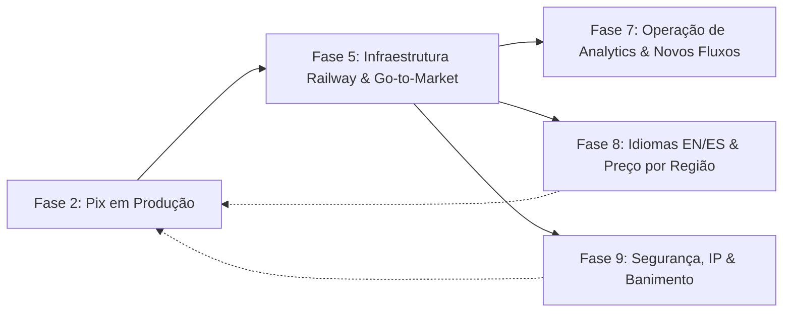

# Plano Faseado de Implementações Futuras: Casa Mia

> **Objetivo:** Reunir as próximas entregas técnicas e de produto do **Casa Mia**.
>
> **Este documento lista só o que falta fazer.** Revisado em **24/10/2026**, considerando o código atual, inclusive alterações locais. A numeração das fases foi preservada para manter as referências entre documentos. Configurações de produção devem ser confirmadas no ambiente antes de serem consideradas pendências.

---

## 1. O que ainda falta

1. **Pagamentos (produção):** concluir cadastro Stripe, configurar chaves/preços/webhook live e URL de produção, ativar Pix live e validar compra até a liberação de acesso no processo publicado; para a NFS-e (código pronto), obter certificado A1, confirmar habilitação e política contábil e homologar no Emissor Nacional antes de ativar a transmissão (Fases 2 e 5; ver [`pagamentos-e-notas-fiscais.md`](./pagamentos-e-notas-fiscais.md)).
2. **Produção:** Dockerfile, confirmação de backups, domínio e DNS; e-mails de boas-vindas/presente/resumo, ativação da emissão fiscal e depósito de marca (Fase 5).
3. **Analytics (configuração nas contas):** o código está pronto; falta configurar Google (Tag Manager, GA4, Ads, Search Console), PostHog (funis, painéis e alertas por versão) e o webhook do Resend com os dados reais, e ligar os e-mails em produção (Fase 7).
4. **Idiomas e preço por região:** app só em português e reais (Fase 8).
5. **Segurança e banimento (restante):** auditoria das ações da equipe, linha do tempo de segurança, contas relacionadas, Turnstile/Cloudflare e lista de e-mails descartáveis (Fase 9).
6. **Validação em celulares físicos:** executar o roteiro do modo loja offline e da Wake Lock em Android e iPhone reais. O fluxo já foi testado em Chromium e WebKit com perfis móveis; isso não substitui aparelhos físicos (ver [`lista-meu-enxoval-fase11.md`](./lista-meu-enxoval-fase11.md)).

---

## 2. Roadmap Faseado de Implementação

---

### FASE 2: Pix em Produção

#### 2.1 Pendências operacionais de lançamento
* Concluir o cadastro Stripe e habilitar cobranças reais. Os ambientes `staging` e `production` na Railway ainda usam chave de teste e URL de staging.
* Configurar chave, preços, URL e webhook próprios de produção; ativar Pix na configuração live.
* Publicar o código e validar uma compra real autorizada no Passe em BRL, incluindo confirmação assinada no webhook, liberação única de acesso e tratamento de expiração. Seguir o procedimento de [`pagamentos-e-notas-fiscais.md`](./pagamentos-e-notas-fiscais.md).

---

### FASE 5: Infraestrutura Railway, Automação Fiscal e Lançamento

#### 5.1 Hospedagem no Railway
* Dockerfile do serviço Node.js/Express (não existe no repositório).
* Confirmar PostgreSQL dedicado com backups diários automáticos no ambiente de produção.
* Confirmar domínio personalizado (`app.casamia.com.br` ou `casamiaapp.com.br`).

#### 5.2 E-mails Transacionais com Resend Pro
* Confirmar autenticação DNS do domínio (SPF, DKIM e DMARC).
* Templates novos com a assinatura do Nino: boas-vindas após a confirmação da conta, presente recebido no Chá de Casa Nova e resumo mensal de conquistas.

#### 5.3 Ativação Fiscal e Registro de Marca
* **NFS-e Nacional (pendências operacionais):** nenhuma nota real foi emitida. Falta:
  1. Obter o certificado ICP-Brasil A1 da empresa e configurar `NFSE_NACIONAL_CERT_PATH`, `NFSE_NACIONAL_KEY_PATH` e `NFSE_NACIONAL_KEY_PASSPHRASE`.
  2. Confirmar a habilitação do CNPJ para emitir pelo Emissor Nacional em Camaçari/BA (2905701). A transição para ME/EPP do Simples está prevista para 01/11/2026 (CGSN 191/2026); a adesão do município ao ADN não basta como permissão de emissão.
  3. Obter da contabilidade, por escrito, o momento de emissão e a competência; preencher `NFSE_NACIONAL_TAX_CONFIG`, `NFSE_NACIONAL_ISSUE_ON`, `NFSE_NACIONAL_COMPETENCE` e `NFSE_NACIONAL_ACCOUNTING_REFERENCE`. Até lá, a emissão fica manual.
  4. Emitir e consultar uma nota em produção restrita (`NFSE_NACIONAL_ENVIRONMENT="homologacao"`) antes de ativar a produção.
  5. Ativar `NFSE_NACIONAL_ENABLED` e `NFSE_NACIONAL_ISSUER_ENABLED` em produção e acompanhar a primeira emissão real. Ver [`pagamentos-e-notas-fiscais.md`](./pagamentos-e-notas-fiscais.md).
* Depósito de marca mista no INPI nas classes 9, 35 e 42.

---

### FASE 6: Catálogo Compartilhado (só quando escalar)

> Nada pendente hoje. Os itens abaixo só valem quando o uso crescer.

* **Na Railway:** o Redis só vale a pena quando houver mais de uma instância; ao ligá-lo, configure `REDIS_URL` (e `REDIS_KEY_PREFIX` diferente se homologação e produção dividirem o mesmo Redis).
* **Escala:** se o catálogo passar de dezenas de milhares de itens, migrar a similaridade em memória para `pg_trgm`.

---

### FASE 7: Analytics, Funil de Aquisição e Reengajamento (configuração nas contas)

> **Referências:** [`analytics.md`](./analytics.md) (o que está implementado e como configurar) e [`analytics-funil-e-reengajamento.md`](./analytics-funil-e-reengajamento.md). O código está pronto; o que falta depende das contas do Google, do PostHog e do Resend e de dados reais. Validar a coleta em produção antes de qualquer gasto com anúncios.

* **Google:** criar e publicar o contêiner do Tag Manager (tags do GA4 para os eventos da seção "GA4 e Tag Manager", "mudanças no histórico" desligado, retenção de 14 meses, tráfego interno), ligar Google Ads e Search Console, enviar `sitemap.xml` ao Search Console e conferir os sinais do Consent Mode v2. Configurar `GA4_MEASUREMENT_ID`/`GA4_API_SECRET` e validar `purchase` do Passe e das cobranças recorrentes com uma compra real.
* **Remarketing (L10):** criar no Google Ads os públicos "visitou /cadastro e não criou conta" e "criou conta e não terminou o funil" (os eventos já chegam ao GA4) e decidir o uso de listas de e-mail, só com consentimento de marketing.
* **PostHog:** montar os funis F1 a F6, a retenção semanal e os alertas de exceção por `app_version`; calibrar a definição de **ativação** e responder às perguntas de negócio com os primeiros 200 usuários.
* **Resend:** cadastrar o webhook `<APP_URL>/api/webhooks/resend` e configurar `RESEND_WEBHOOK_SECRET`.
* **Ligar os e-mails em produção:** validar o proxy `/ingest` e a atribuição do cadastro com as chaves reais; rodar o ciclo de vida em `LIFECYCLE_MODE=simulate`, revisar o painel de Operação em `/admin` e só então ativar `send`.

---

### FASE 8: Idiomas (Inglês e Espanhol) e Preço por Região

> **Documentação:** [`internacionalizacao-regiao-e-seguranca.md`](./internacionalizacao-regiao-e-seguranca.md), partes A e B.

#### 8.1 Três idiomas no app inteiro
* Português (base), **inglês e espanhol** em interface, landing, funil, e-mails, erros do servidor, catálogo, planilhas, textos legais e Nino. Atualizar o inventário de textos antes da extração das traduções.
* Infra com `i18next`, chaves tipadas, teste de paridade entre idiomas, pseudolocalização, erros do servidor por **código** e URLs por idioma com `hreflang`. **A infra vem primeiro: nenhum texto novo entra fixo no código.**
* Não é só tradução: o catálogo já tem `slug` e `translations` por item, a geografia e o clima deixam de ser só Brasil (país → região → cidade, hemisfério) e o conceito de "enxoval" é adaptado a cada mercado.

#### 8.2 Preço por região e segregação regional
* Tabelas `regions`, `region_countries` e `plan_prices` (preço versionado por região e moeda), integradas à Stripe com várias moedas, impostos (Stripe Tax) e meios de pagamento locais; NFS-e só no Brasil.
* País de cobrança confirmado no pagamento e anti-abuso de preço regional (VPN, cartão de outro país). Países bloqueados.
* Segregam-se por região: preços e moedas, impostos, textos legais e consentimento, pacote de itens, relatórios e modelos de e-mail. A conta continua global.

---

### FASE 9: Confiança, Segurança e Proteção contra Abuso (IP, Dispositivo e Banimento)

> **Documentação:** [`internacionalizacao-regiao-e-seguranca.md`](./internacionalizacao-regiao-e-seguranca.md), parte C.

* **Próximos passos:** `auth_events` para trocas de senha e ações sensíveis; histórico de aceite e revogação de termos e consentimentos além do registro de marketing no cadastro; trilha de auditoria das ações da equipe (hoje só o autor do bloqueio fica registrado); decidir o que acontece com enxovais compartilhados quando o dono é bloqueado.
* **Prevenção:** limites persistentes para as demais rotas (hoje em memória, reiniciam a cada deploy), Cloudflare/Turnstile, lista de e-mails descartáveis e e-mail equivalente (pontos e `+` no Gmail), alertas de pico.
* **Painel `/admin`:** linha do tempo de segurança da conta, contas relacionadas (mesmo aparelho ou faixa), fila de abuso e trilha de auditoria.
* **Conformidade:** documentar a base legal e revisar a cobertura e a retenção dos registros de acesso; manter a política de privacidade alinhada às novas funcionalidades; definir o processo de revisão humana de bloqueios, a segurança dos próprios logs e o plano de incidente.

---

### Validação operacional: celulares físicos

As implementações de documentos, OCR local de notas, retorno pelos lembretes de garantia e cache completo do modo loja estão concluídas. O armazenamento pode continuar no PostgreSQL; um bucket S3/R2 é uma opção de escala, não um requisito desta fase.

Falta executar em Android e iPhone físicos o roteiro de perda de sinal, reabertura, sincronização e comportamento da tela ligada. Não havia aparelhos físicos acessíveis para esta validação. Evidências e roteiro ficam em [`lista-meu-enxoval-fase11.md`](./lista-meu-enxoval-fase11.md).

---

### Ajustes planejados para 2026-10-21

#### A1. Trial de 3 dias (72 horas) no lugar de 2 dias (48 horas)

Hoje o teste dura 48 horas, com cartão cadastrado e cobrança automática do Mensal ao final. A mudança é de duração; o modelo (cartão no início, cancelamento no app, bloqueio dos convidados ao cancelar) continua o mesmo.

* **Cobrança:** `server/billing.ts` (linha ~393) usa `trial_period_days: 2`; passar para `3`. Trocar também o texto de `custom_text.submit.message` ("Teste completo por 2 dias (48 horas)").
* **Textos de interface com "48 horas" ou "2 dias":** `src/components/LandingPage.tsx` (9 ocorrências, incluindo o selo do hero e o FAQ), `PlanSelection.tsx` (8), `SubscriptionAccess.tsx` (2, inclusive "São 48 horas completas"), `AuthPage.tsx` (2), `ProfileDialog.tsx`, `OnboardingFlow.tsx`, `AdminPage.tsx`, e e-mails em `server/mailer.ts` (2). Procurar por `48 horas|48h|2 dias|dois dias`; algumas ocorrências de `24 horas` são do lembrete e não mudam.
* **Lembrete das últimas 24 horas:** `server/workers/trialNotifications.ts` continua válido; confirmar que ele usa `trial_ends_at` e não uma duração fixa.
* **Testes:** `tests/billing-db.mjs` (`trial_period_days, 2`, `48 * 3600`, `23 hours`) e `tests/freemium-db.mjs` (`interval '48 hours'`) passam para 72 horas. Rodar `npm run test:billing-db`, `npm run lint`, `npm run build` e `node tests/trial-ui.mjs`.
* **Documentação:** atualizar a seção "Trial e cobrança" do `README.md` e `docs/analytics.md` se citar a duração.
* **Contas em teste:** quem já está em trial mantém o `trial_end` gravado na Stripe, então continua com 48 horas. Não há migração de dados. Só novos checkouts recebem 72 horas.
* **Atenção:** `routes.ts` tem `interval '48 hours'` para expiração de sessão por inatividade. Não tem relação com o trial e não deve mudar.

#### A2. Manter os preços visíveis na tela principal (decisão)

Decisão: não esconder valores para revelá-los só no paywall. Motivos: contradiz "acolhimento antes da cobrança" e "respeito ao bolso" (seções 2 e 6 de `docs/branding-casa-mia.md`); o público é sensível a custo; e como o trial exige cartão, o preço escondido aumenta a chance de a pessoa se sentir surpreendida na cobrança.

* **O que mudar na home:** manter a seção de preços, mas deixar claro, perto do botão, que são **3 dias com cartão cadastrado, cancelamento no app antes do fim e cobrança do Mensal depois**. Isso já aparece em parte e passa a falar em 3 dias (A1).
* **Não usar** a frase "Grátis até 2 cômodos": o app hoje não tem plano gratuito para criar enxoval (a criação sem assinatura retorna `SUBSCRIPTION_REQUIRED`). A seção 1 deste documento ainda descreve limites gratuitos e está desatualizada; revisar junto.
* **No checkout e no paywall:** repetir preço e equivalência mensal, para não haver surpresa.
* **Teste opcional:** se houver dados suficientes, comparar cadastro com e sem preço na home antes de mudar a decisão (eventos `landing_viewed` → `account_created` em `docs/analytics-funil-e-reengajamento.md`, F1).
* **Relacionado:** P01 de `design/inventario/inventario.md` (a FAQ ainda diz que os planos não estão à venda).

---

## 3. Matriz de Prioridade e Sequência de Execução

| Ordem | Entregável | Impacto Principal | Complexidade |
|:---:|---|---|:---:|
| **2º** | **Fase 2 (restante):** Cadastro Stripe, configuração live e validação do Pix em produção | Monetização e Negócio | Baixa-Média |
| **5º** | **Fase 5 (restante):** Dockerfile, validação de infraestrutura e DNS, novos e-mails e ativação fiscal | Escala e Estabilidade | Média |
| **7º** | **Fase 7 (configuração):** Google, PostHog e Resend com dados reais; ligar os e-mails em produção | Aquisição, Ativação e Retenção | Baixa |
| **8º** | **Fase 8:** Inglês e espanhol no app inteiro + preço, impostos e conteúdo por região | Novos Mercados e Receita | Alta |
| **9º** | **Fase 9 (restante):** Auditoria, linha do tempo e contas relacionadas no painel, Turnstile e e-mails descartáveis | Proteção e Confiança | Média |
| **11º** | **Validação física:** Modo loja offline e Wake Lock em Android/iPhone reais | Confiabilidade na loja | Baixa |

> **A ordem acima é de menor risco de produto, não de valor.** A validação em produção da Fase 7 (antes de comprar anúncios) e a Fase 9 devem ser **antecipadas**; a infraestrutura de idiomas da Fase 8 (nenhum texto novo fixo no código) também deve começar já, porque o custo de extração cresce a cada tela nova. Tabelas de região e preço da Fase 8 e o antifraude da Fase 9 são pré-requisitos da cobrança em outros países.
