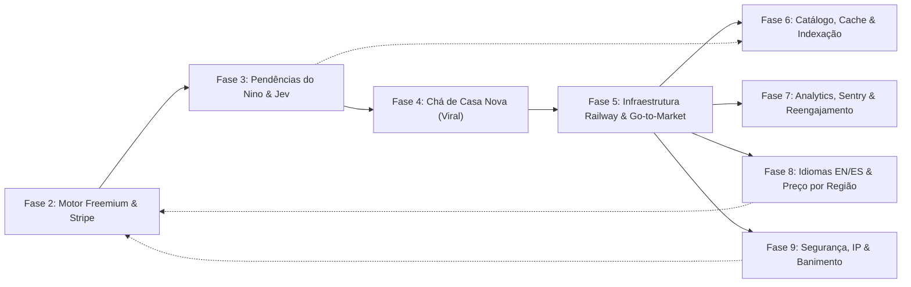

# Plano Faseado de Implementações Futuras: Casa Mia

> **Objetivo:** Estabelecer o roteiro técnico e de produto para transformar a base de código atual no aplicativo comercial do **Casa Mia**, com arquitetura Freemium, integração de pagamentos Stripe, motor de IA Jev (TypeSafe AI), mascote Nino e a página pública de Chá de Casa Nova.
>
> **Este documento lista só o que falta fazer.** O que já foi entregue está resumido na seção 1.

---

## 1. Estado Atual da Aplicação

### Já entregue (não repetido abaixo)
* **Base do produto:** ambientes e itens com status, quantidades e orçamento; exportação/importação Excel e CSV; funil de onboarding `/comecar` (rodando depois do cadastro em `/login`); autenticação com recuperação de senha, convite de membros por e-mail, área `/admin`; PostgreSQL e SQLite; e-mails transacionais via Resend (`server/mailer.ts`: recuperação, convite, senha alterada, feedback, oportunidade de preço).
* **Fase 1 (completa):** paleta `--cm-*`, tipografia Nunito + Fraunces, `Brand`, favicons e manifest, mascote Nino (`src/components/Nino.tsx`, poses em `public/brand/`), nova Home (`LandingPage.tsx` + `landing.css`). Desvios aceitos: Nunito no lugar de DM Sans; botão secundário "Ver como funciona" (não há demonstração). A Home já cita cobrança e limite de dicas de IA, que só passam a existir de fato nas Fases 2 e 3 (os limites de cômodos e itens já valem).
* **Fase 3 (base pronta):** `server/services/jev.ts` (cliente, cache de 10 min, teto diário `JEV_DAILY_LIMIT`, limiares de confiança) e `server/ai.ts` com `GET /api/ai/status`, `POST /api/ai/assess-item` (ambiente do item novo + aviso de compra redundante, numa só chamada), `POST /api/ai/recommend` e `POST /api/ai/prioritize` (régua de 8 níveis em `src/planning/purchaseUrgency.ts`, gravada em `items.ai_urgency`). Interface: `AddItemModal` e `NinoAssistant` no planejamento de compras. Fica desligada sem `TYPESAFE_API_KEY`; sem chave, erro ou confiança baixa tudo volta vazio. Também entregues: planejamento de compras e leitura de produtos/rastreio de preço.
* **Fase 2 (travas do plano gratuito prontas, sem cobrança):** coluna `users.plan` (`free` | `monthly` | `semiannual` | `annual` | `founder`). Contas que já existiam viraram `founder` (tudo liberado), uma única vez, na migração; contas novas nascem `free`. Regras e preços ficam em `src/plans.ts`, compartilhado pela landing e pelo paywall. Travas em `server/freemium.ts`, aplicadas em `server/routes.ts`:
  * Plano gratuito: **1 enxoval, 2 ambientes por enxoval e 5 itens por ambiente**. Recusas em `403` com `code`: `LIMIT_REACHED_ENXOVAIS`, `LIMIT_REACHED_ENVIRONMENTS` e `LIMIT_REACHED_ITEMS` (`HttpError` ganhou o campo `code`).
  * Vale o plano do **dono** do enxoval: convidados herdam os limites ou a liberação dele.
  * Sem contornos: criar item com um nome de ambiente novo conta como ambiente novo; mover um item para um ambiente cheio é recusado; repetir o nome de um ambiente existente não conta. A checagem trava a linha do enxoval na transação, então duas abas não passam juntas do limite.
  * O funil `/comecar` e o modelo padrão entram cortados no gratuito (os 2 primeiros ambientes, com os 5 primeiros itens). O passo final do funil avisa o corte antes de confirmar (`AuthUser.plan` no bootstrap).
  * Interface: `api.ts` dispara o evento `casamia:limit-reached` e o `PaywallDialog` (Nino, mensagem do plano, preços) abre por cima da janela atual, inclusive na importação de planilha. Sem Stripe, ainda não há botão de assinar: o texto diz que as assinaturas abrem em breve. `useDialogAccessibility` passou a responder ao teclado só na janela de cima.
  * Landing corrigida para "2 cômodos com até 5 itens cada" (antes dizia 10).
  * Teste: `npm run test:freemium-db` (no CI). Os testes de banco que cobrem outras funções põem as contas em plano pago.
* **Fase 6 (pronta, menos o autocomplete na planilha):** catálogo mestre compartilhado no Postgres (`server/catalog/`), com 1.115 itens curados em duas levas, 270+ apelidos e 23 grupos de função; faixa real de preço no planejamento e no alerta de preço; Redis opcional (L3) para várias instâncias; normalização única em `src/catalog/normalize.ts`; cascata exato → similar (≥ 0,8) → Jev desempata → Jev infere item novo (pendente de revisão), com os passos do Jev fora da requisição; urgência por faixa de perfil compartilhada entre enxovais; prazo de entrega no planejamento; faixas de preço por UF e Brasil (k ≥ 5, sem extremos, só agregados); autocomplete no `AddItemModal`; painel no `/admin`; rotina `npm run catalog:refresh`. Detalhes e pendências na própria Fase 6.
* **Documentos de planejamento** das Fases 7 a 9 já escritos (links nas fases).

### O que ainda NÃO existe
1. **Pagamentos:** integração com a Stripe pronta (`server/billing.ts`): Checkout hospedado, Customer Portal e webhook assinado (`/api/billing/webhook`), o único caminho que muda o plano. Dois planos pagos: **Mensal** (R$ 29,90, assinatura em `users.plan`) e **Passe da Casa Nova** (R$ 99, pagamento único, 12 meses sem renovação, em `users.pass_expires_at`; o plano em vigor sai de `effectivePlanSql`, então o Passe expira sozinho). Comprar o Passe cancela o mensal e, se já houver Passe, soma 12 meses ao que resta. Limite gratuito: 1 enxoval, 2 ambientes, 10 itens por ambiente. Configuração em `.env.example` (`STRIPE_*`); teste: `npm run test:billing-db`. Ainda faltam também o limite de 3 consultas mensais ao Nino e o bloqueio de convites e do Chá de Casa Nova no plano gratuito, além de Pix e notas fiscais.
2. **Chá de Casa Nova:** sem rotas públicas, tabela ou Pix (Fase 4).
3. **Produção:** sem Dockerfile, domínio próprio, e-mails de boas-vindas/presente/resumo, NFS-e e depósito de marca (Fase 5).
4. **Catálogo compartilhado (restante):** autocomplete do catálogo na importação por planilha (Fase 6).
5. **Analytics, atribuição e reengajamento:** sem PostHog, GA4 nem Sentry (Fase 7).
6. **Idiomas e preço por região:** app só em português e reais (Fase 8).
7. **Segurança e banimento:** não grava IP nem aparelho, não verifica e-mail, só liga/desliga conta (Fase 9).

---

## 2. Roadmap Faseado de Implementação

---

### FASE 2: Motor Freemium, Travas de Limite & Integração Stripe

Esta fase monetiza a plataforma: as travas do plano gratuito e o paywall já existem (ver seção 1); falta cobrar via Stripe.

> **Já feito:** `users.plan`, travas de enxovais, ambientes e itens com os códigos `LIMIT_REACHED_*`, corte do conteúdo inicial, contas antigas como `founder` e o `PaywallDialog`. Pendências:

#### 2.1 Dados da assinatura e travas restantes
* **Campos que faltam (`users` ou tabela `subscriptions`):**
  * `subscription_status`: `'active'` | `'trialing'` | `'past_due'` | `'canceled'`
  * `stripe_customer_id`: string
  * `stripe_subscription_id`: string
  * `nino_ai_credits_used`: integer (reseta mensalmente), para o limite de 3 consultas mensais do gratuito (ver 3.1).
* **Colaboração no gratuito:** a landing diz que a lista a dois e o Chá de Casa Nova são dos planos pagos, mas convites ainda funcionam no gratuito. Decidir se bloqueia (e o que acontece com convidados de quem volta ao gratuito).
* **Rebaixamento:** quando a assinatura cai (`customer.subscription.deleted`), o que já foi cadastrado acima do limite fica guardado e só a criação de novos é barrada (comportamento atual das travas). Confirmar se é isso que queremos.

#### 2.2 Botões de assinatura no paywall
* Hoje o `PaywallDialog` mostra os preços com um "Entendi". Trocar por botões de plano (Mensal, Semestral com desconto, Anual) que chamam o checkout da Stripe.
* Ilustração do Nino com as chaves na mão (hoje usa a pose `wave`).

#### 2.3 Integração com Stripe Brasil
* **Configuração no Stripe Dashboard:**
  * Criar os 3 preços em BRL com renovação recorrente (`month` / `year`).
* **Endpoints Backend:**
  * `POST /api/billing/create-checkout-session`: recebe o `planId`, cria uma sessão no `Stripe Checkout` com suporte a Cartão de Crédito e Pix, e retorna a URL de redirecionamento.
  * `POST /api/billing/webhook`: rota segura que escuta eventos essenciais:
    * `checkout.session.completed` → ativa a assinatura e libera limites ilimitados.
    * `invoice.payment_succeeded` → renova o ciclo e zera contadores.
    * `customer.subscription.deleted` → rebaixa a conta para `'free'`.
  * `POST /api/billing/customer-portal`: gera a URL do **Stripe Customer Portal** para que o usuário altere cartão, consulte faturas ou cancele sem necessidade de telas customizadas.
* **Frontend:** Botão "Minha Assinatura" no menu do usuário abrindo o portal da Stripe.

---

### FASE 3: Motor de IA Jev (TypeSafe AI) & Mascote Nino na Interface

Esta fase transforma o Casa Mia em um assistente proativo que pensa com inteligência prescritiva.

> **Já feito:** rotas `assess-item`, `recommend` e `prioritize`, cliente `jev.ts` e `NinoAssistant` (ver seção 1). Pendências:

#### 3.1 Limite de consultas por plano
* Limitar o Nino/Jev a 3 consultas mensais em contas `'free'`, usando `nino_ai_credits_used` (depende da Fase 2). O teto diário global `JEV_DAILY_LIMIT` já existe.

#### 3.2 Estados visuais do Nino na interface
* Três estados em `NinoAssistant`: *Pensativo* (com trena/prancheta), *Comemorando* (ao riscar itens), *Descansando no arco* (quando o cômodo atinge 100%). Hoje só há as poses de arte do componente `Nino`, sem ligação a esses eventos.
* Balãozinho do Nino dentro da visualização do ambiente (hoje as dicas só aparecem no planejamento de compras).

#### 3.3 Chave em produção
* Criar `TYPESAFE_API_KEY` no servidor para ligar o Jev (hoje desligado).

---

### FASE 4: Página Pública de Chá de Casa Nova (Viral Loop)

A funcionalidade que transforma convidados em novos clientes da plataforma.

#### 4.1 Estrutura de Banco de Dados
* Nova tabela `housewarming_lists`:
  * `id`: uuid
  * `user_id`: uuid
  * `slug`: text unique (ex.: `lar-da-ana-e-leo`)
  * `title`: text (*"Chá de Casa Nova da Ana e do Léo"*)
  * `message`: text (*"Estamos montando nosso cantinho e ficaremos muito felizes com a sua presença e carinho!"*)
  * `event_date`: timestamp
  * `pix_key`: text (chave Pix do casal)
  * `pix_key_type`: text (`cpf`, `email`, `phone`, `random`)
  * `is_public`: boolean

#### 4.2 Interface Pública do Chá (`/cha/:slug`)
* Página de visualização pública, leve e responsiva (sem necessidade de cadastro do convidado).
* **Ações do Convidado:**
  1. **"Vou presentear com este item":** o convidado informa seu nome e e-mail; o item é marcado como "Reservado/Presenteado" na lista em tempo real.
  2. **"Presentear via Pix":** gera o QR Code e código copia-e-cola direto com a chave Pix cadastrada pelos moradores.
  3. **Deixar Recado de Boas-Vindas:** campo de texto onde o convidado deixa uma mensagem de afeto.
* **Experiência do Anfitrião:**
  * O morador recebe notificação no app: *"Maria reservou o Jogo de Pratos para a sua Cozinha e deixou um recado!"*.
* **Rodapé Viral:**
  * Em destaque no final da página: *"Lista organizada com amor no Casa Mia. Monte o seu enxoval também! [Começar Grátis]"*.

---

### FASE 5: Infraestrutura Railway, Automação Fiscal e Lançamento

> **Já existe:** envio via Resend (`server/mailer.ts`) e variáveis `APP_URL`/`RESEND_API_KEY`/`MAIL_FROM` documentadas para Railway no README. Confirmar o que já está provisionado antes de fechar esta fase.

#### 5.1 Hospedagem no Railway
* Dockerfile do serviço Node.js/Fastify (não existe no repositório).
* PostgreSQL dedicado com backups diários automáticos.
* Domínio personalizado (`app.casamia.com.br` ou `casamiaapp.com.br`).

#### 5.2 E-mails Transacionais com Resend Pro
* Autenticação DNS do domínio (SPF, DKIM e DMARC).
* Templates novos com a assinatura do Nino: boas-vindas e ativação de conta, presente recebido no Chá de Casa Nova e resumo mensal de conquistas. (Os e-mails de recuperação, convite, senha alterada, feedback e oportunidade de preço já existem.)

#### 5.3 Automação Fiscal e Registro de Marca
* Integrar o webhook da Stripe com serviço de NFS-e (Focus NFe ou PlugNotas).
* Depósito de marca mista no INPI nas classes 9, 35 e 42.

---

### FASE 6: Camada de Cache, Catálogo Compartilhado e Indexação de Itens

> **Pode (e deve) ser antecipada:** depende só da Fase 3 e reduz o custo dela. A ordem na matriz é a de menor risco de produto, não a de menor valor.

> **Status: implementada (base).** Duas sessões implementaram esta fase em paralelo; a versão final junta o melhor das duas (ver "Fusão" no fim deste bloco). O que existe e onde:
> * **Normalização única** em `src/catalog/normalize.ts` (`foldText`, `normalizeText`, `itemKey`, trigramas): substitui as cópias de `purchasePlan.ts`, `regional.ts`, `importItems.ts` e `jev.ts`. `itemKey` tira acento, caixa, palavras vazias, medidas ("5 litros", "2 portas"), qualificadores ("de casal", cor) e marcas, e passa para o singular.
> * **Tabelas** (`server/migrations.ts`): `catalog_items` (com `slug` e `translations` para a Fase 8), `catalog_item_aliases`, `catalog_item_urgency`, `catalog_price_stats`, `catalog_negative_cache`, `catalog_metrics_daily`, `catalog_seed_state` e `items.catalog_item_id`.
> * **Semente** (`server/catalog/seed.ts` e `seed-v2.ts`): **1.115 itens** aprovados em duas levas (481 do funil e da primeira lista curada, 634 da segunda), 270+ apelidos e 23 grupos de função. Cada item sabe em que leva entrou: um banco já semeado recebe só as levas mais novas, sem ressuscitar o que a equipe apagou ou mesclou. Para crescer, crie `seed-v3.ts` (uma linha por item: `"Nome|faixa|marcas|apelidos|semanas"`) e suba `CATALOG_SEED_VERSION`.
> * **Faixa real de preço no planejamento:** o item traz a faixa do catálogo (a da UF do enxoval, se houver amostra; senão a do Brasil), e ela substitui a faixa genérica do perfil de gasto: econômico de p10 à mediana, equilibrado de p10 a p90, confortável da mediana a p90; o premium segue na faixa genérica (quem compra premium paga acima do que as listas registram). A tela diz "outras listas pagam R$ X a R$ Y" e marca "acima do comum" quando o preço registrado passa da faixa. O total do enxoval e a distribuição do gasto por semana também usam a faixa real.
> * **Faixa real no alerta de preço:** além do menor preço da história e do preço-alvo, a rotina de preços avisa quando a loja chega ao p10 da faixa comum ou abaixo ("mais barato do que outras listas costumam pagar"), e todo e-mail de preço mostra a faixa comum quando ela existe.
> * **Redis opcional (L3, `server/cache/shared.ts`):** com `REDIS_URL`, as respostas do Jev ficam compartilhadas (1 dia, `JEV_SHARED_CACHE_TTL_S`), o teto diário do Jev é somado entre instâncias e uma instância avisa as outras quando o catálogo muda. Sem ele, ou com ele fora do ar, cada processo segue com o próprio cache e nada trava (comandos não esperam reconexão; depois de uma falha, 30 s sem tentar). Local: `npm run redis:up`. Teste: `npm run test:shared-cache`.
> * **Cascata** (`server/catalog/store.ts`): exato → similaridade ≥ 0,8 (vira apelido) → faixa 0,4–0,8, em que o Jev escolhe entre 5 candidatos ou "nenhum" (vira apelido) → nada parecido, em que o Jev infere tudo numa única chamada e o item nasce `pending_review` (ou vai para o cache negativo de 30 dias). Os passos 1 e 2 rodam no cadastro e na edição de itens e no funil. Os passos 3 e 4 rodam numa fila fora da requisição (nunca enquanto a pessoa digita).
> * **Ajuda do Nino sem Jev para itens conhecidos:** `POST /api/ai/assess-item` responde pelo catálogo (cômodo e compra repetida por grupo de função ou mesmo item) e devolve a faixa de preço. O Jev só entra para nomes desconhecidos. `POST /api/ai/prioritize` usa a nota da **faixa de perfil** (moradia × clima × situação, 27 faixas); `items.ai_urgency` virou espelho. Itens livres seguem com nota própria.
> * **Planejamento:** o item herda faixa de preço, prioridade, momento e **prazo de entrega** do catálogo, e o prazo antecipa a semana de compra (ex.: cama com 3 semanas de entrega é comprada 4 semanas antes).
> * **Busca:** `GET /api/catalog/search?q=` (prefixo do nome, apelidos e trigramas) alimenta o autocomplete do `AddItemModal`, que também mostra "Faixa comum: R$ X a R$ Y" e avisa preço acima do comum. A leitura de link de loja usa o cômodo do catálogo (`suggestedRoom`), e o regex de `suggestCategory` ficou como reserva.
> * **Rotina** (`server/workers/catalogWorker.ts`, a cada 6 h em produção, ou `npm run catalog:refresh`): liga itens antigos, promove itens que aparecem em ≥ 5 enxovais (`source = users`, aguardando revisão) e publica faixas de preço p10/p50/p90 por UF e Brasil (um valor por enxoval, extremos fora pela regra do IQR, só com k ≥ 5, só agregados). `--urgency` pré-calcula as notas por faixa em lote (chama o Jev, com `--limit`).
> * **/admin:** métricas (itens resolvidos sem Jev, urgências vindas do catálogo, consultas ao Jev por pessoa ativa, itens sem estimativa) e fila de revisão com aprovar, corrigir, **completar com o Jev** (uma consulta preenche o que falta, a equipe ainda aprova), mesclar, recusar e desfazer apelidos.
> * **Privacidade:** o catálogo guarda só nomes de itens e agregados, e nomes que parecem dado pessoal (e-mail, link, números longos) não entram. A página de privacidade explica o catálogo.
> * **Testes:** `npm run test:catalog` (sem banco) e `npm run test:catalog-db` (cascata com Jev falso, urgência compartilhada entre dois enxovais, preços, rotina e /admin).
>
> **Desvios do texto abaixo:**
> * **Similaridade em memória, e não com `pg_trgm`/`unaccent`.** O catálogo cabe na memória (L1, recarregado a cada 60 s ou na hora em que este processo grava), a similaridade é a mesma do pg_trgm (trigramas e Jaccard) e a normalização fica idêntica à do app. Também não depende de extensões, que quebram nos schemas descartáveis dos testes. Se o catálogo passar de dezenas de milhares de itens, vale migrar para `pg_trgm`.
> * **Faixas de preço recalculadas por inteiro** a cada rodada, e não de forma incremental: barato nesse volume.
>
> **Fusão das duas versões:** ficaram desta a cascata fora da digitação (a outra criava um item pendente para cada rascunho digitado, como "Gela"), a urgência pedida ao Jev só com a faixa de perfil, a semente versionada maior, as faixas por UF e as métricas em lote. Da outra ficaram o texto da pergunta de urgência sem o prazo até a mudança (régua v3), os prazos de entrega de móveis (guarda-roupa, sofá e mesa de jantar em 6 semanas), o filtro de privacidade, o parágrafo da página de privacidade e o "completar com o Jev" do /admin. A primeira versão do esquema, já publicada em homologação, é descartada e recriada uma única vez pela migração (só dados derivados).
>
> **Ainda não feito:** autocomplete do catálogo na importação por planilha. **Na Railway:** o Redis só vale a pena quando houver mais de uma instância; ao ligá-lo, configure `REDIS_URL` (e `REDIS_KEY_PREFIX` diferente se homologação e produção dividirem o mesmo Redis).

**Problema.** Hoje o conhecimento sobre um item morre dentro do enxoval que o gerou. A nota de urgência fica em `items.ai_urgency` (por item, por enxoval) e o cache de `server/services/jev.ts` é em memória, por processo, com 10 minutos de vida: reinicia no deploy e não é compartilhado entre instâncias. Se mil pessoas cadastram "Geladeira", o Jev é consultado mil vezes para chegar à mesma resposta. O catálogo do funil (`src/onboarding/catalog.ts`, 244 entradas) só é consultado por nome idêntico (`matchCatalog`), e a sugestão de ambiente de links de lojas é um conjunto de regex (`suggestCategory`).

**Princípio.** O Jev deve ser consultado só quando o item **não existe** no banco. Tudo o que já foi descoberto uma vez vira conhecimento compartilhado, indexado e de leitura em milissegundos. O Jev passa a ser o último degrau de uma cascata, e também o juiz de dúvidas de deduplicação.

#### 6.1 Catálogo mestre de itens (`catalog_items`)
* Tabela global (sem `user_id` nem `enxoval_id`) com os **1.000+ itens mais comuns** de uma casa nova, semeada a partir do `CATALOG` atual, de uma lista curada e dos itens já cadastrados (deduplicados):
  * `id`, `canonical_name`, `normalized_name` (único), `room` (cômodo), `priority` (essencial/opcional), `timing` (primeira noite/semana), `lead_time_weeks` (entrega e montagem), `price_category` (1 a 4) e `function_group` (ver 6.4).
  * `source` (`curated` > `users` > `jev`) e `status` (`approved`, `pending_review`), para que o que o Jev inventar nunca valha mais que o que a equipe revisou.
* Tabela `catalog_item_aliases` (`item_id`, `alias_normalized`, `source`): "fritadeira elétrica", "airfryer" e "air fryer" apontam para o mesmo item. Cada vez que a deduplicação resolve uma dúvida, o apelido novo é gravado e a mesma dúvida não volta a existir.
* `items.catalog_item_id` (nulo permitido): liga o item do enxoval ao catálogo. Itens livres continuam existindo; só não herdam estimativas.

#### 6.2 Estimativas padrão por perfil, inferidas uma vez
* A urgência depende do perfil (moradia, moradores, clima), e não da pessoa. Guardar a nota por **faixa de perfil** em `catalog_item_urgency` (`item_id`, `profile_bucket`, `urgency`, `confidence`, `rubric_version`), em vez de por item de cada enxoval.
  * Faixas sugeridas: moradia (apartamento/casa/studio) × clima (quente/ameno/frio) × situação (casal/solo/outros). O prazo até a mudança deixa de entrar na nota do Jev e passa a ser combinado em código com a `lead_time_weeks`, que é determinística.
* O Jev só é chamado quando falta a linha da faixa. `items.ai_urgency` vira apenas um espelho de leitura rápida, e a `URGENCY_RUBRIC_VERSION` continua invalidando tudo de uma vez.
* Pré-calcular em lote (um job, como `server/workers/track-prices.ts`) as faixas dos 1.000 itens: custo único, controlado e previsível, em vez de gasto sob demanda.

#### 6.3 Faixas de preço reais, vindas de quem usa
* Tabela `catalog_price_stats` (`item_id`, `region` opcional, `p10`, `p50`, `p90`, `samples`, `updated_at`), alimentada por um job que agrega os preços cadastrados pelas pessoas e os preços lidos de lojas (`product_price_snapshots`).
* Regras de qualidade e privacidade: só publicar com amostra mínima (k ≥ 5 enxovais distintos), descartar valores fora de faixa (IQR), guardar **apenas agregados**, sem ligação com usuário ou enxoval, e atualizar de forma incremental.
* Uso: o formulário mostra "faixa comum: R$ X a R$ Y" e o planejamento troca as faixas genéricas por perfil de gasto pela faixa real do item quando houver amostra. Também alimenta o alerta de preço e a comparação "este preço está acima do comum".

#### 6.4 Deduplicação e busca rápida
* **Normalização** compartilhada num único lugar (hoje há cópias em `purchasePlan.ts`, `regional.ts`, `importItems.ts` e `jev.ts`): sem acento nem caixa, singular/plural, remoção de qualificadores ("de casal", "5L", marca) e de palavras vazias.
* **Índices no Postgres:** extensões `pg_trgm` e `unaccent`, índice GIN de trigramas em `normalized_name` e nos apelidos, e índice por `room`. Busca por prefixo e por similaridade em dezenas de milissegundos, sem rede externa.
* **Cascata de resolução** ao cadastrar ou importar um item:
  1. Acerto exato por nome normalizado ou apelido → usa o catálogo, **zero** consulta ao Jev.
  2. Similaridade de trigramas alta (≥ 0,8) → mesmo item; grava o apelido.
  3. Similaridade intermediária (0,4 a 0,8) → **pergunta ao Jev** com uma `choice` entre os 5 candidatos mais próximos e a opção "nenhum deles". Se escolher um, grava o apelido; se não, segue.
  4. Nada parecido → cria o item no catálogo com `status = pending_review`, pede ao Jev uma única inferência (cômodo, prioridade, prazo, grupo de função) e grava.
* **Grupos de função** (`function_group`, como "fritura sem óleo": airfryer, fritadeira elétrica): o aviso de compra redundante passa a ser uma consulta ao banco ("já existe item deste grupo na lista?"), sem Jev. O Jev só atribui o grupo na hora de criar um item novo no catálogo.
* **Busca instantânea:** `GET /api/catalog/search?q=` (prefixo + trigramas) alimenta o autocomplete do `AddItemModal` e da importação por planilha, e substitui o regex de `suggestCategory` e os `HEADER_ALIASES` como fonte de ambiente.

#### 6.5 Camadas de cache e operação
* **L1** em memória por processo (já existe; passa a ser um LRU pequeno só para os itens quentes), **L2** o catálogo no Postgres (fonte durável e compartilhada) e, se houver mais de uma instância na Railway, **L3** um Redis opcional para o limite de chamadas e para o cache de respostas do Jev, que hoje são por processo.
* **Cache negativo** (por exemplo, "este nome não é um item de casa") com TTL, para entradas sem sentido não reconsultarem o Jev.
* **Painel no `/admin`:** fila de itens `pending_review` (aprovar, renomear, mesclar), ferramenta de mesclar duplicados (move apelidos e vínculos) e métricas: **taxa de acerto do catálogo**, consultas ao Jev por dia, custo por usuário ativo e itens sem estimativa.
* **Meta:** ao menos 90% das resoluções de item e de urgência atendidas sem chamar o Jev depois de alguns meses de uso; o Jev fica restrito a itens realmente novos e a dúvidas de deduplicação.

#### 6.6 Riscos e cuidados
* **Mesclar o que é diferente** ("panela" e "panela de pressão"): limiares conservadores, o Jev decide a faixa de dúvida e há revisão humana de tudo que o Jev criou. Todo apelido tem `source` e pode ser desfeito.
* **Preço enviesado** por poucos dados ou valores digitados errado: amostra mínima, aparar extremos e mostrar a faixa só com `samples` suficientes.
* **Privacidade (LGPD):** o catálogo só guarda nomes de itens e agregados; nenhum dado de pessoa ou enxoval. Atualizar a página de privacidade quando o recurso entrar.
* **Partida a frio:** a semeadura dos 1.000+ itens evita que os primeiros usuários paguem a conta de todas as consultas.

---

### FASE 7: Analytics, Funil de Aquisição, Monitoramento de Erros e Reengajamento

> **Documentação de implementação completa:** [`analytics-funil-e-reengajamento.md`](./analytics-funil-e-reengajamento.md). **Deve vir antes de qualquer gasto com anúncios:** dado de origem que não foi coletado não volta.

Os leads virão de busca orgânica e de anúncios. Esta fase instala **PostHog** (comportamento no produto), **GA4 via Google Tag Manager** (origem, campanhas, Google Ads e Search Console) e **Sentry** (erros e lentidão), e transforma o que se aprende em **disparos de reengajamento** com gatilhos vindos do próprio banco (data da mudança, itens atrasados, inatividade).

#### 7.1 Fundação e privacidade
* Módulo `src/analytics/` com um único `track()` e dicionário tipado de eventos; banner de consentimento com **Google Consent Mode v2**; página de privacidade atualizada; proxy próprio (`/ingest`, `/monitoring`) contra bloqueadores; ambientes separados e testes com análise desligada.
* Regra: o PostHog **não recebe e-mail, nome, IP nem texto livre**, só `user_id` e categorias.

#### 7.2 Sentry
* Navegador e servidor, source maps privados, filtro que remove senha e cookies, Sentry Crons nas rotinas agendadas e alertas por versão.

#### 7.3 Atribuição orgânica e paga
* Convenção de UTM, `channel_group` calculado no servidor, primeiro toque guardado em `users` (`acq_*`, `gclid`, `ga_client_id`), eventos-chave no GA4 e conversões enviadas pelo servidor quando houver pagamento (otimizar anúncio por receita real). SEO técnico mínimo para o orgânico.

#### 7.4 Eventos, funis e dashboards
* Dicionário de eventos do funil `/comecar` (24 etapas), ativação (item conquistado), colaboração, Nino e receita; eventos de valor emitidos pelo servidor.
* Funis F1 a F6, retenção semanal, definição de **ativação** a calibrar e perguntas de negócio que o funil responde.

#### 7.5 Motor de ciclo de vida (reengajamento e disparos)
* Worker no estilo de `priceTrackerWorker`, tabelas `lifecycle_messages`/`lifecycle_events`, consentimento de marketing separado, central de preferências, descadastro com um clique e limite de frequência.
* Fluxos: retomar o funil, primeiro valor, **contagem regressiva da mudança** (T-12 a T+1 semanas, o mais valioso), atrasos, queda de preço, inatividade, marcos, convite parado, pós-mudança, remarketing pago e upgrade.
* **Grupo de controle de 10%** em cada fluxo para medir o efeito real. Campanhas pontuais por segmento em `/admin`.

---

### FASE 8: Idiomas (Inglês e Espanhol) e Preço por Região

> **Documentação:** [`internacionalizacao-regiao-e-seguranca.md`](./internacionalizacao-regiao-e-seguranca.md), partes A e B.

#### 8.1 Três idiomas no app inteiro
* Português (base), **inglês e espanhol** em interface, landing, funil, e-mails, erros do servidor, catálogo, planilhas, textos legais e Nino. Medido hoje: **54 arquivos / ~1.365 linhas** de texto em português, **130** mensagens de erro do servidor e **13** e-mails.
* Infra com `i18next`, chaves tipadas, teste de paridade entre idiomas, pseudolocalização, erros do servidor por **código** e URLs por idioma com `hreflang`. **A infra vem primeiro: nenhum texto novo entra fixo no código.**
* Não é só tradução: o catálogo ganha `slug` por item com traduções (a Fase 6 já nasce assim), a geografia e o clima deixam de ser só Brasil (país → região → cidade, hemisfério) e o conceito de "enxoval" é adaptado a cada mercado.

#### 8.2 Preço por região e segregação regional
* Tabelas `regions`, `region_countries` e `plan_prices` (preço versionado por região e moeda), integradas à Stripe com várias moedas, impostos (Stripe Tax) e meios de pagamento locais; NFS-e só no Brasil.
* País de cobrança confirmado no pagamento e anti-abuso de preço regional (VPN, cartão de outro país). Países bloqueados.
* Segregam-se por região: preços e moedas, impostos, textos legais e consentimento, pacote de itens, relatórios e modelos de e-mail. A conta continua global.

---

### FASE 9: Confiança, Segurança e Proteção contra Abuso (IP, Dispositivo e Banimento)

> **Documentação:** [`internacionalizacao-regiao-e-seguranca.md`](./internacionalizacao-regiao-e-seguranca.md), parte C. **Registrar antes de cobrar (Fase 2):** dado de segurança que não foi gravado não pode ser recuperado depois do incidente.

Hoje o app **não grava IP nem user-agent**, as sessões não têm metadados, não há verificação de e-mail e o único bloqueio é `users.is_active`.
* **Coleta com finalidade e prazo:** tabela `auth_events` (IP, país, provedor, aparelho, resultado), metadados em `sessions`, `user_devices` com `device_id` próprio, prova de consentimento. IP bruto por 6 meses e depois anonimizado por rotina diária.
* **Banimento:** `users.status`, tabela `bans` (conta, IP, faixa, aparelho, domínio de e-mail, país), sessões encerradas na hora, motivo e prazo registrados, recurso e reversão.
* **Prevenção:** verificação de e-mail, limites persistentes (hoje reiniciam a cada deploy), Cloudflare/Turnstile, lista de e-mails descartáveis, alertas.
* **Painel `/admin`:** ficha da conta com linha do tempo de segurança, contas relacionadas, fila de abuso e trilha de auditoria.
* **Conformidade:** base legal (legítimo interesse documentado), guarda de registros de acesso (Marco Civil), política de privacidade, direito de revisão humana, segurança dos próprios logs e plano de incidente.

---

## 3. Matriz de Prioridade e Sequência de Execução

| Ordem | Entregável | Impacto Principal | Complexidade |
|:---:|---|---|:---:|
| **2º** | **Fase 2:** Checkout Stripe (travas do Freemium 2 cômodos / 5 itens já prontas) | Monetização e Negócio | Média |
| **3º** | **Fase 3 (restante):** Limite por plano, estados do Nino e balão no ambiente, chave do Jev em produção | Retenção e Diferencial | Média-Alta |
| **4º** | **Fase 4:** Página pública de Chá de Casa Nova com Pix e Reservas | Crescimento Viral | Média |
| **5º** | **Fase 5:** Deploy Railway + Resend Pro + Emissão Fiscal Automática | Escala e Estabilidade | Média |
| **6º** | **Fase 6:** Catálogo mestre de 1.000+ itens, faixas de preço reais, deduplicação e busca indexada (Jev só para o que não existe) | Custo de IA, Velocidade e Qualidade dos Dados | Média-Alta |
| **7º** | **Fase 7:** PostHog + GA4 (Tag Manager) + Sentry, atribuição orgânica/paga, funis e motor de reengajamento | Aquisição, Ativação e Retenção | Média-Alta |
| **8º** | **Fase 8:** Inglês e espanhol no app inteiro + preço, impostos e conteúdo por região | Novos Mercados e Receita | Alta |
| **9º** | **Fase 9:** Registro de IP/aparelho, banimento, verificação de e-mail e painel antiabuso | Proteção e Confiança | Média |

> **A ordem acima é de menor risco de produto, não de valor.** A Fase 9 (começar a registrar com política pronta) e a Fase 7 (instalar antes de comprar anúncios) devem ser **antecipadas** para antes da Fase 2; a infraestrutura de idiomas da Fase 8 (nenhum texto novo fixo no código) também deve começar já, porque o custo de extração cresce a cada tela nova. Tabelas de região e preço da Fase 8 e o antifraude da Fase 9 são pré-requisitos da cobrança da Fase 2.

> A Fase 6 pode começar logo depois da Fase 3: quanto antes existir o catálogo, menos o Jev é consultado, e as estimativas gravadas passam a valer para todos os enxovais.
