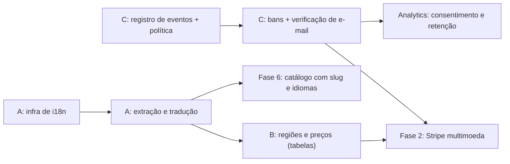

# Internacionalização, Preço por Região e Segurança contra Abuso

> **Objetivo:** preparar o Casa Mia para (A) funcionar inteiro em **português, inglês e espanhol**; (B) cobrar **preços diferentes por região**, separando preço, impostos, textos legais e relatórios por região; (C) **coletar os dados de segurança certos** (IP e sinais de dispositivo) para banir quem abusa e proteger o produto, com base legal e retenção definidas.
>
> **Status:** planejamento. Nada disto existe hoje. Os três temas se apoiam entre si: o país da pessoa define o idioma padrão, o preço e a regra de privacidade; os dados de segurança alimentam a decisão de cobrança e de banimento.
>
> Documento irmão: [`analytics-funil-e-reengajamento.md`](./analytics-funil-e-reengajamento.md) (idioma, país e moeda viram dimensões de análise; o consentimento é o mesmo).
>
> **Aviso:** as partes B.6 e C.9 tocam em LGPD, Marco Civil da Internet, impostos e, ao vender fora do Brasil, em leis de outros países. É orientação técnica, não parecer jurídico. Valide com advogado antes de coletar ou cobrar.

---

# PARTE A: Idiomas (português, inglês e espanhol)

## A.1 Diagnóstico do que existe

| Item | Situação medida no código |
|---|---|
| Textos em português nas telas | **54 arquivos** em `src/` e cerca de **1.365 linhas** com texto em português (landing, funil de 24 etapas, planejamento, Nino, central de ajuda, privacidade, administração) |
| Mensagens de erro do servidor | **130 chamadas** a `HttpError(...)` com texto em português, que o navegador mostra como estão |
| E-mails | **13** modelos em `server/mailer.ts` (redefinição de senha, convite, aviso de preço, central de ajuda...) |
| Formatação | **42** pontos com `pt-BR` ou `BRL` escritos à mão (moeda, data, número) |
| Catálogo de itens | 244 itens com nome em português, usados como **identidade** do item (`matchCatalog` compara pelo nome) |
| Geografia e clima | Só Brasil: `STATES` (UFs), `CITIES`, `NORDESTE`, itens regionais por UF, e estações do ano para o **hemisfério sul** (`SEASONS`) |
| Importação e exportação | Cabeçalhos de planilha só em português (`HEADER_ALIASES`, `STATUS_ALIASES`) |
| Lojas lidas por link | Lojas brasileiras (Mercado Livre BR, Magalu, Leroy...) e tensão `110V/220V` |
| Nino e Jev | Perguntas, critérios e rótulos em português (`src/planning/purchaseUrgency.ts`, `server/services/jev.ts`) |
| Conteúdo cultural | "Enxoval", "chá de casa nova" e "chá de panela" são costumes brasileiros e não têm tradução direta |

**Conclusão:** não é só trocar textos. É preciso (1) extrair ~1.400 textos, (2) deixar o servidor falar por códigos, (3) separar a identidade dos itens do idioma, (4) generalizar geografia e clima, e (5) adaptar o produto ao que cada mercado chama de enxoval.

## A.2 Escopo: o que "o app inteiro" cobre

| Superfície | Pt-BR (base) | Inglês | Espanhol | Observação |
|---|:---:|:---:|:---:|---|
| Interface do app (`App.tsx` e componentes) | ✔ | ✔ | ✔ | Maior volume |
| Landing, preços e páginas públicas | ✔ | ✔ | ✔ | Com URL por idioma e `hreflang` (SEO) |
| Funil `/comecar` (24 etapas) | ✔ | ✔ | ✔ | Perguntas e **opções** mudam por país (A.9) |
| Mensagens de erro e validação do servidor | ✔ | ✔ | ✔ | Via códigos de erro (A.5) |
| E-mails transacionais e de ciclo de vida | ✔ | ✔ | ✔ | Idioma salvo na conta |
| Catálogo de itens e planos gerados | ✔ | ✔ | ✔ | Tradução por item, não por frase solta (A.6) |
| Importação/exportação de planilhas | ✔ | ✔ | ✔ | Cabeçalhos e situações por idioma |
| Nino (Jev): rótulos, respostas e perguntas | ✔ | ✔ | ✔ | Ver A.7 |
| Termos, privacidade, aviso de cookies | ✔ | ✔ | ✔ | Texto de cada jurisdição, revisado por advogado |
| Central de ajuda | ✔ | ✔ | ✔ | Mensagens da equipe podem seguir em um idioma interno |
| Painel `/admin` | ✔ | — | — | Interno: pode ficar em português |

Variantes regionais: **inglês** começa como `en` com formatos pelo país (EUA, Reino Unido, Canadá, Austrália); **espanhol** começa como `es` neutro da América Latina, e a variante da Espanha (`es-ES`) entra se houver mercado lá. Português de Portugal (`pt-PT`) não foi pedido, mas é um mercado natural: o desenho abaixo permite acrescentar.

## A.3 Arquitetura

* **Biblioteca:** `i18next` com `react-i18next` (maduro, carregamento sob demanda, plurais). Alternativas: Lingui ou FormatJS (react-intl). Escolher uma antes de começar.
* **Arquivos:** `src/i18n/<idioma>/<namespace>.json`, com namespaces `common`, `landing`, `auth`, `onboarding`, `app`, `planning`, `nino`, `emails`, `errors`, `legal`. Carregar só o idioma e o namespace da tela (a landing não precisa carregar o painel).
* **Regras de texto:**
  * Chaves estáveis e descritivas (`planning.overdue.title`), nunca o texto em português como chave.
  * **Sem concatenar frases** (a ordem das palavras muda entre idiomas). Usar parâmetros: `"{{count}} itens atrasados"`.
  * **Plurais** pelas regras do idioma (`Intl.PluralRules`), não por `count === 1`.
  * Tratamento de gênero e formalidade decidido por idioma (no espanhol, `tú` ou `usted`, a definir pela marca).
* **Tipagem:** chaves tipadas (o compilador recusa chave inexistente) e um teste que **falha se um idioma tiver chave a menos** que o português.
* **Pseudolocalização:** um idioma de teste (`pseudo`) que alonga e marca os textos, para achar texto não extraído e quebras de layout (alemão e espanhol são mais longos que o português).
* **Fluxo de tradução:** português como fonte; rascunho em inglês e espanhol por tradução automática; **revisão humana** nativa; glossário de marca (Casa Mia, Nino, termos do produto). Texto jurídico e de e-mail sempre com revisão humana.

## A.4 Detecção e persistência do idioma
Ordem de decisão: **preferência salva na conta** (`users.locale`) → prefixo da URL em páginas públicas → cookie de preferência → `Accept-Language` do navegador → português.

* **Páginas públicas por idioma:** `/` (português), `/en/`, `/es/`, com `<link rel="alternate" hreflang>`, `canonical`, `sitemap.xml` por idioma, `<html lang>` correto e imagens de compartilhamento (Open Graph) traduzidas. Sem isso o orgânico em inglês e espanhol não existe.
* **Área logada (`/app`):** usa o idioma da conta. Seletor de idioma no menu e no rodapé.
* **Nunca redirecionar à força** por país ou idioma do navegador (atrapalha SEO e a pessoa); sugerir com um aviso discreto.
* A escolha de idioma é **independente** da região de preço (alguém no Brasil pode usar o app em inglês).

## A.5 Servidor: mensagens por código
Hoje o servidor devolve `{ "error": "texto em português" }` (130 pontos). Passar a devolver:
```json
{ "error": { "code": "item.name_required", "params": { "max": 120 }, "message": "Nome do item é obrigatório." } }
```
O navegador traduz pelo `code` e pelos `params`; o `message` (português) fica como reserva para clientes antigos. Migração **gradual**: o cliente usa o `code` se existir e o `message` se não existir. Validações de formulário também falam por código.

**E-mails:** `server/mailer.ts` passa a montar assunto e corpo a partir de modelos por idioma (`emails.json`), com o `locale` da pessoa. Para quem **ainda não tem conta** (convidado), usar o idioma de quem convidou e permitir mudar.

## A.6 Catálogo, itens e dados do funil
* Cada item do catálogo ganha um **`slug` estável** (`jogo-de-panelas`), independente do idioma. Nomes ficam em `catalog_item_translations (item_id, locale, name, aliases)`. Chaves de cache, de nota de urgência (`urgencyKey`) e de deduplicação passam a usar o slug.
* **A Fase 6 (catálogo mestre e cache) deve nascer com idiomas desde o primeiro dia.** Reabrir depois custa mais.
* Texto que a **pessoa digitou** (nome de item, descrição, nome do enxoval) **não é traduzido**; ela vê o que escreveu.
* Planos gerados no funil gravam o idioma de origem; ao mudar de idioma, itens vindos do catálogo (com slug) são exibidos no novo idioma, e itens livres ficam como estão.
* **Planilhas:** `HEADER_ALIASES` e `STATUS_ALIASES` ganham equivalentes em inglês e espanhol; a exportação usa o idioma da pessoa (e continua reimportável em qualquer um).

## A.7 Nino e Jev em outros idiomas
* A régua (`URGENCY_SCALE`) já separa **rótulo** (para a pessoa) de **critério** (para o Jev). Rótulos viram chaves de tradução; os critérios podem continuar em um idioma só (o de maior qualidade comprovada), porque o Jev não os mostra.
* O que o Jev recebe em outro idioma são **nomes de itens** e ambientes. **Testar antes de prometer**: montar um conjunto de avaliação (50 itens por idioma) e comparar ordem e confiança com o português, usando a chave real. Se a qualidade cair, enviar o **slug/nome canônico do catálogo** (Fase 6) em vez do texto digitado.
* A versão da régua (`URGENCY_RUBRIC_VERSION`) cobre mudanças de critério; trocar idioma de exibição **não** invalida nota guardada (a nota é do item, não do texto).

## A.8 Formatação, fuso e unidades
* Trocar os 42 usos de `pt-BR`/`BRL` por **uma função** `formatMoney(cents, currency, locale)` e `formatDate(date, locale, timezone)` baseadas em `Intl`. Nenhum componente cria seu próprio `Intl.NumberFormat`.
* **Fuso horário por pessoa** (`users.timezone`): o horário permitido de e-mail, as "semanas até a mudança" e os lembretes dependem dele (hoje tudo assume Brasil).
* Primeiro dia da semana e formato de data por região; unidades (centímetros e polegadas) onde o produto mostrar medida; **tensão elétrica** (110/127/220V) só faz sentido em alguns países: tornar o campo regional.

## A.9 Geografia, clima e conteúdo por país
O funil e o planejamento assumem o Brasil. Generalizar para **país → região (estado/província) → cidade**:
* `STATES`, `CITIES` e `NORDESTE` viram **pacotes de regras por país** (`regions/<país>.ts`) com estados, cidades principais, clima e itens regionais.
* **Hemisfério:** `SEASONS` (verão, outono, inverno, primavera) assume o hemisfério sul. Para quem mora no norte, as estações e os meses ideais de compra se invertem.
* **Itens e costumes:** o catálogo é de uma casa brasileira (ex.: panela de pressão, tanquinho, "Kit churrasco"). Cada país precisa de um pacote de itens próprio e de revisão cultural. Nos EUA, "housewarming registry"; no México e na Espanha, termos diferentes de "enxoval/ajuar". Isso é **adaptação de produto**, não só tradução.
* **Quais países primeiro** é decisão em aberto: ver a distribuição de visitantes por país no GA4/PostHog (analytics, seção 11) e uma lista de espera antes de investir no pacote de cada país.
* **Lojas por link:** o leitor de produtos (`productScraper.ts`) conhece lojas brasileiras. Outros países pedem adaptadores novos (por exemplo Amazon, Walmart, Mercado Libre México e Argentina) e atenção aos termos de uso de cada loja.

## A.10 Ordem de execução da Parte A
1. **Infra de i18n + teste de paridade + regra de revisão**: nenhum texto novo entra fixo no código a partir daqui (maior retorno, menor esforço, e o custo da extração cresce a cada tela nova).
2. Moeda/data/fuso por função única (A.8).
3. Mensagens do servidor por código (A.5).
4. Extração dos ~1.400 textos (os 54 arquivos), por namespace, começando por landing, cadastro e funil.
5. Tradução e revisão em inglês e espanhol; e-mails; planilhas.
6. Páginas públicas por idioma com `hreflang` e sitemap.
7. Pacotes regionais de país (A.9), um por vez, guiados por demanda.

---

# PARTE B: Preço por região e segregação regional

## B.1 Conceitos separados (não misturar)
| Conceito | Definição | Quem decide |
|---|---|---|
| **País de cobrança** (`billing_country`) | País do meio de pagamento e do endereço de cobrança. Define imposto e preço | Pagamento (verificado) |
| **País detectado** (`geo_country`) | País do IP (documento C) | Sistema |
| **Região de preço** (`region`) | Grupo de países com a mesma tabela de preços e moeda (ex.: `BR`, `LATAM`, `US_CA`, `EU`, `UK`) | Equipe (tabela `regions`) |
| **Moeda** | BRL, USD, EUR, MXN, GBP... | Região de preço |
| **Idioma** (`locale`) | Língua da interface | Pessoa |
| **Fuso** (`timezone`) | Para horários | Pessoa/navegador |

Uma pessoa pode ter idioma inglês, estar no Brasil e pagar em reais. Cada conceito é um campo próprio.

## B.2 Modelo de dados (esboço)
```sql
CREATE TABLE regions (
  code text PRIMARY KEY,               -- 'BR', 'LATAM', 'US_CA', 'EU', 'UK'
  name text NOT NULL,
  default_currency text NOT NULL,      -- ISO 4217
  default_locale text NOT NULL,
  tier text NOT NULL,                  -- grupo de poder de compra: 'A', 'B', 'C'
  tax_mode text NOT NULL,              -- 'inclusive' (preço já com imposto) | 'exclusive'
  active boolean NOT NULL DEFAULT true
);
CREATE TABLE region_countries (
  country text PRIMARY KEY,            -- ISO 3166-1 alpha-2
  region_code text NOT NULL REFERENCES regions(code),
  sales_blocked boolean NOT NULL DEFAULT false   -- países em que não vendemos (sanções, risco)
);
CREATE TABLE plan_prices (
  id uuid PRIMARY KEY,
  plan_id text NOT NULL,               -- 'plus', 'anual'...
  region_code text NOT NULL REFERENCES regions(code),
  currency text NOT NULL,
  unit_amount integer NOT NULL,        -- menor unidade da moeda
  interval text NOT NULL,              -- 'month' | 'year'
  stripe_price_id text NOT NULL,
  version integer NOT NULL,            -- histórico: grandfathering
  active_from timestamptz NOT NULL,
  active_to timestamptz,
  UNIQUE (plan_id, region_code, interval, version)
);
-- em users:
country text,           -- país de cobrança confirmado (ou NULL antes de pagar)
geo_country text,       -- último país detectado por IP
locale text, timezone text, currency text, region_code text
-- em subscriptions (Fase 2): region_code, currency, price_version, tax_country
```
Preços **nunca** ficam fixos no código nem no navegador: o servidor devolve a tabela da região da pessoa.

## B.3 Como a região é decidida
Precedência: **país de cobrança confirmado** > país escolhido pela pessoa no seletor de região (antes de pagar) > país detectado por IP > região padrão (`BR`).

* A página de preços mostra o valor da região detectada, com seletor visível ("Preços para: Brasil"). Trocar o seletor muda a exibição, mas **a cobrança só aceita país de cobrança coerente com o meio de pagamento**.
* **Anti-abuso de preço regional (VPN/cartão de outro país):** exigir país de cobrança, comparar com o país do cartão e com o IP, e usar as regras do antifraude do processador de pagamento (Stripe Radar) para sinalizar divergência. Divergência não bloqueia automaticamente: pede confirmação ou cobra a tabela do país do cartão.
* Cache e CDN **não** podem servir o preço de uma região para outra (variar por região/país no cache).

## B.4 Cobrança (Fase 2) com várias moedas
* **Stripe:** um produto, **preços por moeda** (multi-currency prices) ou um preço por região; `stripe_price_id` por linha de `plan_prices`. Avaliar também o recurso de preços adaptativos da Stripe (exibição na moeda local com conversão automática) e comparar com tabela manual: tabela manual dá controle de "preço psicológico" (R$ 19,90 · US$ 4,99 · MX$ 99); a conversão automática oscila com o câmbio.
* **Impostos:** Stripe Tax (ou equivalente) para IVA/VAT na União Europeia e Reino Unido, imposto sobre vendas nos EUA, GST etc. Definir `tax_mode` por região: Europa exibe preço **com** imposto; EUA mostra preço sem imposto e soma no pagamento. Obrigações de registro fiscal por país são decisão contábil.
* **Notas fiscais:** NFS-e brasileira só para cobranças do Brasil (Fase 5.3). Nos demais países, fatura/recibo da Stripe com os dados fiscais exigidos.
* **Meios de pagamento por região:** Pix e cartão no Brasil; cartão, débito direto (SEPA) e carteiras na Europa; meios locais na América Latina (conforme disponibilidade na Stripe). Habilitar só os que a conta oferece.
* **Webhooks** gravam `region_code`, `currency`, `price_version` e `tax_country` na assinatura. Reembolso e cancelamento seguem a região da assinatura.

## B.5 Experiência
* Mostrar sempre **moeda e o que está incluso** ("R$ 19,90/mês, imposto incluso"). Formatação por `Intl` com a moeda da região e o idioma da pessoa.
* Preços redondos por região, definidos à mão, não por conversão direta.
* Todos os textos de limites do plano gratuito são iguais em todas as regiões; **só o preço muda** (decisão de produto a confirmar).
* E-mails e telas de upgrade (fluxo L11 do documento de analytics) usam moeda e idioma da pessoa.

## B.6 Governança de preço
* **Versionar preços** (`version`, `active_from/to`): quem assinou mantém o preço (grandfathering) até decisão contrária.
* **Testes de preço por região** com experimentos do PostHog, medindo conversão e receita por visitante; um teste por região de cada vez.
* **Revisão trimestral** frente ao câmbio, à inflação local e a concorrentes.
* **Países bloqueados** (`sales_blocked`): sanções internacionais e países em que não há como operar legalmente. O cadastro e a cobrança consultam a tabela.
* Restrições legais variam por país (defesa do consumidor, renovação automática, direito de arrependimento). Revisão jurídica por região antes de abrir.

## B.7 O que é segregado por região
| Dimensão | Segregação |
|---|---|
| Preços e moedas | Por região (`plan_prices`) |
| Impostos e notas | Por país de cobrança |
| Textos legais e consentimento | Por jurisdição (LGPD no Brasil, regras da UE/Reino Unido, estados dos EUA...) |
| Catálogo e conteúdo | Pacote de itens por país (A.9) |
| Análise e relatórios | Propriedades `country`, `region`, `currency`, `locale` em todo evento; receita na moeda original **e** convertida |
| Fluxos de e-mail | Modelo por idioma, horário pelo fuso, janela legal de contato por país |

* **Contas continuam globais** (uma pessoa, uma conta). Não se separam bancos por região, a não ser que uma exigência legal ou de cliente apareça.
* **Residência de dados** (onde ficam banco, PostHog, Sentry): hoje tudo opera em provedores fora do Brasil, e ao vender para a Europa a transferência internacional precisa de base legal e aviso. Decidir cedo a região de cada fornecedor; mudar depois é caro. O Railway permite escolher a região do serviço e do banco.

---

# PARTE C: Confiança, segurança e proteção contra abuso

## C.1 Objetivo e princípios
Poder **identificar, bloquear e provar** abuso (contas falsas, fraude de pagamento, invasão de conta, robôs, spam de convites, extração em massa), e atender a **pedidos legais** quando houver. Sem virar vigilância.

1. **Coletar o necessário para um motivo escrito.** Cada dado tem finalidade, local, prazo e quem acessa.
2. **Retenção curta e explícita.** IP bruto por um prazo definido e depois reduzido (C.4).
3. **Transparência.** A política de privacidade descreve o que é coletado para segurança e por quê.
4. **Ações graduais e revisáveis.** Aviso → limitação → suspensão → banimento, com motivo registrado e caminho de recurso.
5. **Humano na decisão final** de banimento (a LGPD dá direito de pedir revisão de decisões automatizadas).

## C.2 Diagnóstico do que existe hoje
| Item | Estado atual |
|---|---|
| IP | `user_ip_events` registra IP, `user-agent` e aparelho de cadastro, login bem-sucedido e criação de conta por convite. Falhas de login ficam em `auth_failures` (só IP, 1 dia) para o bloqueio automático. O painel `/admin` permite buscar pelo IP e bloquear. Retenção de 6 meses, com remoção diária |
| `user-agent`, idioma, dispositivo | `user-agent` bruto em `user_ip_events` (6 meses); `user_devices` com `device_id` próprio (cookie `casamia_device`) e navegador, sistema e tipo interpretados. Idioma e fuso não são coletados |
| Sessões | `sessions` guarda `device_id` e última atividade; ainda sem IP |
| Histórico de segurança | Não existe (logins, falhas, trocas de senha, convites, exclusões) |
| Banimento | Tabela `bans` (conta, IP, faixa, aparelho) com motivo, prazo, autor e revogação, aplicada na entrada e em toda a API. Bloqueio automático e temporário (1 h, só na entrada) de IPs com rajadas de falhas de login ou de cadastros. `users.is_active` continua para desativar contas |
| Verificação de e-mail | Obrigatória para contas novas em produção (`email_verified_at`, link de 48 h); convite e redefinição de senha também confirmam |
| Limite de tentativas | Em memória por processo (reinicia no deploy); o bloqueio automático de IP já é persistente, no Postgres |
| IP real | `app.set("trust proxy", 1)`: correto para um proxy na frente; muda se entrar outro (por exemplo Cloudflare) |
| Auditoria de ações do admin | Não existe |

## C.3 O que coletar (e o que não coletar)
| Dado | Para quê | Onde | Retenção sugerida |
|---|---|---|---|
| **IP** (cadastro, login bem-sucedido e primeiro acesso por convite) | Detectar abuso e localizar contas associadas ao mesmo IP | `user_ip_events` | IP bruto por até 6 meses; depois removido |
| **País, região e cidade aproximados e provedor (ASN)** do IP | Risco geográfico, divergência com o país do cartão, VPN/hospedagem | `auth_events` | Junto do IP; o país pode ficar mais tempo |
| **User-agent** bruto e interpretado (navegador, sistema, tipo de aparelho) | Distinguir aparelhos, robôs | `auth_events`, `user_devices` | 6 meses (bruto) |
| **Idioma e fuso do navegador** | Coerência com o país | `auth_events` | 6 meses |
| **`device_id`**: identificador aleatório próprio, gerado pelo app e guardado no aparelho | Ligar contas criadas no mesmo aparelho; "novo aparelho" | `user_devices` | Enquanto a conta existir |
| **Resultado e motivo** (sucesso, senha errada, conta bloqueada, limite) | Detectar ataque de senha | `auth_events` | 6 meses |
| **E-mail normalizado** (sem pontos e `+` em contas Gmail) e domínio | Evitar contas repetidas e e-mails descartáveis | `users` | Enquanto a conta existir |
| **E-mail verificado em** (`email_verified_at`) | Confiança do cadastro | `users` | Enquanto a conta existir |
| **Prova de consentimento:** versão dos termos e da política aceita, data/hora, IP e user-agent do aceite | Comprovar o aceite | `consents` | Pelo prazo de prescrição aplicável (decisão jurídica) |
| **Pagamento (Fase 2):** país e impressão do cartão, resultado do antifraude, contestações (chargebacks) | Fraude de pagamento | Stripe + referência no banco | Conforme a Stripe e a lei |
| **Ação administrativa:** quem baniu, quando, motivo, evidência | Auditoria e recurso | `admin_audit_log`, `bans` | Enquanto houver risco legal |

**O que não coletar:** impressão digital agressiva do aparelho (canvas, áudio, fontes) sem aviso e sem necessidade comprovada; senhas ou corpo das requisições nos logs; localização precisa (GPS); lista de contatos; conteúdo de mensagens; qualquer dado "por garantia". O `device_id` é um identificador próprio e revogável, não um rastreador entre sites.

## C.4 Modelo de dados (esboço)
```sql
CREATE TABLE auth_events (
  id uuid PRIMARY KEY,
  user_id uuid REFERENCES users(id) ON DELETE SET NULL,   -- NULL quando a tentativa é de e-mail inexistente
  email_hash text,                  -- hash do e-mail tentado (nunca o e-mail em texto, nas falhas)
  type text NOT NULL,               -- 'register','login_ok','login_fail','logout','password_reset_requested',
                                    -- 'password_changed','invitation_sent','session_revoked','ban_applied',...
  result text NOT NULL,             -- 'ok','fail','blocked','rate_limited'
  reason text,
  occurred_at timestamptz NOT NULL DEFAULT now(),
  ip inet,                          -- bruto durante a janela de retenção
  ip_prefix cidr,                   -- /24 (IPv4) ou /48 (IPv6): sobra depois de anonimizar
  ip_country text, ip_region text, ip_city text, ip_asn integer, ip_org text,
  is_proxy boolean,                 -- VPN/hospedagem, se a base de geo-IP informar
  user_agent text, ua_browser text, ua_os text, ua_device text,
  accept_language text, tz text,
  device_id uuid,
  session_id uuid,
  request_id text
);
CREATE INDEX ON auth_events (user_id, occurred_at DESC);
CREATE INDEX ON auth_events (ip, occurred_at DESC);
CREATE INDEX ON auth_events (device_id, occurred_at DESC);

ALTER TABLE sessions ADD COLUMN created_ip inet, ADD COLUMN last_ip inet,
  ADD COLUMN user_agent text, ADD COLUMN device_id uuid, ADD COLUMN last_seen_at timestamptz;

CREATE TABLE user_devices (
  id uuid PRIMARY KEY, user_id uuid NOT NULL REFERENCES users(id) ON DELETE CASCADE,
  device_id uuid NOT NULL, first_seen_at timestamptz NOT NULL, last_seen_at timestamptz NOT NULL,
  ua_browser text, ua_os text, ua_device text, trusted boolean NOT NULL DEFAULT false,
  UNIQUE (user_id, device_id)
);

ALTER TABLE users ADD COLUMN status text NOT NULL DEFAULT 'active'   -- 'active','suspended','banned'
  CHECK (status IN ('active','suspended','banned')),
  ADD COLUMN email_normalized text, ADD COLUMN email_verified_at timestamptz,
  ADD COLUMN signup_ip inet, ADD COLUMN signup_country text;          -- IP e país do cadastro

CREATE TABLE bans (
  id uuid PRIMARY KEY,
  target_type text NOT NULL CHECK (target_type IN ('user','ip','cidr','device','email_domain','country')),
  target_value text NOT NULL,       -- id, IP, faixa, device_id, domínio ou país (ISO)
  action text NOT NULL CHECK (action IN ('warn','throttle','suspend','ban')),
  reason_code text NOT NULL,        -- 'fraud','chargeback','spam','abuse','scraping','impersonation','legal'
  notes text, evidence jsonb,       -- referências a eventos (ids), nunca dados desnecessários
  created_by text NOT NULL,         -- admin que aplicou
  created_at timestamptz NOT NULL DEFAULT now(),
  expires_at timestamptz,           -- NULL = sem prazo
  revoked_at timestamptz, revoked_by text,
  appeal_status text                -- NULL, 'requested','upheld','overturned'
);
CREATE INDEX ON bans (target_type, target_value) WHERE revoked_at IS NULL;

CREATE TABLE consents (
  id uuid PRIMARY KEY, user_id uuid REFERENCES users(id) ON DELETE CASCADE,
  kind text NOT NULL,               -- 'terms','privacy','marketing','analytics','ads'
  version text NOT NULL, granted boolean NOT NULL, at timestamptz NOT NULL DEFAULT now(),
  ip inet, user_agent text, source text
);
CREATE TABLE admin_audit_log (
  id uuid PRIMARY KEY, admin text NOT NULL, action text NOT NULL,
  target_type text, target_id text, details jsonb, at timestamptz NOT NULL DEFAULT now(), ip inet
);
```
**Rotina de retenção implementada:** worker diário remove linhas de `user_ip_events` com mais de 6 meses. Atualmente não há anonimização nem exceções de retenção para eventos ligados a banimento ou fraude confirmada.

## C.5 Obter o IP certo
* Hoje `trust proxy = 1`: confia em **um** proxy (o da Railway). Se entrar um **segundo** na frente (Cloudflare), o IP verdadeiro vem em `CF-Connecting-IP` e a configuração muda; errar aqui faz o sistema registrar o IP do proxy (todo mundo "igual") ou aceitar IP forjado em `X-Forwarded-For`.
* **Cloudflare na frente** é a recomendação: oferece WAF, limite de taxa, proteção contra robôs, **desafio Turnstile** (alternativa de CAPTCHA que respeita a privacidade) e o país já pronto (`CF-IPCountry`).
* Sem Cloudflare: base de geo-IP (por exemplo MaxMind GeoLite2, com licença gratuita e atualização periódica) consultada no servidor.
* **IPv6:** tratar por prefixo `/64` para limites e bloqueios (uma casa tem milhões de endereços).
* **Pseudonimização para correlação** depois da anonimização: guardar um `ip_hash` com segredo do servidor. IPv4 tem espaço pequeno; o hash sozinho não é anonimização forte, e é tratado como dado pessoal.

## C.6 Detecção e resposta

**Sinais** (regras simples e explicáveis, sem modelo opaco):
* Várias contas no mesmo `device_id` ou faixa de IP em pouco tempo.
* Muitas falhas de login para uma conta, ou muitas contas tentadas de um IP (preenchimento de credenciais).
* Cadastro com e-mail descartável, e-mail equivalente a outro (pontos, `+`) ou domínio na lista de bloqueio.
* País do IP diferente do idioma, fuso e país do cartão; IP de hospedagem/VPN.
* Rajadas em `/api/auth/*`, `/api/invitations`, `/api/feedback`, `/api/products/extract` e `/api/ai/*` (consumo de Jev e de leitura de lojas, que custam dinheiro).
* Muitos convites enviados e não aceitos (spam por e-mail em nome do Casa Mia).
* Contestação de pagamento (chargeback) ou falha repetida de cartão.

**Respostas graduais:**
| Nível | Ação |
|---|---|
| 1 | Registrar e marcar a conta para revisão |
| 2 | Limitar (menos tentativas, menos convites, menos chamadas de IA) |
| 3 | Pedir prova: verificação de e-mail, desafio Turnstile, confirmação no pagamento |
| 4 | Suspender (sessões encerradas, login bloqueado, dados preservados) |
| 5 | Banir (conta, dispositivo e/ou IP), com motivo e prazo |

**Controles preventivos que valem implementar já:**
* **Verificação de e-mail** no cadastro e e-mail "novo aparelho entrou" (também é um recurso que o usuário valoriza).
* **Limites persistentes** em Postgres ou Redis (hoje reiniciam a cada deploy e não somam entre instâncias); chave por IP, por conta e por `device_id`.
* **Turnstile** em cadastro, login após falhas e redefinição de senha.
* Lista de domínios de e-mail descartável.
* Alertas (Sentry/canal da equipe) para picos de falhas e de cadastros.

## C.7 Banimento: como funciona
* **Alvos:** conta, IP, faixa (CIDR), `device_id`, domínio de e-mail, país (vendas bloqueadas).
* **Onde é verificado:** cadastro, login, middleware de toda a API (consulta rápida, com cache de poucos segundos), envio de convite, formulário de ajuda e cobrança. Conta suspensa/banida: todas as sessões são removidas na hora (`DELETE FROM sessions WHERE user_id`).
* **Cuidado com falsos positivos de IP:** banir IP isolado atinge redes compartilhadas (empresas, operadoras). Preferir banir **conta + dispositivo**; IP só por prazo curto ou por faixa de hospedagem.
* **Enxovais compartilhados:** decidir o que acontece quando o dono é banido (convidados mantêm acesso de leitura por X dias, transferência para o convidado mais antigo ou exclusão). Decisão de produto a registrar.
* **Mensagem à pessoa:** código de motivo, o que aconteceu e como recorrer (e-mail de suporte). Sem expor o detalhe que ensinaria a burlar.
* **Recurso:** pedido registrado (`appeal_status`) e analisado por pessoa; reversão registrada.
* **Reincidência:** a lista de `bans` por dispositivo/e-mail normalizado impede o mesmo cadastro de voltar.

## C.8 Painel `/admin`
Hoje o painel lista contas e liga/desliga `is_active`. Evoluir para:
* **Ficha da conta:** linha do tempo de segurança, aparelhos, IPs e países usados, contas relacionadas (mesmo aparelho ou faixa), pagamentos e disputas, ações anteriores.
* **Ações:** suspender, banir, reverter, limitar, exigir verificação, com motivo obrigatório e prazo.
* **Busca por IP, faixa, aparelho e e-mail** (e atalho "ver tudo deste aparelho").
* **Fila de abuso:** contas sinalizadas por regra, em ordem de risco, com decisão registrada.
* **Lista de bloqueios** (criar, expirar, revogar) e exportação para atendimento de ordem judicial.
* **Trilha de auditoria** de tudo que a equipe fizer; quem consulta dados de segurança também fica registrado.
* **Métricas:** contas bloqueadas por mês, falsos positivos revertidos, tempo médio de resposta, fraudes evitadas.

## C.9 LGPD, Marco Civil e conformidade
> Orientação técnica; confirmar com advogado.

* **Base legal:** prevenção a fraude e segurança do serviço costumam se apoiar em **legítimo interesse** (LGPD, art. 7º, IX), com **teste de proporcionalidade documentado** (finalidade, necessidade, impacto na pessoa e salvaguardas). Prova de aceite de termos: execução de contrato e exercício regular de direitos. Marketing: **consentimento** (não confundir com o aceite dos termos).
* **Guarda de registros de acesso:** o Marco Civil da Internet (Lei 12.965/2014) exige que provedores de aplicações constituídos como pessoa jurídica guardem os registros de acesso (data, hora e IP) por **6 meses**, em ambiente controlado e seguro. A retenção de 6 meses proposta na C.3 foi pensada para isso; confirmar enquadramento do Casa Mia.
* **Transparência:** a política de privacidade deve dizer que IP, aparelho e país são coletados para **segurança e prevenção a fraude**, por quanto tempo, com quem são compartilhados (provedores de infraestrutura, processador de pagamento, autoridades quando houver ordem legal) e como pedir informações.
* **Direitos do titular:** acesso, correção, exclusão. **Exclusão não apaga** o que a lei manda reter nem o necessário para defesa em processo (bans e evidências ficam o mínimo necessário, e a política explica isso).
* **Decisão automatizada:** o banimento é decisão de pessoa; regras só **sinalizam**. A pessoa pode pedir revisão.
* **Segurança dos próprios logs:** acesso só para administradores nomeados, trilha de consulta, banco cifrado em repouso e em trânsito, backups com a mesma retenção, sem copiar logs de segurança para ferramentas de análise ou de terceiros.
* **Outras jurisdições:** ao vender para a União Europeia e Reino Unido, o IP também é dado pessoal; valem bases legais, avisos e transferência internacional equivalentes (cláusulas contratuais, acordos com operadores). Estados dos EUA têm regras próprias de privacidade do consumidor.
* **Incidente de segurança:** plano de resposta (quem decide, prazos de comunicação à ANPD e aos titulares quando houver risco relevante).
* **Registros internos:** mapa de operações de tratamento (quais dados, onde, por quê), contratos com operadores, nomeação do encarregado (DPO) e canal de contato público.

## C.10 Ordem de execução da Parte C
1. **Registro de eventos de autenticação** (`auth_events`) e metadados de sessão (IP, aparelho). Sem isso, nada do resto é possível, e dado não coletado não volta.
2. Política de privacidade, base legal e retenção definidas **antes** de gravar.
3. `users.status`, tabela `bans` e verificação no login/cadastro/API; sessões encerradas ao banir.
4. Verificação de e-mail, limites persistentes, Turnstile e Cloudflare.
5. Painel `/admin` (ficha da conta, fila de abuso, auditoria).
6. Rotina de retenção e anonimização, com teste automatizado.
7. Sinais de pagamento quando a Fase 2 entrar.

---

# D. Dependências e ordem entre as três partes



* **Primeiro, e barato:** A.10 passo 1 (nenhum texto novo fixo) e C.10 passos 1 e 2 (começar a registrar com política pronta).
* **Antes da Fase 2 (Stripe):** tabelas de região/preço (B), país de cobrança, país bloqueado, antifraude e `users.status`. Cobrar sem isso obriga a refazer.
* **Antes da Fase 6 (catálogo mestre):** decidir `slug` e traduções por item (A.6).
* **Antes de abrir inglês e espanhol ao público:** hreflang e URLs por idioma, textos legais revisados, pacote de país (A.9) e preço da região.
* **Sempre:** idioma, país e moeda como propriedades de todo evento (analytics, seção 11).

## E. Decisões em aberto
1. Quais **países** vêm primeiro (inglês: EUA? Reino Unido? Canadá? Espanhol: México? Argentina? Espanha? Colômbia?), a partir da demanda real.
2. Espanhol neutro latino ou variante da Espanha.
3. Tom de voz no espanhol (`tú` ou `usted`) e nome do produto/termos nos mercados (o conceito de "enxoval").
4. Preço por região: tabela manual ou conversão automática; níveis de poder de compra e valores de cada região.
5. Região dos dados (banco, PostHog, Sentry) e se haverá exigência de residência.
6. Se o Casa Mia se enquadra no dever de guarda de 6 meses do Marco Civil e qual prazo de retenção de provas de consentimento e de banimento.
7. O que acontece com enxovais compartilhados quando o dono é banido.
8. Entrada da Cloudflare (WAF, Turnstile) na frente do serviço.
